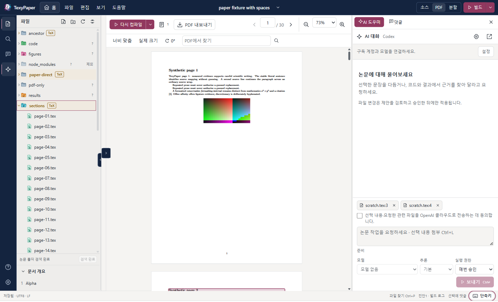

<div align="center">


# TexyPaper

**セクシーな LaTeX エディター。ローカルや SSH 上の論文を元の場所で編集し、そのホストでコンパイル。AI による変更は、ソースに反映する前に一つずつ確認できます。**

<p>
  <a href="https://github.com/HSoo-Kim/texypaper/releases/latest"></a>
  <a href="https://github.com/HSoo-Kim/texypaper/releases/latest"></a>
  <a href="https://github.com/HSoo-Kim/texypaper/releases"></a>
  <a href="https://github.com/HSoo-Kim/texypaper/stargazers"></a>
  <a href="LICENSE"></a>
</p>

<p>
  <a href="README.md">English</a> ·
  <a href="README.ko.md">한국어</a> ·
  <a href="README.zh-CN.md">简体中文</a> ·
  <b>日本語</b>
</p>



</div>

Tauri 2、Rust、React、CodeMirror で構築した Windows 向けデスクトップ LaTeX エディターです。この PC または SSH サーバー上の論文フォルダーを開き、元の場所で編集・コンパイルし、ソースの横に PDF を表示します。

アプリの UI は韓国語と英語に対応しており、この文書では英語の UI 表記を使用します。

## 主な機能 (Key Capabilities)

| 機能 | 内容 |
|---|---|
| **ローカルと SSH のプロジェクト** | この PC のフォルダー、または既存の OpenSSH 設定を使ってサーバー上の実際の POSIX パスを開けます。ファイルは元の場所で読み書きし、Windows にはミラーリングしません。[詳細](#プロジェクトを開く) |
| **`Ctrl+S` で PDF を表示** | 保存すると、論文が置かれているマシンで latexmk によるコンパイルが実行されます。メイン文書は `% !TeX root`、ユーザーの選択、または `\documentclass` から判定するため、通常は設定不要です。[詳細](#コンパイルと-pdf) |
| **ソースと PDF を並べて表示** | PDF を `Ctrl+click` するとソースの該当行に移動し、`Ctrl+Alt+J` で PDF の対応箇所を強調表示します（SyncTeX）。区切り線をドラッグでき、ソース・PDF・チャットの表示倍率は個別に変更できます。 |
| **Overleaf スタイルの編集** | Overleaf の既定のショートカットキー（`Ctrl+D` で行削除、`Ctrl+/` でコメント、複数カーソル、折りたたみ）、番号付きのセクション構成、引用とラベルの補完に対応します。 |
| **スペルチェックと単語数** | 英語の文章だけをスペルチェックし、TeX コマンド・数式・コメント・引用キーは指摘しません。クリックまたは `Alt+F8` で修正候補を表示します。ステータスバーには文書全体または選択範囲の単語数を表示します。[詳細](#スペルチェックと単語数) |
| **プロジェクト全体の置換** | ファイルごとにすべての変更行をプレビューし、最大 16 ファイルを、取り消し可能な 1 回の保存としてまとめて置換します。[詳細](#プロジェクト全体の置換) |
| **ドロップ・貼り付けで図を追加** | 画像や PDF をエクスプローラーにドロップするか、スクリーンショットをソースに貼り付けると、ファイルをプロジェクトにコピーし、内容を埋められる図のひな形を挿入します。[詳細](#ドロップや貼り付けで図を追加) |
| **チェックポイント** | プロジェクトのテキストファイルのスナップショットに名前を付けて保存し、現在の状態とのファイル別の差分を確認できます。復元も取り消せます。[詳細](#チェックポイント) |
| **テンプレートから論文を作成** | ローカルまたは SSH 上の既存フォルダーで、英語論文・韓国語論文・スライド・章構成のレポートを作成できます。[詳細](#テンプレートから始める) |
| **PDF から文章を編集** | 表示された文章を選択すると、ソース内の文章と文字どおり一致することを確認した範囲を、変更前後の差分で確認できます。適用は取り消し可能な 1 回の保存として行われ、その後に再ビルドします。[詳細](#pdf-から文章を直す) |
| **コメント** | ソースまたは PDF の選択範囲にコメントできます。スレッドは `.texypaper/comments.json` に保存され、編集後は引用文と前後の文脈を使って再接続します。 |
| **AI が提案し、ユーザーが適用** | Codex と Claude は、ユーザー自身のサブスクリプションで公式 CLI を通じて動作します。プロジェクトを読み、変更を提案できますが、**Apply changes** を押すまで書き込みません。[詳細](#ai-codex-と-claude) |
| **安全な保存と復旧** | 書き込み前の SHA-256 確認、外部での編集に対する競合ダイアログ、未保存テキストの復旧ジャーナル、直前の保存の取り消しを備えています。 |
| **論文を識別するエクスプローラー** | TeX ファイルを含むフォルダーには、展開する前から **TeX** バッジを表示します。ファイル形式別のアイコンと、役割に応じて色分けしたフォルダーアイコンも表示します。 |
| **テーマと言語** | 韓国語・英語の UI、ライト・ダーク・システムテーマに対応し、アクセント・背景・エディター・サイドバーの色を指定できます。 |
| **更新通知** | 新しいリリースがある場合は、画面下部に通知を表示し続けます。自動でインストールすることはありません。 |

[すべての機能](#機能)

## クイックスタート

1. [最新リリース](https://github.com/HSoo-Kim/texypaper/releases/latest)から `TexyPaper_<version>_x64-setup.exe` をダウンロードします（Windows x64 向け。Windows 11 で開発・テストしており、Microsoft Edge WebView2 ランタイムが必要です）。ポータブル ZIP もあります。
2. インストーラーを実行します。現在のユーザー向けにインストールするため、管理者権限は不要です。ZIP 版ではすべてのファイルを展開し、`texypaper.exe` を実行します。
3. `Ctrl+O` で **Home** を開き、**Open project** を選択して論文フォルダーを指定します。`.tex` ファイルを開き、`Ctrl+S` を押します。

`latexmk` が `PATH` にある TeX ディストリビューションも必要です（SSH プロジェクトではサーバー側に必要です）。インストーラーと実行ファイルにはコード署名がないため、Windows が発行元を確認できないという警告を表示する場合があります。更新時は作業内容を保存し、TexyPaper を完全に終了してから（**File → Exit TexyPaper**、`Ctrl+Shift+Q`、またはトレイの **Exit TexyPaper**）、新しいインストーラーを実行してください。

### 動作要件

| 用途 | 必要なもの |
|---|---|
| デスクトップアプリ | Windows x64 と Microsoft Edge WebView2 ランタイム |
| ローカルでの TeX ビルド | `PATH` にある `latexmk`、選択するエンジン（`pdflatex`、`xelatex`、`lualatex`）、論文に必要な TeX パッケージ・フォント・BibTeX/Biber |
| ソース ⇄ PDF の移動 | ビルドで生成された SyncTeX データと、ホスト上の `synctex` |
| SSH 経由の編集 | Windows OpenSSH の `ssh.exe`、`python3` 3.9 以降を備えた Linux または macOS の POSIX サーバー、プロジェクトとユーザー用キャッシュフォルダーへの書き込み権限 |
| SSH 経由のビルド | 上記に加え、**サーバー上**にインストールされた latexmk、使用するエンジン、SyncTeX、論文の依存パッケージ |
| AI | Windows にインストールした公式 Codex または Claude Code CLI、そのプロバイダーが対応するサブスクリプションアカウントへのサインイン、インターネット接続 |

TeX、Python、SSH、AI の CLI は同梱していません。TexyPaper がグローバルパッケージやサーバー側のパッケージをインストールすることもありません。SSH サーバーに Codex、Claude、Node、常駐デーモンは不要です。TeX がないサーバーでもファイルは編集できますが、ビルドは `TEX_TOOL_MISSING` で失敗します。

## プロジェクトを開く

**Home**（**Home** ボタン、`Ctrl+O`）は、プロジェクトの選択・追加・切り替えを行う全画面の画面です。最近使ったプロジェクトを先に表示し、開いているプロジェクトには **Return to project** を表示します。Home を表示している間も、開いているプロジェクトの編集・ビルド・AI の処理は継続します。未保存ファイルや実行中の作業について確認するのは、別のプロジェクトに切り替えるときだけです。

**This computer:** **Open project → This computer → Browse folder** を選択します。プロジェクトはそのディレクトリ内で直接読み書きします。ファイルパネルから `.tex` ファイルを開くと、その下の **File outline** に `\section`、`\subsection`、`\subsubsection` を `1`、`1.1`、`1.1.1` の番号と階層別のインデントで表示します。項目をクリックすると該当行に移動します（番号はソース内の順序に従うため、コンパイル後の番号とは異なる場合があります）。

**SSH サーバー:**

1. **Add SSH environment** で OpenSSH のエイリアスまたはホスト名を入力し、必要に応じてユーザー・ポート・秘密鍵・別の SSH 設定ファイルを指定します。OpenSSH 設定の個別の `Host` エイリアスと `Include` 行を読み取りますが、ワイルドカードをサーバー一覧に展開することはありません。
2. `/home/user/paper` など、**サーバー上の実際の POSIX パス**を入力します。
3. ヘルパーに関する通知を確認し、同意します。接続用に、標準ライブラリだけを使う小さな Python ワーカーを起動します。SHA-256 で検証したバージョンを `~/.cache/texypaper/worker/<sha256>/` にキャッシュします。pip、npm、root 権限でのインストール、ポートの開放は不要です。
4. 初めて接続するサーバーでは、OpenSSH が提示するフィンガープリント全体を確認します。パスワード、鍵のパスフレーズ、keyboard-interactive 認証への応答は、アプリ内の認証ウィンドウに入力します。キャンセルすると接続を中止します。

既存の鍵、SSH エージェント、ProxyJump 設定を使用しますが、TexyPaper が ssh-agent サービスを起動したり、権限を昇格したりすることはありません。**ホスト鍵の変更はエラー**として扱い、回避のために `known_hosts` を消去することはありません。接続が切れた場合、保存やビルドが完了したと表示することはありません。最後の PDF と未保存の編集内容を保持し、**Reconnect** 後に元のリビジョンと状態が不確かなトランザクションを確認します。失敗した書き込みを自動で再送することはありません。

## コンパイルと PDF

ビルドは必ず、プロジェクトを保持しているホストで実行します。SSH 上の論文を Windows にコピーしてビルドすることはありません。**`Ctrl+S` で保存とコンパイル**を行います（設定で **Build automatically after save** をオフにすると保存のみ）。入力を一時停止すると自動保存し、その後コンパイルします。PDF ペインの **Recompile**、上部の **Build** ボタン、`Ctrl+Shift+B` も同じ動作です。

メイン文書は設定なしで、次の順序で判定します。開いているファイル内の `% !TeX root = ...` → ユーザーが選択したメイン文書 → `\documentclass` がある場合は開いているファイル → 開いているファイルのフォルダーから上へたどり、`\documentclass` を含むファイルがちょうど 1 つある最も近いフォルダー内の文書。同順位の候補が複数ある場合は推測せず確認を求めます。**Build options → Main document** または **Recompile** の横のメニューで指定してください。選択したメイン文書は `.texypaper/project.json` に保存します。

| プロファイル | 動作 |
|---|---|
| **Basic** | `latexmk -norc` に `-no-shell-escape`、SyncTeX、レコーダーを指定します。latexmk の rc ファイルは無視しますが、TeX 自体をサンドボックス化するものではありません。 |
| **Project** | 既存の latexmk 設定を使用します。コマンドを実行できるため、明示的な信頼確認が必要です。信頼設定はプロジェクトの JSON ではなく、クライアントのアプリデータに保存します。 |

ビルドは一度に 1 つだけ実行し、保存が重なった場合は最新の再ビルド要求にまとめます。既定の制限時間は 120 秒で、キャンセルするとアプリが起動したプロセスツリーを停止します。ビルドが失敗・キャンセル・タイムアウトした場合は、最後に正常に生成された PDF を、古い状態であることを示して表示し続けます。ログボタンの数字はエラーと警告の件数です。表示できる PDF がない場合に限り、ログを自動で開きます。

ビルドに失敗し、ログにソース位置付きのエラーが表示されている場合、**Ask AI about this error** で最初のエラーの前後各 20 行のソースを AI チャットに添付します。入力欄が空であれば質問文も入力します。送信を押すまでは何も送信しません。

PDF ペインでは、ページ移動、幅に合わせる表示、実際のサイズ、拡大・縮小、90° 回転、ページごとのテキスト検索、PDF のエクスポートができます。別途開いた参照用 PDF は、メイン文書を再ビルドしても置き換わりません。**Return to built PDF** でビルド結果の PDF に戻ります。PNG、JPEG、WebP、コードを実行しない SVG ファイルは、その場でプレビューできます。

### PDF から文章を直す

1. PDF に表示された文章を選択し、**View source / Edit text / Edit with AI / Comment** を選びます。
2. **Edit text** は現在の PDF、SyncTeX データ、コンパイル時のソースのスナップショット、現在のソースのハッシュを照合します。SyncTeX の位置情報だけから文字オフセットを推測することはありません。
3. ソースの 1 つの段落内で、文字どおり一致する箇所が一意であると確認できた文章範囲だけを、変更前後の確認画面に渡します。入力はプレーンテキストとして扱い、TeX の特殊文字はエスケープします。TeX コードそのものはソースエディターで編集してください。
4. 適用時にハッシュを再確認し、取り消し可能な 1 つのトランザクションとして保存して再ビルドします。ソースが変わった場合や選択範囲の有効性が失われた場合は、`PDF_STALE` で適用を拒否します。再ビルドしてから選択し直してください。

繰り返される文、マクロ、数式、引用、表、ファイルや段落の境界をまたぐ選択、複数段組みで連続しない選択、判別が曖昧な合字やハイフン、検証できない座標は、自動で置き換えません。候補のソースに移動して明示的に修正するか、内容を確認できる AI の提案を使ってください。

### コメント

ソースまたは PDF の選択範囲からコメントを作成し、返信・編集・削除・解決・再開できます。コメントはプロジェクトの実際のホスト上の `.texypaper/comments.json` に保存し、TeX の `%` コメントとして挿入することはありません。アプリ内の編集ではバイト位置のアンカーを移動します。外部で編集した後は、同じファイル内で引用文と前後の文脈が一意に一致する場合に限り再接続し、それ以外は **Orphaned** と表示して再選択できるようにします。PDF だけに付けたコメントはその PDF のハッシュに結び付き、新しい PDF の同じページ番号へ移動することはありません。

## 執筆と推敲

### スペルチェックと単語数

**Settings → Source editing** の **Spell check (English)** でオン・オフを切り替えます（既定ではオン）。ソースの表示範囲にあるスペルミスに波線を表示します。単語にポインターを合わせるかクリックする、またはカーソルを置いて `Alt+F8` を押すと、最大 5 件の修正候補と **Ignore word** を表示します。

- **チェック対象:** 組版される文章だけを確認します。TeX コマンドとそのオプション引数、数式、コメント、verbatim テキスト、ラベル、引用キーは除外します。数字を含む単語、すべて大文字の略語、camelCase、ハイフンやアンダースコアを含む識別子も除外します。韓国語など、他の文字体系のテキストはチェックしません。入力が一時停止してから該当箇所に印を付けます。
- **辞書:** PC に Windows の英語辞書（米国または英国）があれば、それを使用します。韓国語だけの環境でよくあるように、他の言語しかインストールしていない Windows PC には英語辞書がないため、TexyPaper は内蔵の英語辞書を代わりに使用します（SCOWL、約 0.5 MB、初回チェック時にのみ読み込みます。読み込みに伴うワーキングセットの増加は約 3 MB と測定されています）。使用中の辞書は **Settings** に表示します。
- **無視する単語:** **Ignore word** で単語を TexyPaper 自身の設定に保存します（最大 500 語。**Clear ignored words** で一覧を空にします）。Windows のユーザー辞書は変更しません。
- **単語数:** ステータスバーには、TeX コマンド・数式・コメントを除いた文章の単語数と文字数を表示し、テキスト選択中は選択範囲の数を表示します。分かち書き処理は行わないため、連続するハングルやその他の CJK 文字は 1 語と数えます。短縮形やハイフンでつながった単語も 1 語と数え、単独の数字は数えません。文字数には文章の空白と句読点を含めます。ソースに基づく概算であり、マクロは展開しません。

### プロジェクト全体の置換

左のレールで **Project search** パネルを開き、検索するテキストを入力して **Replace** を開きます。**Preview** で各ファイルの変更行を変更前後で一覧表示し、**Replace all** で適用します。

- **対象範囲:** UTF-8 のテキストファイルだけを対象にします。4 MiB を超えるファイル、バイナリファイル、UTF-8 以外のファイル、アプリ専用のメタデータは、スキップした項目として表示し、変更しません。**Match case** と **Whole word** を使用できます。
- **上限:** 一度に最大 16 ファイル、2,000 件の一致までです。超える場合はメッセージを表示して拒否し、何も書き込みません。先に検索を絞り込んでください。
- **取り消し可能な 1 回の保存:** アプリは各ファイルを読み直し、プレビュー時の SHA-256 と照合します。開いているエディターを先に保存し、BOM と改行形式を保持したまま、すべてのファイルを 1 つのトランザクションで書き込みます。プレビュー後にいずれかのファイルが変わっていれば、何も書き込みません。結果の横にある **Undo** で、各ファイルを変更前の内容に戻せます。
- ローカル・SSH どちらのプロジェクトでも使えます。

### ドロップや貼り付けで図を追加

PNG、JPEG、GIF、WebP、SVG、PDF、EPS ファイルをファイルツリーにドロップできます（フォルダーの行ならそのフォルダーを、それ以外なら `figures` フォルダーがあればそこを、なければプロジェクトのルートを使用します）。ソースエディターへのドロップや、クリップボードの画像の貼り付けもできます。エクスプローラーへのドロップではファイルのコピーだけを行います。エディターへのドロップや貼り付けでは、さらに `\includegraphics`、空のキャプション、ラベルを含む `\begin{figure}` ブロックをカーソル位置に挿入し、開いているファイルからの相対パスを使います。

- **安全なコピー:** 1 ファイルあたり最大 20 MiB で、上記の拡張子だけに対応します。名前をファイルシステムで安全に使える形にし、既存ファイルは上書きせず番号を付加します。転送後に内容のハッシュを検証し、ファイルはアトミックに配置します。そのため、ハードリンク非対応のファイルシステム上のフォルダーでは、途中まで書き込まずエラーで失敗します。
- 貼り付けた画像は `pasted-image-<date>-<time>.png` として保存します（クリップボードの画像が PNG でない場合は、先に PNG に変換します）。LaTeX に取り込める形式はエンジンによって異なり、pdfLaTeX は PNG、JPEG、PDF に対応します。ローカル・SSH どちらのプロジェクトでも使え、SSH では既存の接続を通じてデータを転送します。

### チェックポイント

左のレールの **Checkpoints** では、プロジェクトのテキストファイルのスナップショットに名前を付けて保持します。バージョン管理リポジトリより手軽な安全策で、リポジトリとは独立しています。

- **Create checkpoint** は開いているファイルを先に保存し、プロジェクトのソース系テキストファイルを、プロジェクト内ではなく TexyPaper のアプリデータに保存します。対象は UTF-8 で書き込み可能な `.tex`、`.ltx`、`.bib`、`.bst`、`.cls`、`.sty`、`.bbx`、`.cbx`、`.dtx`、`.ins`、`.md`、`.txt`、`.csv`、`.tsv`、`.json`、`.yaml`、`.yml`、`.toml`、`.py`、`.r`、`.m`、`.jl`、`.sh` ファイルです。隠しファイルと隠しフォルダー（`.git`、`.texypaper` など）、`node_modules`、`venv`、`__pycache__`、`build`、`dist`、`target`、UTF-8 テキストとして読み取れないファイルは除外します。
- **上限:** 1 MiB を超えるファイル、読み取り専用、UTF-8 以外のファイルはスキップし、一覧に表示します。チェックポイントは最大 400 ファイル、合計 8 MiB までです。上限を超えるプロジェクトは一部だけを保存せず、説明を表示して拒否します。チェックポイントは最大 50 件を保持し、古いものから削除します。
- **Compare** は現在のプロジェクトとの比較で変更・追加・削除されたファイルを一覧表示し、ファイルごとに行単位の差分を表示します。
- **Restore** では、変更された全ファイル、選択したファイル、または 1 ファイルを、一度に最大 16 ファイルまで復元できます。事前に確認し、**Before restore** チェックポイントを作成してから、ファイルを 1 つのトランザクションで書き込み、**Undo** を表示します。チェックポイント作成後に追加されたファイルは削除しません。

### テンプレートから始める

Home の **New paper from template** で、既存のフォルダーに論文のひな形を作成します。フォルダーは空が望ましいです。PC または SSH 環境、フォルダーを指定し、**English article**、**Korean article**（ko.TeX を使用する XeLaTeX）、**Presentation slides**（Beamer）、**Chapter-based report** のいずれかを選び、**Create and open** を押します。

TexyPaper は新しいファイルの作成だけを行います。テンプレートのファイルまたはフォルダーが 1 つでも存在する場合は、何も作成せず、そのパスを一覧表示します。メイン文書とエンジンを `.texypaper/project.json` に保存し、コンパイルできる状態で論文を開きます。

## AI: Codex と Claude

AI チャット上部の **Settings** を開き、プロバイダーを選んで **Refresh connection** を押すと、公式 CLI とアカウントを確認できます。対応プロトコルの基準バージョンは **Codex 0.153.2 / Claude Code 2.1.300** です。モデル、推論レベル、実行権限は送信ボタンの横にあります。バージョンの不一致、利用できないモデル、制限、認証やネットワークの失敗は、そのまま表示します。TexyPaper が別の有料 API に切り替えることはありません。

- **Codex:** **Official sign-in → Open authorization page** から ChatGPT へのサインインを完了します。TexyPaper は専用の公式ストア（`CODEX_HOME=<app-data>/providers/codex`）を使用するため、別の場所で Codex にサインイン済みでも、再度のサインインが必要な場合があります。既存のトークンやグローバル設定をコピーすることはありません。
- **Claude:** 公式 CLI の `claude.ai` サブスクリプションアカウントを使用します。必要に応じてターミナルで `claude auth login` を実行し、接続を更新してください。Console/API キーや第三者経由のログインは、サブスクリプションとして扱いません。

モデル選択欄には、GPT-6 以降の各ファミリーの最新バージョンと、Claude Opus・Sonnet・Haiku の 5.5 のみを表示します。現在の既定モデルは **GPT-6 Astra と Luna、GPT-6.1 Sol と Terra**、および **Claude Opus 5.5、Sonnet 5.5、Haiku 5.5** です（[OpenAI のモデル](https://developers.openai.com/api/docs/guides/latest-model)、[Claude のモデル](https://platform.claude.com/docs/en/models/overview)）。CLI の候補一覧にない公式モデルも選択できます。その場合、モデルに関する案内では「現在の CLI が報告していない公式カタログの選択肢」と説明し、入力した ID をそのまま送信します。サブスクリプションで利用を拒否された場合は、別のモデルに切り替えず、プロバイダーのエラーを表示します。推論レベルは、選択したモデルの CLI メタデータだけから取得し、メタデータがなければプロバイダーの既定値を使用します。

両方の CLI は**Windows クライアント上でのみ**実行し、SSH URI を作業ディレクトリにすることはありません。選択したローカルまたは SSH プロジェクトには、非公開の制御用ディレクトリと 7 つの MCP ツール（`list_files`、`read_text`、`search_text`、`get_build_status`、`propose_changes`、`propose_command`、`get_command_status`）を通じてアクセスします。プロバイダー独自のシェルと直接ファイルを書き込むツールは無効にしています。

**添付と同意。** ソースまたは PDF から `Ctrl+L`、または右クリック → **Attach to AI chat** で明示的に添付したテキストだけが、入力欄のチップになります。選択しただけでは何も共有しません。クラウド転送への同意は、**プロバイダーごとに一度**（OpenAI、Anthropic）チェックボックスで取得して記憶し、入力欄に説明と **Revoke consent** を残します。同意後は、関連するソース・コード・結果の抜粋を、選択したプロバイダーに送信します。既定の読み取りツールは秘密情報、`.env*`、認証情報、アプリ自身の認証・復旧ストアを除外し、`propose_changes` が書き込めるのは TeX・Bib・スタイルファイルだけです。

**モデルの応答や提案は、保存ではありません。** `propose_changes` は提案を作成するだけで、**Awaiting approval** の状態にします。差分と、その根拠となるファイル・行を確認してから **Apply changes** を押すと書き込みます。拒否やキャンセルではソースを変更せず、適用時にはすべての基準ハッシュを再確認します。競合した場合も提案を保持し、新しいソースに合わせて書き直せるようにします。適用した提案は取り消せます。AI タスクは一度に 1 つだけ実行し、必要なときだけプロセスを起動します。会話を再開するためにセッション ID を保持しますが、モデルサーバーが常駐することはありません。

### プロジェクトのコード実行

AI は `propose_command` を通じてコマンドを提案し、コマンドはプロジェクトの実際のホスト（ローカルプロジェクトではこの PC、SSH プロジェクトではサーバー）で実行します。モデルが権限を変更したり、自分のコマンドを承認したりすることはできません。

| 実行権限 | 動作 |
|---|---|
| **Deny** | 新しい提案をブロックし、保留中の提案を拒否して、実行中のコマンドを停止します |
| **Ask each time**（既定） | コマンドごとに環境・作業フォルダー・正確な argv・制限時間を表示し、承認または拒否を求めます |
| **Allow session** | リスクに関する通知とチェックボックスでの確認後、現在のプロジェクト接続で以降のコマンドを個別の承認なしで実行します |

セッションの権限は、プロジェクトの切り替え、再接続、完全な終了でリセットします（トレイに隠すだけでは終了になりません）。いつでも **Ask each time** または **Deny** に戻せます。コマンドカードには stdout/stderr、終了コード、出力が省略されたかどうかを表示し、各コマンドを停止できます。コマンドは一度に 1 つ、既定の制限時間は 120 秒です。暗黙にシェル文字列を実行することはなく、インタープリターも含め、承認した argv をそのまま実行します。

**作業フォルダーの制限は、OS のサンドボックスではありません。** 承認したコマンドは、ローカルまたは SSH のアカウント権限で実行され、プロジェクト外のファイル・ネットワーク・システムにも影響を与えられます。副作用は自動では取り消せず、承認したコマンドには、前述のファイル読み取り・書き込み制限は適用されません。

### チャットウィンドウとトレイ

- **Detach chat window** でチャットを別ウィンドウにし、**Dock in main window** で戻せます。会話、下書き、閲覧位置、実行中の作業、承認待ちの項目はメインコントローラーで保持します。別ウィンドウを閉じると、チャットはメインウィンドウに戻ります。過去のメッセージを読んだり選択したりしている間は、新しい応答が届いても末尾へスクロールしません。
- メインウィンドウで**初めて X を押すと**、**Keep running in tray / Exit completely / Cancel** を確認します。トレイでの継続を選択した後は、X でメインウィンドウと別ウィンドウのチャットをまとめて隠し、AI・コマンド・ビルドは継続します。
- **File → Exit TexyPaper**、`Ctrl+Shift+Q`、トレイの **Exit TexyPaper** は、作業の停止と未保存内容について確認してから終了します。トレイの **Open TexyPaper**、アイコンのダブルクリック、または同じ Windows ユーザーとプロファイルでの TexyPaper の再起動で、既存のウィンドウを復元します。異なる `--data-dir` を指定すると別のインスタンスになります。Windows の自動起動は設定しません。

Claude サブスクリプションとの連携は、個人利用を想定しています。他者へ配布する前に、[公式のサブスクリプションガイダンス](https://support.claude.com/en/articles/15036540-use-the-claude-agent-sdk-with-your-claude-plan)と [Agent SDK ポリシー](https://code.claude.com/docs/en/agent-sdk/overview)を再確認してください。

## 機能

### エディターと保存
- **編集:** TeX の構文強調、括弧の対応表示、インデント、行番号、検索・置換、読み込んだ TeX/Bib ファイルに基づく引用とラベルの補完に対応します。`\section` や `\centering` などの LaTeX コマンドは、配色にかかわらず常に緑色で表示します。コードファイルは言語モードを遅延読み込みし、未知のテキストはプレーンテキストとして開きます。言語サーバーは起動しません。
- **Overleaf の既定操作:** `Ctrl+D` で行削除、`Ctrl+/` でコメント切り替え、`Ctrl+B` / `Ctrl+I`、大文字・小文字の変換、行の移動とコピー、折りたたみ、`Ctrl+click` で複数カーソル、`Alt`+ドラッグで矩形選択に対応します。`Ctrl+Enter` と `Ctrl+.` でコンパイルし、`Ctrl+J` でコメントパネルを切り替え、`Ctrl+Shift+C` で選択範囲にコメントします。
- **自動保存:** 入力が止まってから 700 ms 後に保存し、IME 変換中は延期します。`Ctrl+S` は未保存のソースを即座に保存してコンパイルします。自動保存後の自動ビルドには、別途 800 ms のデバウンスがあります。
- **安全な書き込み:** 書き込み直前に SHA-256 を比較し、同じファイルシステム上の一時ファイルをフラッシュしてから置き換えます。UTF-8 BOM と既存の改行形式は保持します。ファイルサイズや更新時刻だけで競合を判断することはありません。
- **競合:** 外部で変更されたファイルは、バッファに未保存の編集がなければ再読み込みします。未保存の編集がある場合は `FILE_CONFLICT` を表示し、**Compare / Reload / Save copy** から選びます（再読み込みでは編集内容を破棄するため、先に確認します）。これは楽観的な競合検出です。外部エディターは TexyPaper のロックには従いません。
- **復旧:** 未保存のテキストはアプリ専用の復旧レコードに保存し、再起動や再接続時に元のハッシュとトランザクションの状態を照合します。`TRANSACTION_PARTIAL` が出た場合は、同じ操作を繰り返さず、影響を受けたパスと保持されたジャーナルを確認してください。**Undo last save** はジャーナルに基づいて動作し、結果のファイルがその後に変更されている場合は上書きを拒否します。
- **保護:** プロジェクトの切り替えや終了時には、未保存内容の保存・破棄・キャンセルと、実行中の作業を停止するかどうかを確認します。保存に失敗したまま先へ進むことはできません。4 MiB を超えるファイルは読み取り専用で開き、メモリに関する警告後に明示的に許可すると編集できます。UTF-8 以外のファイルを黙って変換することはありません（**Save converted copy** では、読み取れないバイトを置き換える場合がありますが、元のファイルは保持します）。
- **セッション復元:** プロジェクトごとに、開いているタブ、アクティブなファイル、ソースのカーソル・選択・スクロール位置、ソースと PDF の分割比率とパネル幅、PDF のページ・倍率・回転、チャット履歴の閲覧位置を保持します。PDF の位置を再利用するのは、**同じビルドかつ同じファイルハッシュ**の場合だけです。ローカル・SSH どちらのプロジェクトも、この PC のアプリデータに保存し、他の PC には同期しません。実行権限とクラウド転送への同意は、ここから復元しません。

### エクスプローラー
- **ファイル形式とフォルダー:** ファイル形式別の色付きアイコン（TeX、bib、PDF、画像、コードなど）と、名前に応じて色と図柄が変わるフォルダーアイコンを表示します。`docs`、`src`、`tests`、`results`、`figures`、`sections`、`paper`、`references` などの一般的な名前には専用の色と図柄を使い、未知の名前は既定の青灰色、`node_modules` や `.git` などのツール用フォルダーは淡く表示します。フォルダーの色は見た目のためであり、論文が含まれる証拠ではありません。アイコンは独自に制作した SVG です。
- **TeX バッジ:** `.tex`、`.ltx`、`.bib`、`.cls`、`.sty`、`.bst`、`.bbx`、`.cbx` ファイルを直下に含むフォルダーは、太字の名前、琥珀色の帯、**TeX** バッジで表示します。さらに下の階層だけにこれらのファイルがあるフォルダーには、淡い **TeX** バッジを表示します。展開前から表示され、フォルダー名から判定することはありません。メインの TeX ファイルには `Main` バッジを付けます。PDF だけでは LaTeX プロジェクトとみなしません。
- **検索範囲:** 自動検出では `.git`、`.texypaper`、`node_modules`、`.venv`、`venv`、`__pycache__` を除外します。一覧は設定で確認でき、これらのフォルダーも明示的に開けます。一度に最大 20,000 項目を走査し、**Continue discovery** で続行します。
- **ファイル操作:** 作成・名前変更・移動・削除に対応します。削除は事前に確認し、ファイルをプロジェクトの `.texypaper/trash/` に移動します。プロジェクトのごみ箱から復元できます。

### ペイン・表示倍率・ナビゲーション
- **Home:** `Ctrl+O` で開きます。開いているプロジェクトは背後で動作し続けます。
- **ペイン:** ソースと PDF の区切り線は、ポインターでのドラッグや矢印キーで移動できます（ダブルクリックで 50/50 に分割）。中央の矢印で片側を折りたたみ、同じ端の矢印で元の比率に戻します。小さいウィンドウでは中央のペインを 1 つにし、サイドパネルを重ねて表示します。
- **表示倍率:** `Ctrl+wheel` または `Ctrl`+`+`/`-` で、ポインターの下または選択中のペインにあるソースの文字、PDF、AI チャットの文字を拡大・縮小します。それぞれ個別に保存します。アプリ全体の倍率は UI ズーム設定（100–200%）で変更します。PDF 自体を編集することはありません。
- **ソース ⇄ PDF:** PDF 内の `Ctrl+click` で対応するソース行を開きます（ソースより古い PDF では、おおよその位置であることを表示します）。`Ctrl+Alt+J` またはエディターのツールバーボタンで、PDF の該当箇所へスクロールして強調表示します。ソース内の `Ctrl+click` は Overleaf と同じ複数カーソルの操作です。
- **クイックオープンと検索:** `Ctrl+P` で名前からファイルを開きます。先頭に `>` を入力すると、プロジェクト内のテキストを検索します。
- **ショートカットキーヘルプ:** ステータスバー右下（Home では右上）の **Shortcuts** ボタンと **Help** メニューに、すべてのショートカットキーをカテゴリ別に表示し、検索できます。

### 外観
- **言語とテーマ:** UI は韓国語または英語、テーマはシステム・ライト・ダークから選べます。変わるのは UI 言語だけで、論文や AI の出力言語は翻訳しません。
- **配色:** ナビゲーションなどの UI はネイビーを基調に、控えめなバーガンディーとローズをアクセントにしています。ライトテーマは暖かみのあるオフホワイト、ダークテーマは低彩度のネイビーです。ライト・ダーク別に **accent, background, editor and sidebar** の色を HEX またはカラーピッカーで指定できます。プリセット、直近 8 件の配色、リセットを備えています。文字のコントラストやエラーと警告の識別チェックを満たさない配色は適用しません。PDF の紙面は白のままで、エラー・警告・論文フォルダーのマークも意味を保持します。
- **アクセシビリティ:** 動きを減らす設定、ハイコントラスト、省電力、透明効果の無効化に従います。

### 更新
- **通知のみ:** 設定の **Update notifications** は、新しいバージョンがあることだけを通知します。TexyPaper がインストーラーをダウンロード・実行したり、自分自身を置き換えたりすることはありません。**View release** をクリックすると HTTPS のページを開きます。
- **フィード:** リリースビルドには [HSoo-Kim/texypaper](https://github.com/HSoo-Kim/texypaper) のフィードを組み込んでいます。GitHub リポジトリの URL を指定すると、その `/releases/latest` メタデータを読み取ります。`{ "version": "1.2.3", "url": "https://example.org/releases/1.2.3", "notes": "optional" }` という形式の通常の HTTPS JSON フィードにも対応します（これは形式の例で、実際のアドレスではありません）。バージョンは SemVer で比較し、より新しい安定版だけを通知します。URL は認証情報・クエリ・フラグメントのない HTTPS である必要があり、リダイレクトには従いません。
- **確認間隔:** 自動確認の間隔は最低 **24 時間**です。**Check now** はこの間隔を無視しますが、通知自体がオフの場合は確認しません。失敗は状態として保持し、それ以前の新バージョン通知は消去しません。

## 使い方

1. `Ctrl+O` を押してプロジェクトを開き、`.tex` ファイルを開きます。
2. `Ctrl+S` で保存・コンパイルすると、ソースの横に PDF が表示されます。
3. PDF を `Ctrl+click` するとソースに移動します。PDF の文章を選択して、編集・コメント・AI への質問もできます。
4. 左のレールから AI パネルを開き、`Ctrl+L` で選択範囲を添付します。提案は必ず確認してから **Apply changes** を押してください。

### キーボードショートカット

| キー | 操作 |
|---|---|
| `Ctrl+O` | **Home** でプロジェクトを選択・追加・切り替えます |
| `Ctrl+P` | ファイルをクイックオープンします。先頭に `>` を入力するとプロジェクト内のテキストを検索します |
| `Ctrl+S` / `Ctrl+Enter` / `Ctrl+.` | 保存してコンパイルします（**Build automatically after save** がオフの場合は保存のみ）。AI 入力欄では `Ctrl+Enter` で送信します |
| `Ctrl+Shift+B` | 今すぐビルドします |
| `Ctrl+Alt+J` | ソースの位置から PDF に移動し、強調表示します（ソースのツールバーにもボタンがあります） |
| PDF 内の `Ctrl+click` | クリックした箇所のソースに移動します。ソース内の `Ctrl+click` は Overleaf と同様にカーソルを追加します |
| `Ctrl+L` | 選択範囲（または現在の行）を AI チャットに添付します |
| `Ctrl+J` | コメントパネルを開閉します |
| `Ctrl+Shift+C` | 選択範囲にコメントします（以前の `Ctrl+Shift+A` は Overleaf の変更履歴ショートカットキーと競合するため廃止しました） |
| `Ctrl+wheel` / `Ctrl`+`+` / `Ctrl`+`-` | ポインターの下または選択中のペインにあるソース・PDF・AI チャットを拡大・縮小します |
| `Ctrl+Shift+Q` | 作業と未保存の変更を確認し、完全に終了します |
| `Alt+F8` | カーソル位置の下線付き単語のスペル修正候補を開きます |
| `Escape` | ポップアップや選択を閉じます。開いている SSH プロンプトをキャンセルします |

ソース編集のショートカットキーは Overleaf の既定値に従います。アプリ内のヘルプにすべて掲載しています。

## データと互換性

- **アプリデータ:** ユーザーごとのディレクトリは `%APPDATA%\dev.texypaper.desktop` です（`--data-dir` で変更可能）。設定、最近使ったプロジェクト、復旧内容、チェックポイント、表示中の AI 会話、CLI が管理する Codex アカウントが含まれる場合があるため、丸ごと共有しないでください。他の PC への同期は行いません。
- **プロジェクトデータ:** `.texypaper/comments.json` と `project.json` はプロジェクトと一緒に持ち運びます。`build`、`transactions`、`trash` は生成物または復旧レコードです。削除前に未完了の作業がないか確認してください。
- **ポータブル版:** ポータブル ZIP も同じ `%APPDATA%` の場所に保存します。実行ファイルを移動しても、同じ Windows アカウントの設定を引き続き使います。
- **Paperdock からの移行:** 初回起動時に、古い `%APPDATA%\dev.paperdock.desktop` プロファイルとプロジェクトの `.paperdock` フォルダーを、新しい名前に変更します。認証情報の読み取りやコピーは行いません。競合時は明示的なエラーで停止し、統合も削除も行いません。[移行に関する説明](docs/DEVELOPMENT.md#one-time-migration-from-paperdock-data)を参照してください。
- **ネットワーク:** アプリ自身の HTTP クライアントを使うのは更新通知だけです。ユーザーの操作またはスケジュールに応じて最新リリースの情報を取得します。それ以外の通信は、SSH 接続とユーザーが実行する AI の CLI によるものです。
- **検証:** 実際に実行して確認した内容とその証拠は [docs/VERIFICATION.md](docs/VERIFICATION.md) に、内部の境界と保存構成は [docs/ARCHITECTURE.md](docs/ARCHITECTURE.md) に記録しています。

## ソースからビルド

必要なもの：Windows x64、`pnpm` を備えた Node.js、MSVC Rust ツールチェーン（edition 2024）、Visual Studio C++ Build Tools / Windows SDK、WebView2。

```powershell
pnpm install --frozen-lockfile
pnpm dev -- -- --data-dir "$env:TEMP\texypaper-dev-isolated"   # アプリのウィンドウを表示し、プロファイルを分離
pnpm test                                                      # フロントエンドのテスト
pnpm tauri build --ci --target x86_64-pc-windows-msvc --bundles nsis -- --locked
```

出力先は `src-tauri/target/x86_64-pc-windows-msvc/release/texypaper.exe` と `bundle/nsis/TexyPaper_<version>_x64-setup.exe` です。ビルドスクリプト全体、実アプリのスモークテスト群、メモリ測定、移行に関する説明は [docs/DEVELOPMENT.md](docs/DEVELOPMENT.md) にあります。

## 構成

```text
src/                         React front end
  ui/                        App shell, toolbar, Home, themes, shortcut help
  editor/                    CodeMirror editor, TeX shortcuts, folding, buffers, spelling, word count, image paste
  pdf/                       PDF.js viewer, text layer, range transport
  features/
    explorer/                File tree, paper index, outline, file icons
    ai/                      Chat, proposals, command review, chat history
    comments/                Comment threads and anchors
    search/                  Project-wide replace plan and review
    templates/               Paper templates and create-only project start
    assets/                  Figure import (drop and paste)
    history/                 Checkpoints, diff and restore
    pdf-edit/                Selection actions and the source-edit review
  state/                     Workspace and reading-position state
src-tauri/
  src/
    workspace/               Local and SSH workspaces, transactions, SSH config
    spell.rs                 English spell check (Windows dictionary, built-in fallback)
    checkpoints.rs           Checkpoint storage in app data
    latex/                   latexmk scheduler, diagnostics, SyncTeX, prose mapping
    ai/                      Codex/Claude adapters, MCP broker, proposals, model catalog
    execution.rs             Approved command execution
    comments.rs              Comment storage and anchors
    migration.rs             One-time Paperdock data migration
    updates.rs  tray.rs  chat_window.rs  process.rs  state.rs
  resources/remote_worker.py SSH worker (Python standard library only)
  tests/                     Native integration tests
scripts/                     Windows build, smoke suites, memory measurement
docs/                        ARCHITECTURE, VERIFICATION, DEVELOPMENT
```

## ライセンス

[MIT ライセンス](LICENSE)です。第三者のコンポーネントには、それぞれのライセンスと著作権表示が適用されます（[`THIRD_PARTY_NOTICES.md`](THIRD_PARTY_NOTICES.md)、[`licenses/`](licenses/)）。コードのライセンスと第三者に関する通知は、製品名やロゴの商標権を許諾するものではありません。公式 CLI、TeX ディストリビューション、WebView2、クラウドサービスには、それぞれの提供元のライセンス、利用規約、アカウント制限が適用されます。
