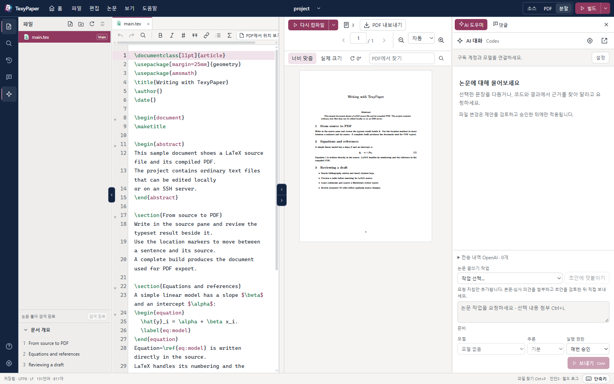

<div align="center">


# TexyPaper

**この PC や SSH サーバーにある LaTeX 論文を元の場所で編集し、ソースの横に PDF を表示する Windows 用デスクトップエディター**

<p>
  <a href="https://github.com/HSoo-Kim/texypaper/releases/latest"></a>
  <a href="https://github.com/HSoo-Kim/texypaper/releases/latest"></a>
  <a href="LICENSE"></a>
</p>

<p>
  <a href="README.md">English</a> ·
  <a href="README.ko.md">한국어</a> ·
  <a href="README.zh-CN.md">简体中文</a> ·
  <b>日本語</b>
</p>



</div>

TexyPaper は、ローカルのフォルダーや SSH サーバー上の実際のパスを、同期用の作業フォルダーを作らずにそのまま開きます。編集やプレビューに必要な内容だけをクライアントのメモリに読み込み、ビルドは論文があるホストで実行します。

アプリの UI は韓国語と英語に対応しています。README は 4 言語で用意していますが、UI は日本語に対応していません。本文のメニュー名とボタン名は英語 UI の表記です。

## 主な機能

| 機能 | 内容 |
|---|---|
| ローカルと SSH | この PC のフォルダーや、OpenSSH で接続したサーバー上のフォルダーを元の場所で読み書きします。 |
| ソース編集 | 構文の色分け、引用とラベルの補完、セクションのアウトライン、複数カーソル、折りたたみに対応します。英語の文章のスペルチェックと、おおよその単語数も表示します。 |
| 高速プレビュー | 入力中は PC 上の TeX エンジンが実際の PDF を先に更新します。最終的な PDF は、ホストでのフルビルドで作ります。 |
| ソースと PDF の対応 | 片方のペインをクリックすると、もう片方の対応する位置に印が付きます。SyncTeX によるジャンプも使えます。 |
| 論文ツール | BibTeX の検索と引用の挿入、データからの表作成、提出前チェックを **Paper** メニューから使えます。 |
| コメントとレビュー | ソースや PDF にコメントを付け、スレッドを Markdown のレビューレポートとして書き出せます。 |
| AI（任意） | Codex と Claude を公式 CLI 経由で使います。ソースの変更案は差分で確認してから適用します。 |
| 保護と復旧 | チェックポイント、取り消し、ハッシュによる競合検出、未保存の編集の復旧を備えています。 |

## インストール

1. [最新リリース](https://github.com/HSoo-Kim/texypaper/releases/latest)から、インストーラー `TexyPaper_<version>_x64-setup.exe` かポータブル ZIP をダウンロードします。
2. インストーラーは現在のユーザーにインストールするので、管理者権限は要りません。ZIP 版は、すべてのファイルを展開してから `texypaper.exe` を実行します。
3. どちらもコード署名がないため、Windows が発行元の警告や SmartScreen の警告を出すことがあります。

更新するときは作業を保存し、**File → Exit TexyPaper**、`Ctrl+Shift+Q`、またはトレイの **Exit TexyPaper** でアプリを完全に終了してから、新しいインストーラーを実行します。ウィンドウの X で閉じただけでは、アプリがトレイに残っている場合があります。

### 動作要件

| 用途 | 必要なもの |
|---|---|
| アプリ本体 | Windows x64（Windows 11 で開発・テスト）と Microsoft Edge WebView2 ランタイム |
| ビルド | `latexmk`、選んだエンジン（`pdflatex`、`xelatex`、`lualatex`）、論文が使うパッケージ・フォント・BibTeX/Biber |
| ソースと PDF の移動 | SyncTeX を出力するビルドと、ホスト上の `synctex` |
| 高速プレビュー | この PC にある互換性のある TeX Live 2026 と、`PATH` 上の `kpsewhich`。SSH プロジェクトでもローカルに必要です |
| SSH | Windows OpenSSH の `ssh.exe`、Python 3.9 以降がある Linux または macOS の POSIX ホスト、プロジェクトとキャッシュへの書き込み権限 |
| AI（任意） | Windows にインストールした公式 Codex CLI または Claude Code CLI と、対応するサブスクリプションでのサインイン |

SSH プロジェクトでは、ビルドと SyncTeX に必要なものをサーバー側に用意します。ホスト用の TeX、Python、SSH、AI の CLI は同梱しておらず、自動でインストールすることもありません。同梱の WasmTex エンジンは高速プレビュー用で、完全な TeX ディストリビューションの代わりにはなりません。

## 最初のプロジェクトを開く

1. `Ctrl+O` で **Home** を開き、**Open project** を選びます。
2. ローカルなら **This computer** でフォルダーを選びます。SSH なら **Add SSH environment** で OpenSSH のエイリアスかホスト名を入力し、`/home/user/paper` のようなサーバー上の実際のパスを指定します。
3. `.tex` ファイルを開いて `Ctrl+S` を押すと、保存して最初のビルドを始めます。

メイン文書は、`% !TeX root` の指定、ユーザーの選択、`\documentclass` を含むファイルの探索から決まります。候補が並んで決められない場合は推測せずに尋ねるので、メイン文書とエンジンを選んでください。

SSH では、既存の鍵、SSH エージェント、SSH 設定のエイリアスや ProxyJump をそのまま使います。接続すると、標準ライブラリだけで動く検証済みの Python ヘルパーを `~/.cache/texypaper/worker/<sha256>/` にキャッシュします。root 権限、pip や npm、ポートの開放、サーバー上の AI CLI、常駐サービスは要りません。初めて接続するサーバーでは、OpenSSH が示すフィンガープリントを確認してください。ホスト鍵が変わった場合はエラーで止まり、確認を省いて接続することはありません。

## 高速プレビューとフルビルド

`Ctrl+S` は保存してビルドします（**Build automatically after save** をオフにすると保存だけ）。`Ctrl+Shift+B` でいつでもビルドできます。正式なフルビルドは `latexmk` を使い、ローカルのプロジェクトならこの PC、SSH のプロジェクトならサーバーで実行します。

| プロファイル | 動作 |
|---|---|
| **Basic** | `latexmk -norc` を shell escape なしで実行します。latexmk の設定ファイルは読みませんが、OS のサンドボックスではありません。 |
| **Project** | ユーザー自身の latexmk 設定を使います。設定からコマンドを実行できるため、使う前にそのプロジェクトを信頼するかどうかの確認が必要です。 |

Basic プロファイルで自動ビルドを有効にすると、PC 上に常駐する TeX エンジンが、最後に検証したビルドの入力と現在の編集内容から実際の PDF を作り、PDF ペインを先に更新できます。UI では **Live preview** と表示します。クラウドには送らず、この PC でコンパイルします。初回の初期化と最初のフルビルドには時間がかかります。

互換性のある Basic/pdfLaTeX の文書では、表示中のページと次のページを優先して更新します。ほかのページには前回のフルビルドの結果が残り、そのことを画面に表示します。プリアンブルを変えたり部分コンパイルが使えなかったりすると、プレビューで文書全体をコンパイルします。互換性のないフォントやパッケージ、Project プロファイル、メイン文書のフォルダーの外にあるファイルは、ホストでのフルビルドで処理します。部分コンパイルは、すべてのエンジンで使えるわけではありません。

Basic/pdfLaTeX の自動フルビルドは、入力が止まるのを待ってから始まります。保存と明示的なビルドは待たずに始まります。ビルドが失敗した場合は、最後に成功した PDF を古い結果として示したまま表示し続けます。PDF のエクスポートと PDF コメントのアンカーには、検証済みのフルビルドが必要です。

### ソースと PDF の位置

ソースか PDF をクリックすると、もう一方のペインの対応する位置に印が付きます。キーボードのフォーカスは移りません。明示的に移動するには、PDF で `Ctrl+click`、ソースで `Ctrl+Alt+J` を使います。対応位置は、表示中の PDF と一致するソースと SyncTeX データから求めます。対応付けが準備中か古い場合はそのことを表示し、位置を推測しません。

### PDF から文章を直す

PDF で文章を選んで **Edit text** を選ぶと、ソースと文字どおり一致し、場所を一意に特定できた文章だけを編集できます。適用前に差分を確認し、ソースのハッシュも照合します。数式や表を含め、PDF の任意の箇所を直接書き換える機能ではありません。特定できない選択範囲は、ソースで直接編集してください。エクスポートする PDF は、常にフルビルドした完全な文書です。

## 論文ツール、レビュー、AI

### 論文ツール

**Paper** メニューのツールはローカルと SSH のどちらでも使え、ソースを AI に送りません。

- **Find references** は、プロジェクトの `.bib` ファイルをタイトル・著者・年・引用キーで検索し、引用を挿入します。オンラインで文献を探したり、内容を検証したりはしません。
- **Create table from data** は、CSV・TSV・セミコロン区切りのデータを、エスケープ済みの LaTeX の表に変換します。挿入前にプレビューでき、追加のパッケージは要りません。上限は 200 行・30 列です。
- **Pre-submission check** は、引用やラベルの未定義と重複、見つからない静的な入力ファイル、TODO を一覧にします。確認できなかった範囲と、PDF が古いかどうかも表示します。TeX の実行、事実確認、投稿先の規定への適合を保証するものではありません。

画像はドロップや貼り付けで追加できます。ソースエディターに入れると、ファイルをプロジェクトにコピーして figure ブロックを挿入します。エクスプローラーへのドロップはコピーだけです。Home の **New paper from template** には、英語論文、韓国語論文、Beamer スライド、章構成のレポートの 4 種類のテンプレートがあります。

### コメントとレビューレポート

ソースや PDF の選択範囲にコメントを付け、返信したり解決済みにしたりできます。コメントはプロジェクトのホスト上の `.texypaper/comments.json` に保存します。**Export review report** はスレッドを Markdown のレポートとして書き出します。書き出し先は新しいパスに限られ、既存のファイルは上書きしません。

### AI（任意）

AI を使わなくても、編集とビルドはすべて使えます。AI を使う場合は、Windows 上の公式 CLI を通じて、自分のサブスクリプションで Codex または Claude を使います。使えるアカウントやモデルは、プロバイダー側で決まります。

- Codex はアプリ専用の `CODEX_HOME` を使います。ほかの場所で済ませたサインインを黙ってコピーすることはないため、アプリでもう一度サインインが必要になる場合があります。
- Claude は、公式 CLI で claude.ai のサブスクリプションにサインインして使います。

送信すると、プロンプト、明示的に添付した内容、AI が読み取った関連する文脈が、選んだプロバイダー（OpenAI または Anthropic）のクラウドに送られます。テキストを選択しただけでは送られません。通常の PDF のコンパイルは、AI のクラウド呼び出しではありません。PC から送った内容は、チャットの **Sent to OpenAI** / **Sent to Anthropic** で確認できます。

執筆用のプリセットは、主張を変えずに短くする **Shorten without changing claims**、学術英語に整える **Polish academic English**、論証と根拠を批評する **Critique argument and evidence**、査読者への回答案を作る **Draft reviewer responses** の 4 つです。プリセットは編集できる下書きに指示を足すだけで、送信は自分で **Send** を押して行います。結果の事実の正確さは保証されません。

AI がソースの変更を提案すると差分を表示し、**Apply changes** を押したときに書き込みます。適用時に競合を確認し、適用した変更は取り消せます。プロジェクトでのコマンド実行は別の権限で管理し、既定は **Ask each time** です。承認したコマンドはローカルまたは SSH のユーザー権限で動き、プロジェクト外のファイルやネットワークにも影響することがあります。

Claude のサブスクリプション連携は、個人での利用を想定しています。他の人に配布する前に、[公式のサブスクリプションガイダンス](https://support.claude.com/en/articles/15036540-use-the-claude-agent-sdk-with-your-claude-plan)と [Agent SDK のポリシー](https://code.claude.com/docs/en/agent-sdk/overview)を確認してください。

## データと安全

- 入力が少し止まると自動保存します。IME の変換中は保存を待ちます。
- 変更はチェックポイントと取り消しで戻せます。プロジェクト全体の置換は、差分を確認してから適用します。保存の前にはハッシュで外部の変更を検出し、未保存の編集は復旧用に記録します。
- チェックポイントを作れなかった場合、AI の変更と置換は警告を出したうえで続けられますが、PDF からの文章編集は中止します。復旧データはバックアップの代わりにはなりません。
- SSH が切れても、編集内容と最後の PDF は残ります。書き込みとビルドには再接続が必要です。結果が不確かな書き込みを自動で再送することはありません。
- アプリデータは `%APPDATA%\dev.texypaper.desktop` にあります。ポータブル版も同じ場所を使い、EXE の横には保存しません。復旧データ、チェックポイント、AI の会話、プロバイダーの状態が入っているので、フォルダーを丸ごと共有しないでください。開発用にプロファイルを分けるときは `--data-dir` を使います。
- `.texypaper/project.json`、`comments.json`、生成される復旧・ビルドのメタデータはプロジェクト側にあり、アプリデータとは別です。
- 新しいリリースは通知するだけで、自動でインストールはしません。

## よく使うショートカット

| キー | 操作 |
|---|---|
| `Ctrl+O` | **Home** でプロジェクトを選択・追加・切り替え |
| `Ctrl+P` | ファイルを名前で開く。`>` で始めるとプロジェクト内のテキストを検索 |
| `Ctrl+S` | 保存してビルド（保存後の自動ビルドをオフにすると保存のみ） |
| `Ctrl+Shift+B` | 今すぐビルド |
| PDF で `Ctrl+click` | クリックした位置のソースへ移動 |
| `Ctrl+Alt+J` | ソースの位置から PDF へ移動 |
| `Ctrl+L` | 選択範囲、選択がなければ現在の行を AI チャットに添付 |
| `Ctrl+Shift+C` / `Ctrl+J` | 選択範囲にコメント / コメントパネルの開閉 |
| `Alt+F8` | カーソル位置の単語のスペル修正候補 |
| `Ctrl+Shift+Q` | 作業と未保存の変更を確認してから完全に終了 |

すべてのショートカットは、アプリ内の **Shortcuts** ボタンと **Help** メニューで確認できます。

## 開発とドキュメント

開発には Windows x64、Node.js 24、pnpm 12.16.1、Rust edition 2024 に対応した MSVC ツールチェーン、Visual Studio C++ Build Tools / Windows SDK、WebView2 が必要です。

```powershell
pnpm install --frozen-lockfile --ignore-scripts
pnpm dev -- -- --data-dir "$env:TEMP\texypaper-dev-isolated"
pnpm test
pnpm tauri build --ci --target x86_64-pc-windows-msvc --bundles nsis -- --locked
```

上の開発コマンドは、分離したプロファイルでアプリのウィンドウを開きます。初回のビルドと開発環境の準備では、バージョンを固定したエンジンと対応ソースをダウンロードして検証します。実行時のプレビューのパッケージ検索は、ローカルだけで行います。`pnpm dev:web` だけではネイティブ API を使えません。CI が通っても、実際のデスクトップや TeX 環境での動作を確認したことにはなりません。

- [docs/DEVELOPMENT.md](docs/DEVELOPMENT.md)：ビルド、CI、パッケージ化、実アプリでの確認手順
- [docs/ARCHITECTURE.md](docs/ARCHITECTURE.md)：内部構造と保存の仕組み
- [docs/VERIFICATION.md](docs/VERIFICATION.md)：実際に確認した内容とその記録

## ライセンス

アプリケーションは [MIT ライセンス](LICENSE)です。第三者のコンポーネントには、それぞれのライセンスと著作権表示が適用されます（[`THIRD_PARTY_NOTICES.md`](THIRD_PARTY_NOTICES.md)、[`licenses/`](licenses/)）。MIT ライセンスは、同梱の TeX エンジンのライセンスに優先しません。エンジンのライセンスと対応する正確なソースは、**Settings → Open source** から確認できます。

コードのライセンスと第三者に関する通知は、製品名やロゴの商標権を許諾するものではありません。公式 CLI、TeX ディストリビューション、WebView2、クラウドサービスには、それぞれの提供元のライセンス、利用規約、アカウント制限が適用されます。
