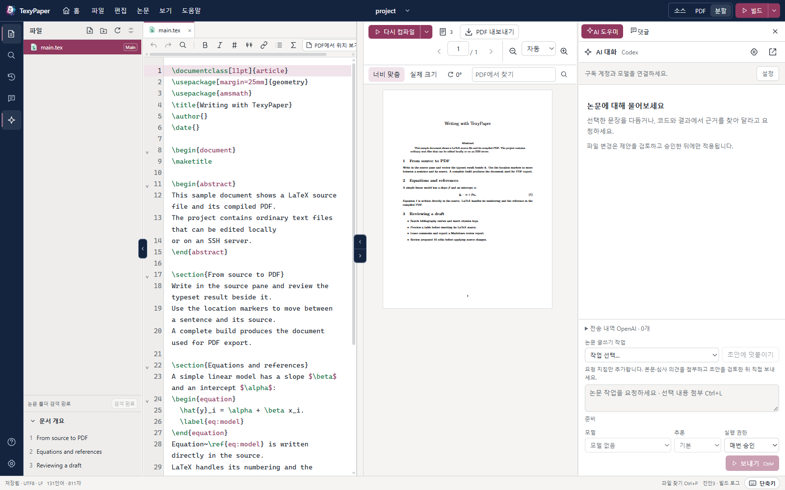

<div align="center">


# TexyPaper

**이 PC나 SSH 서버의 논문 폴더를 열어 소스 옆에 컴파일된 PDF를 띄워 주는 Windows용 LaTeX 편집기입니다.**

<p>
  <a href="https://github.com/HSoo-Kim/texypaper/releases/latest"></a>
  <a href="https://github.com/HSoo-Kim/texypaper/releases/latest"></a>
  <a href="LICENSE"></a>
</p>

<p>
  <a href="README.md">English</a> ·
  <b>한국어</b> ·
  <a href="README.zh-CN.md">简体中文</a> ·
  <a href="README.ja.md">日本語</a>
</p>



</div>

TexyPaper는 이 PC의 논문 폴더나 SSH 서버의 실제 경로를 열어 파일을 원래 자리에서 편집합니다. 따로 동기화할 작업 사본은 없고, 필요한 내용만 앱 메모리로 읽어 옵니다. 정식 빌드는 논문이 있는 컴퓨터에서 latexmk로 실행합니다. 호환되는 환경에서는 입력하는 동안 이 PC의 빠른 미리보기가 PDF를 갱신합니다. Codex나 Claude를 연결하면 글쓰기에 도움을 받을 수 있지만, 편집과 빌드에는 AI가 필요 없습니다.

## TexyPaper로 할 수 있는 일

| 영역 | 내용 |
|---|---|
| 프로젝트 | 로컬 폴더와 SSH 서버의 실제 경로를 원래 위치에서 열기 |
| 편집 | LaTeX 구문 강조, 인용·레이블 자동 완성, 절 개요, 다중 커서, 접기, 산문 대상 영어 맞춤법 검사, 대략적인 단어 수 |
| 빌드 | 프로젝트 호스트의 latexmk, 주 문서 자동 판별, 이 PC에서 조판하는 빠른 미리보기 |
| 소스와 PDF | 나란히 놓인 두 창, 양방향 SyncTeX 이동, PDF에서 바로 하는 짧은 문장 수정 |
| 논문 도구 | BibTeX 검색과 인용 삽입, CSV·TSV 데이터로 표 만들기, 제출 전 점검, 그림 가져오기, 템플릿 네 가지 |
| 검토 | 소스나 PDF에 다는 댓글, 답글과 해결 처리, Markdown 검토 보고서 |
| 안전 장치 | 변경 차이 검토, 실행 취소, 체크포인트, 충돌 감지, 저장하지 않은 편집 복구 |
| AI(선택) | 공식 CLI로 쓰는 Codex·Claude. 소스 수정은 차이를 보고 직접 적용하고, 프로젝트 명령은 따로 승인 |

앱 화면 언어는 한국어와 영어 두 가지뿐입니다.

## 설치

1. [최신 릴리스](https://github.com/HSoo-Kim/texypaper/releases/latest)에서 `TexyPaper_<버전>_x64-setup.exe`나 portable ZIP을 내려받습니다.
2. 설치 파일을 실행합니다. 현재 사용자 계정에 설치되므로 관리자 권한이 필요 없습니다. ZIP을 쓴다면 압축을 모두 푼 뒤 `texypaper.exe`를 실행하세요.
3. TeX 배포판이 없다면 설치합니다. 필요한 구성은 아래 요구 사항을 참고하세요.

TexyPaper는 Windows x64에서 동작하며 Windows 11에서 개발하고 테스트했습니다. Microsoft Edge WebView2 런타임이 필요합니다. 설치 파일과 실행 파일에 코드 서명이 없어서 Windows SmartScreen이 게시자를 확인할 수 없다고 경고할 수 있습니다.

업데이트하려면 작업을 저장하고 **파일 → TexyPaper 완전 종료**, `Ctrl+Shift+Q`, 트레이 메뉴의 **TexyPaper 종료** 중 하나로 앱을 완전히 끈 다음 새 설치 파일을 실행하세요. 창의 X 버튼으로 닫으면 트레이에서 계속 실행될 수 있습니다. 새 릴리스가 나오면 알림이 뜨지만, 앱이 업데이트를 스스로 내려받거나 설치하지는 않습니다.

### 요구 사항

| 용도 | 필요한 것 |
|---|---|
| 빌드 | `latexmk`, 사용할 엔진(`pdflatex`·`xelatex`·`lualatex`), 논문에 쓰는 패키지·글꼴·BibTeX 또는 Biber. SSH 프로젝트라면 서버에 설치합니다. |
| 소스·PDF 이동 | 빌드가 만든 SyncTeX 데이터와 빌드 호스트의 `synctex` |
| 빠른 미리보기 | 이 PC에 설치한 호환 TeX Live 2026과 `PATH`의 `kpsewhich`. 프로젝트가 SSH 서버에 있어도 마찬가지입니다. |
| SSH 프로젝트 | Windows OpenSSH(`ssh.exe`), Python 3.9 이상이 있는 Linux·macOS 서버, 프로젝트와 사용자 캐시 폴더 쓰기 권한 |
| AI(선택) | Windows에 설치한 공식 Codex 또는 Claude Code CLI, 해당 공급자가 지원하는 구독, 인터넷 연결 |

빠른 미리보기용 WebAssembly TeX 엔진은 앱에 들어 있지만 TeX 배포판을 대신하지는 못합니다. 호스트용 TeX, Python, SSH, AI CLI는 앱에 포함되지 않으며 TexyPaper가 설치해 주지도 않습니다. TeX가 없는 서버에서도 파일 편집은 되지만 빌드는 실패합니다.

## 프로젝트 열기

`Ctrl+O`로 **홈**을 열고 **프로젝트 열기**를 고릅니다. 이 컴퓨터의 폴더나 SSH 환경을 선택하고 `.tex` 파일을 연 뒤 `Ctrl+S`를 누르면 저장과 함께 첫 빌드가 시작됩니다.

주 문서는 `% !TeX root` 줄, 직접 고른 문서, 연 파일 근처에서 `\documentclass`가 있는 파일을 보고 찾습니다. 후보가 여럿이면 추측하지 않고 물어봅니다. 주 문서는 **빌드** 버튼 옆 **빌드 옵션**에서, 엔진과 빌드 프로필은 **설정**에서 정합니다. 고른 값은 `.texypaper/project.json`에 저장됩니다.

### SSH 프로젝트

1. **SSH 환경 추가**에 OpenSSH 별칭이나 호스트 이름을 넣습니다. 필요하면 사용자, 포트, 개인 키, 별도 SSH 설정 파일도 지정합니다. TexyPaper는 OpenSSH 설정의 `Host` 별칭과 `Include` 줄을 읽고, 이미 쓰고 있는 키와 SSH agent, ProxyJump 설정을 그대로 사용합니다.
2. 서버에 있는 프로젝트의 실제 POSIX 경로를 입력합니다(예: `/home/user/paper`).
3. 도우미 프로그램 안내에 동의합니다. TexyPaper는 표준 라이브러리만 쓰는 작은 Python 도우미를 실행하고, 검증한 사본을 `~/.cache/texypaper/worker/<sha256>/`에 저장합니다. root 권한, pip·npm 설치, 열린 포트, 서버 쪽 AI CLI, 상시 실행 서비스는 필요 없습니다.
4. 처음 연결하는 서버라면 OpenSSH가 보여 주는 호스트 키 지문 전체를 확인하세요. 암호나 키 암호 같은 입력 요청은 TexyPaper의 인증 창에 나타납니다.

호스트 키가 바뀌면 TexyPaper는 오류로 처리하며, 이를 넘기려고 `known_hosts`를 고치지 않습니다. 연결이 끊겨도 저장하지 않은 편집과 마지막 PDF는 화면에 남습니다. 다시 저장하거나 빌드하려면 먼저 **다시 연결**을 누르세요. 결과가 불확실한 쓰기는 자동으로 다시 시도하지 않습니다.

## 빌드와 빠른 미리보기

`Ctrl+S`를 누르면 저장한 뒤 빌드합니다. **저장 후 자동 빌드**를 끄면 저장만 합니다. `Ctrl+Shift+B`나 **빌드** 버튼으로는 언제든 빌드할 수 있습니다. 입력을 멈추면 곧 자동 저장하며, IME로 글자를 조합하는 동안에는 기다립니다.

정식 빌드는 프로젝트 호스트에서 latexmk로 실행합니다. 로컬 프로젝트는 이 PC가, SSH 프로젝트는 서버가 호스트입니다. PDF 내보내기와 PDF 댓글 위치 지정은 정식 빌드가 끝까지 완료되어야 쓸 수 있습니다.

| 빌드 프로필 | 동작 |
|---|---|
| 기본(Basic) | 처음 설정된 프로필입니다. `latexmk -norc`를 shell escape 없이 실행하므로 latexmk rc 파일을 읽지 않습니다. 운영체제 수준의 샌드박스는 아닙니다. |
| 프로젝트(Project) | 명령을 실행할 수 있는 사용자 latexmk 설정을 그대로 씁니다. 먼저 이 프로젝트를 신뢰할지 묻습니다. |

빌드가 실패하면 마지막으로 성공한 PDF를 '갱신 필요' 표시와 함께 계속 보여 줍니다. 로그 버튼의 숫자는 오류와 경고 수입니다.

### 빠른 미리보기

기본 프로필에서 자동 빌드를 켜 두면 정식 빌드가 끝나기 전에 PDF 창을 먼저 갱신할 수 있습니다. 이 PC에서 도는 WasmTex 엔진이 마지막 검증 빌드의 입력과 지금 편집 중인 버퍼를 함께 조판해 실제 PDF를 보여 줍니다. 문서를 클라우드 컴파일러로 보내지 않습니다. 엔진을 처음 띄울 때와 첫 정식 빌드에는 시간이 더 걸립니다.

호환되는 pdfLaTeX 입력이면 지금 보이는 쪽과 다음 쪽을 먼저 조판할 수 있습니다. 나머지 쪽은 이전 전체 결과라는 표시와 함께 그대로 둡니다. 프리앰블을 바꾸거나 지원하지 않는 경우에는 미리보기가 문서 전체를 다시 컴파일합니다. 주 문서가 든 폴더 바깥의 입력 파일이나 미리보기에서 쓸 수 없는 글꼴·패키지가 있으면 정식 호스트 빌드가 PDF를 갱신합니다.

첫 빌드 이후 기본 프로필의 pdfLaTeX 자동 정식 빌드는 입력을 잠시 멈춘 뒤 시작합니다. 저장과 명시적 빌드는 이 대기 시간을 거치지 않습니다.

### 소스와 PDF

한쪽 창을 클릭하면 다른 쪽 창에 대응 위치가 표시되고, 키보드 포커스는 그대로 남습니다. PDF에서 `Ctrl+클릭`하면 소스 줄로, 소스에서 `Ctrl+Alt+J`를 누르면 PDF 위치로 이동합니다. 위치 연결에는 화면에 떠 있는 PDF의 SyncTeX 데이터를 씁니다. 연결 정보가 아직 준비 중이거나 빌드 뒤에 소스가 바뀌었다면 위치를 추측하지 않고 그 사실을 알려 줍니다.

PDF에서 글을 선택하고 **텍스트 수정**을 고를 수도 있습니다. 선택한 부분이 소스 문단 하나 안에서 유일하게 확인되는 일반 문장 구간일 때만 동작합니다. 수정 전후 차이를 검토하면 TexyPaper가 소스 해시를 다시 확인한 뒤 저장하고 재빌드합니다. 매크로, 수식, 인용, 표, 모호한 선택은 소스에서 직접 고치세요.

## 논문 도구와 댓글

**논문** 메뉴는 로컬·SSH 프로젝트 모두에서 쓸 수 있고, 소스를 AI 공급자에게 보내지 않습니다.

- **참고문헌 찾기**는 프로젝트 `.bib` 파일의 제목·저자·연도·인용 키를 검색해 `\cite{key}`를 삽입합니다. 이미 가진 메타데이터를 검색할 뿐, 온라인에서 논문을 찾거나 검증하지는 않습니다.
- **데이터로 표 만들기**는 CSV, TSV, 세미콜론으로 구분한 텍스트를 특수 문자가 이스케이프된 LaTeX 표로 바꿉니다. 별도 패키지가 필요 없고, 삽입하기 전에 결과를 미리 봅니다.
- **제출 전 점검**은 정의되지 않았거나 중복된 인용·레이블, 찾을 수 없는 정적 입력 파일, TODO 표시를 알려 줍니다. PDF를 다시 빌드해야 하는지, 검사하지 못한 파일이 무엇인지도 보여 줍니다. 소스를 정적으로 읽기만 하므로 TeX 실행, 사실 확인, 학회·저널 규정 준수 판정은 하지 않습니다.

그림을 넣으려면 이미지나 PDF를 소스 편집기에 끌어다 놓거나 스크린샷을 붙여넣습니다. 파일이 프로젝트로 복사되고 figure 블록이 삽입됩니다. 탐색기에 끌어다 놓은 파일은 복사만 됩니다. 홈의 **템플릿으로 새 논문**은 이미 있는 폴더에 영문 논문, 한글 논문, Beamer 발표 자료, 장별 보고서 중 하나를 만들어 줍니다.

댓글은 소스나 PDF에서 선택한 부분에 달고, 답글과 해결 처리를 할 수 있습니다. 댓글은 프로젝트 호스트의 `.texypaper/comments.json`에 저장되며 TeX 소스에는 들어가지 않습니다. **검토 보고서 내보내기**는 스레드를 새 Markdown 파일로 저장하고, 기존 파일은 덮어쓰지 않습니다.

## AI 도움(선택)

TexyPaper는 Windows에 설치한 공식 CLI로 Codex나 Claude에 연결하며, 공급자가 지원하는 구독으로 로그인해야 합니다. 쓸 수 있는 계정과 모델은 공급자가 정합니다. 접근이 막혀도 TexyPaper가 유료 API로 전환하지는 않습니다.

- Codex는 TexyPaper 앱 데이터 안의 별도 `CODEX_HOME`에 로그인 정보를 둡니다. 기존 로그인을 복사하지 않으므로, 다른 곳에서 Codex에 로그인해 두었더라도 한 번 더 로그인해야 할 수 있습니다.
- Claude는 공식 CLI의 claude.ai 구독 로그인을 씁니다. 필요하면 터미널에서 `claude auth login`을 실행한 뒤 **연결 새로 고침**을 누르세요.

두 CLI는 Windows 클라이언트에서 실행되고, TexyPaper가 제공하는 도구로만 프로젝트에 접근합니다. 공급자 자체의 shell과 파일 쓰기 도구는 꺼져 있습니다. 읽기 도구는 `.env*` 파일, 인증 정보, TexyPaper의 로그인·복구 저장소를 건너뜁니다.

Claude 구독 연결은 개인 사용을 전제로 합니다. 다른 사람에게 TexyPaper를 배포하기 전에 [공식 구독 지원 안내](https://support.claude.com/en/articles/15036540-use-the-claude-agent-sdk-with-your-claude-plan)와 [Agent SDK 정책](https://code.claude.com/docs/en/agent-sdk/overview)을 읽어 보세요.

### 전송되는 내용

글을 선택하기만 해서는 아무것도 전송되지 않습니다. **보내기**를 누르면 프롬프트, `Ctrl+L`로 첨부한 글, AI가 읽은 프로젝트 내용이 선택한 공급자(OpenAI 또는 Anthropic)로 전송되고, 그 공급자의 클라우드 모델이 처리합니다. 무엇을 넘겼는지는 채팅의 **전송 내역 OpenAI** 또는 **전송 내역 Anthropic** 목록에 기록됩니다. 일반 PDF 빌드에는 AI 공급자가 관여하지 않습니다.

프리셋 네 가지가 초안에 지시를 덧붙입니다. **주장 유지하며 줄이기**, **학술 영어 다듬기**, **논증과 근거 점검**, **심사 의견 답변 초안**입니다. 초안을 고친 다음 직접 보내면 됩니다. 프리셋은 숫자·인용·TeX를 그대로 두라고 모델에 요청하지만, 결과의 정확성을 보장하지는 못합니다. 빌드가 실패하면 **이 오류를 AI에게 묻기**가 첫 오류 주변의 소스를 채팅에 첨부합니다. 이때도 자동으로 보내지는 않습니다.

### 수정과 명령

AI가 제안한 소스 수정은 **승인 대기** 상태의 차이(diff)로 나타납니다. 제안은 **변경 적용**을 눌러야 파일에 기록됩니다. 그 시점에 충돌을 검사하며, 적용한 변경은 되돌릴 수 있습니다.

프로젝트 명령 실행은 별도 권한입니다. 기본값인 **매번 승인**에서는 명령마다 실행할 호스트, 작업 폴더, 정확한 인자, 제한 시간을 보고 승인합니다. **실행 안 함**은 명령을 막습니다. **세션 허용**은 프로젝트를 바꾸거나 다시 연결하거나 앱을 종료할 때까지 이후 명령을 묻지 않고 실행합니다.

승인한 명령은 로컬 또는 SSH 계정의 권한으로 실행됩니다. 프로젝트 밖의 파일, 네트워크, 시스템에도 영향을 줄 수 있으며, TexyPaper는 그 부작용을 되돌리지 않습니다.

## 데이터와 안전

TexyPaper는 저장하기 전에 파일의 SHA-256을 확인해 다른 프로그램이 바꾼 내용을 잡아냅니다. 저장하지 않은 편집이 있는 동안 파일이 바뀌었다면 비교, 다시 불러오기, 복사본 저장 중에서 고를 수 있습니다. 저장하지 않은 글은 복구 기록에 남고, 앱을 다시 시작하거나 다시 연결할 때 확인합니다. 복구 기록이 백업을 대신하지는 않으니 백업은 따로 해 두세요.

프로젝트 전체 바꾸기는 파일에 쓰기 전에 바뀔 줄을 모두 보여 주고, 한 번의 실행 취소로 전체를 되돌립니다. **체크포인트**는 프로젝트 텍스트 파일의 스냅샷을 앱 데이터에 저장합니다. AI 제안 적용, 프로젝트 전체 바꾸기, PDF 텍스트 수정 직전에도 TexyPaper가 체크포인트를 자동으로 만들려고 시도합니다. 이 체크포인트를 만들지 못하면 AI 변경과 바꾸기는 경고를 띄운 뒤 진행하고, PDF 텍스트 수정은 멈춥니다.

앱 데이터는 `%APPDATA%\dev.texypaper.desktop`에 있습니다. portable ZIP도 실행 파일 옆이 아니라 이 폴더를 씁니다. 여기에는 설정, 복구 데이터, 체크포인트, AI 대화, 공급자 로그인 상태가 들어 있으니 폴더를 통째로 공유하지 마세요. 개발할 때는 `--data-dir`로 프로필을 분리할 수 있습니다.

프로젝트마다 주 문서 설정은 `.texypaper/project.json`에, 댓글은 `.texypaper/comments.json`에 저장됩니다. `.texypaper` 아래의 다른 폴더에는 자동 생성된 빌드·복구 데이터가 있으니, 지우기 전에 끝나지 않은 작업이 없는지 확인하세요. 앱이 직접 보내는 네트워크 요청은 업데이트 알림용 최신 릴리스 정보 조회뿐입니다. 그 밖의 통신은 SSH 연결과 AI CLI에서 생깁니다.

## 단축키

| 키 | 동작 |
|---|---|
| `Ctrl+O` | 홈: 프로젝트 열기·추가·전환 |
| `Ctrl+P` | 이름으로 파일 열기. `>`로 시작하면 프로젝트 본문 검색 |
| `Ctrl+S` | 저장 후 빌드(**저장 후 자동 빌드**를 끄면 저장만) |
| `Ctrl+Shift+B` | 지금 빌드 |
| PDF에서 `Ctrl+클릭` | 대응하는 소스 줄로 이동 |
| `Ctrl+Alt+J` | 소스에서 PDF 위치로 이동 |
| `Ctrl+L` | 선택한 글(없으면 현재 줄)을 AI 채팅에 첨부 |
| `Ctrl+Shift+C` | 선택한 부분에 댓글 달기 |
| `Ctrl+J` | 댓글 패널 열기·닫기 |
| `Alt+F8` | 커서 위치 단어의 맞춤법 제안 |
| `Ctrl+Shift+Q` | TexyPaper 완전 종료 |

상태 표시줄의 **단축키** 버튼과 도움말 메뉴에서 전체 단축키를 검색해 볼 수 있습니다.

## 개발

Windows x64, Node.js 24, `pnpm@12.16.1`, edition 2024를 지원하는 Rust MSVC 도구 체인, Windows SDK를 포함한 Visual Studio C++ Build Tools, WebView2가 필요합니다.

```powershell
pnpm install --frozen-lockfile --ignore-scripts
pnpm dev -- -- --data-dir "$env:TEMP\texypaper-dev-isolated"
pnpm test
pnpm tauri build --ci --target x86_64-pc-windows-msvc --bundles nsis -- --locked
```

위 개발 실행 명령은 분리된 프로필로 앱 창을 열고, `pnpm test`는 프런트엔드 테스트를 실행합니다. 처음 개발 실행이나 빌드를 할 때 고정된 미리보기 엔진과 그 대응 소스를 내려받아 검증합니다. 앱이 실행되는 동안 미리보기는 이 PC에서만 패키지를 찾습니다. `pnpm dev:web`은 프런트엔드 서버만 띄우므로 파일, SSH, 프로세스 같은 네이티브 기능을 쓸 수 없습니다.

전체 빌드, CI, 패키징, 서명은 [docs/DEVELOPMENT.ko.md](docs/DEVELOPMENT.ko.md)에 정리되어 있습니다. 내부 구조와 신뢰 경계는 [docs/ARCHITECTURE.md](docs/ARCHITECTURE.md)에서, 실제로 확인한 범위는 [docs/VERIFICATION.md](docs/VERIFICATION.md)에서 볼 수 있습니다.

## 라이선스

TexyPaper 자체 코드는 [MIT License](LICENSE)를 따릅니다. 앱에 포함된 미리보기 엔진을 비롯한 제3자 구성 요소에는 각자의 라이선스와 저작권 고지가 적용됩니다. 자세한 내용은 [`THIRD_PARTY_NOTICES.md`](THIRD_PARTY_NOTICES.md)와 [`licenses/`](licenses/)에 있습니다. 앱의 **설정 → 오픈 소스**에서 엔진 라이선스와 정확한 대응 소스를 확인할 수 있습니다. MIT License는 이 조건을 바꾸지 않으며, 코드 라이선스와 고지 어느 쪽도 제품 이름이나 로고의 상표권을 허락하지 않습니다. 공식 CLI, TeX 배포판, WebView2, 클라우드 서비스는 각 공급자의 라이선스·약관·계정 제한을 따릅니다.
