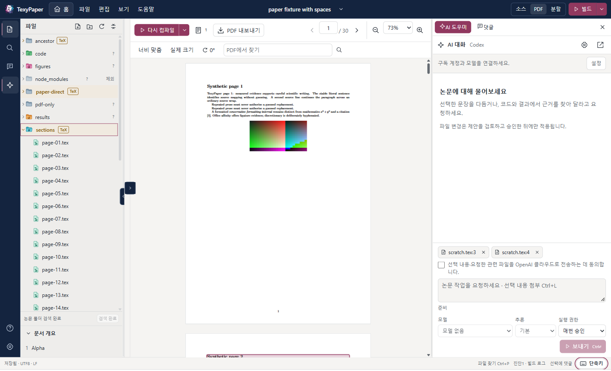

<div align="center">


# TexyPaper

**The Sexy LaTeX Editor. 로컬과 SSH 서버의 논문을 원래 위치에서 편집하고, 호스트에서 컴파일하고, AI의 모든 변경을 직접 검토한 뒤에만 적용합니다.**

<p>
  <a href="https://github.com/HSoo-Kim/texypaper/releases/latest"></a>
  <a href="https://github.com/HSoo-Kim/texypaper/releases/latest"></a>
  <a href="https://github.com/HSoo-Kim/texypaper/releases"></a>
  <a href="https://github.com/HSoo-Kim/texypaper/stargazers"></a>
  <a href="LICENSE"></a>
</p>

<p>
  <a href="README.md">English</a> ·
  <b>한국어</b> ·
  <a href="README.zh-CN.md">简体中文</a> ·
  <a href="README.ja.md">日本語</a>
</p>



</div>

Tauri 2, Rust, React, CodeMirror로 만든 Windows 데스크톱 LaTeX 편집기입니다. 이 컴퓨터나 SSH 서버에 있는 논문 폴더를 원래 위치에서 열어 편집하고 컴파일하며, 소스 옆에 PDF를 보여 줍니다.

## 핵심 기능 (Key Capabilities)

| 기능 | 설명 |
|---|---|
| **로컬·SSH 프로젝트** | 이 컴퓨터의 폴더, 또는 내 OpenSSH 설정으로 접속한 서버의 실제 POSIX 경로를 엽니다. 파일은 그 자리에서 읽고 쓰며 Windows에 복사본을 만들지 않습니다. [자세히](#프로젝트-열기) |
| **`Ctrl+S` 한 번이면 PDF** | 저장하면 논문이 있는 컴퓨터에서 latexmk로 컴파일합니다. 주 문서는 `% !TeX root`, 직접 고른 문서, `\documentclass`로 찾아 대개 따로 설정할 것이 없습니다. [자세히](#컴파일과-pdf) |
| **소스와 PDF 나란히** | PDF에서 `Ctrl+클릭`하면 소스의 해당 줄로, `Ctrl+Alt+J`는 대응하는 PDF 위치를 강조해 이동합니다(SyncTeX). 구분선을 끌어 폭을 조절하고, 소스·PDF·대화 글자는 각각 확대·축소합니다. |
| **Overleaf 방식 편집** | Overleaf 기본 단축키(`Ctrl+D` 줄 삭제, `Ctrl+/` 주석, 다중 커서, 접기), 번호가 붙는 문서 개요, 인용·레이블 자동 완성. |
| **맞춤법 검사와 단어 수** | 렌더되는 산문만 검사하는 영어 맞춤법 검사입니다. TeX 명령·수식·주석·인용 키는 표시하지 않으며, 클릭하거나 `Alt+F8`로 제안을 봅니다. 상태 표시줄에 단어 수(선택 영역이 있으면 그 수)가 나옵니다. [자세히](#맞춤법-검사와-단어-수) |
| **프로젝트 전체 바꾸기** | 파일별로 바뀔 줄을 미리 보고, 최대 16개 파일에 걸쳐 되돌릴 수 있는 하나의 저장으로 바꿉니다. [자세히](#프로젝트-전체-바꾸기) |
| **그림 끌어 놓기·붙여넣기** | 이미지나 PDF를 탐색기에 끌어 놓거나 스크린샷을 소스에 붙여넣으면 프로젝트로 복사되고 채울 수 있는 figure 블록이 삽입됩니다. [자세히](#그림-끌어-놓기와-붙여넣기) |
| **체크포인트** | 프로젝트 텍스트 파일의 이름 붙은 스냅샷, 현재 상태와의 파일별 차이 보기, 되돌릴 수 있는 복원. [자세히](#체크포인트) |
| **템플릿으로 새 논문** | 이미 있는 폴더에서 영문 논문·한글 논문·발표 슬라이드·장별 보고서를 시작합니다. 로컬과 SSH 모두 됩니다. [자세히](#템플릿으로-시작하기) |
| **PDF에서 글 고치기** | 렌더된 PDF 글을 선택하면, 유일하게 증명된 리터럴 산문 구간만 전후 차이 검토로 보냅니다. 적용은 되돌릴 수 있는 하나의 저장이며 이어서 재빌드합니다. [자세히](#pdf의-글-고치기) |
| **댓글** | 소스나 PDF 선택에 댓글을 답니다. `.texypaper/comments.json`에 저장되고, 편집 후에도 인용문과 문맥으로 다시 연결합니다. |
| **AI는 제안, 적용은 사람** | Codex와 Claude를 공식 CLI와 내 구독으로 실행합니다. 프로젝트를 읽고 변경을 제안할 수 있지만 **변경 적용**을 누르기 전에는 아무것도 저장되지 않습니다. [자세히](#ai-codex와-claude) |
| **안전한 저장과 복구** | 쓰기 전 SHA-256 검사, 외부 수정 충돌 대화상자, 미저장 내용을 위한 복구 기록, 마지막 저장 되돌리기. |
| **논문을 아는 탐색기** | TeX 파일이 있는 폴더에는 펼치기 전부터 **TeX** 배지가 붙고, 파일 종류 아이콘과 역할별 색의 폴더 아이콘을 보여 줍니다. |
| **테마와 언어** | 한국어·English UI, 밝게·어둡게·시스템 테마, 직접 고르는 강조·배경·편집 영역·사이드바 색. |
| **업데이트 알림** | 새 릴리스가 있으면 하단에 계속 표시합니다. 스스로 설치하지는 않습니다. |

[전체 기능](#기능)

## 빠른 시작

1. [최신 릴리스](https://github.com/HSoo-Kim/texypaper/releases/latest)에서 `TexyPaper_<버전>_x64-setup.exe`를 내려받습니다(Windows x64, Windows 11에서 개발·테스트, Microsoft Edge WebView2 런타임 필요). portable ZIP도 있습니다.
2. 설치 파일을 실행합니다. 현재 사용자에게 설치하므로 관리자 권한이 필요 없습니다. ZIP은 전체를 풀고 `texypaper.exe`를 실행하세요.
3. `Ctrl+O`로 **홈**을 열고 **프로젝트 열기**에서 논문 폴더를 고른 뒤 `.tex` 파일을 열고 `Ctrl+S`를 누릅니다.

`latexmk`가 `PATH`에 있는 TeX 배포판도 필요합니다(SSH 프로젝트는 서버에). 설치 파일과 실행 파일은 코드 서명이 없어 Windows가 게시자를 확인할 수 없다고 경고할 수 있습니다. 업데이트할 때는 작업을 저장하고 TexyPaper를 완전히 종료(**파일 → TexyPaper 완전 종료**, `Ctrl+Shift+Q`, 또는 트레이의 **TexyPaper 종료**)한 뒤 새 설치 파일을 실행하세요.

### 필요한 것

| 용도 | 전제 조건 |
|---|---|
| 데스크톱 앱 | Windows x64, Microsoft Edge WebView2 런타임 |
| 로컬 TeX 빌드 | `PATH`의 `latexmk`, 선택한 엔진(`pdflatex`·`xelatex`·`lualatex`), 논문에 필요한 TeX 패키지·글꼴·BibTeX/Biber |
| 소스 ⇄ PDF 이동 | 빌드의 SyncTeX 데이터와 호스트의 `synctex` |
| SSH 편집 | Windows OpenSSH `ssh.exe`, `python3` 3.9 이상이 있는 Linux/macOS POSIX 서버, 프로젝트와 사용자 캐시 폴더 쓰기 권한 |
| SSH 빌드 | 위 조건에 더해 **서버에** latexmk·선택 엔진·SyncTeX와 논문 의존성 설치 |
| AI | Windows에 설치한 공식 Codex 또는 Claude Code CLI, 해당 공급자의 지원되는 구독 로그인, 인터넷 연결 |

TeX·Python·SSH·AI CLI는 앱에 포함되지 않으며 TexyPaper가 전역 패키지나 서버 패키지를 자동 설치하지 않습니다. SSH 서버에는 Codex·Claude·Node나 상시 데몬이 필요하지 않습니다. TeX가 없는 서버에서도 파일 편집은 가능하지만 빌드는 `TEX_TOOL_MISSING`으로 실패합니다.

## 프로젝트 열기

**홈**(상단 홈 버튼, `Ctrl+O`)은 프로젝트를 고르고 추가하고 바꾸는 전체 화면입니다. 최근 프로젝트가 먼저 나오고 열려 있는 프로젝트에는 **프로젝트로 돌아가기**가 붙습니다. 홈을 보는 동안에도 열린 프로젝트의 편집 내용·빌드·AI 작업은 계속되며, 다른 프로젝트로 실제 전환할 때만 미저장 파일과 실행 중인 작업을 확인합니다.

**이 컴퓨터:** **프로젝트 열기 → 이 컴퓨터 → 폴더 선택**을 고릅니다. 프로젝트는 그 디렉터리에서 직접 읽고 씁니다. 파일 패널에서 `.tex` 파일을 열면, 아래 **문서 개요**가 `\section`·`\subsection`·`\subsubsection`을 `1`, `1.1`, `1.1.1` 번호와 단계별 들여쓰기로 보여 주고 항목을 누르면 해당 줄로 이동합니다(번호는 소스 순서 기준이라 컴파일 결과의 번호와 다를 수 있습니다).

**SSH 서버:**

1. **SSH 환경 추가**에서 OpenSSH 별칭 또는 호스트 이름을 지정합니다. 필요하면 사용자·포트·개인 키·별도 SSH 설정 파일도 입력합니다. OpenSSH 설정의 구체적인 `Host` 별칭과 `Include`를 읽으며, wildcard를 서버 목록으로 확장하지 않습니다.
2. 서버의 `/home/user/paper` 같은 **실제 POSIX 경로**를 입력합니다.
3. 도움 프로그램 안내에 동의합니다. 연결 동안 작은 표준 라이브러리 Python worker를 실행하고, SHA-256으로 검증한 버전을 `~/.cache/texypaper/worker/<sha256>/`에 저장합니다. pip·npm·root 설치나 공개 포트는 사용하지 않습니다.
4. 처음 보는 서버는 OpenSSH가 제시한 전체 지문을 확인하세요. 암호·키 암호·keyboard-interactive 응답은 앱의 인증 창에서 입력하며, 취소하면 연결도 중단됩니다.

기존 키·SSH agent·ProxyJump 설정을 사용하지만 ssh-agent 서비스를 자동 시작하거나 권한을 올리지 않습니다. **변경된 호스트 키는 오류**이며 앱이 known_hosts를 지워 우회하지 않습니다. 연결이 끊기면 저장·빌드를 완료로 보고하지 않고 마지막 PDF와 편집 중이던 내용을 유지합니다. **다시 연결**한 뒤 원본 revision과 불확실한 트랜잭션 상태를 확인하세요. 실패한 쓰기는 자동으로 재전송하지 않습니다.

## 컴파일과 PDF

빌드는 언제나 프로젝트가 있는 호스트에서 실행합니다. SSH 논문을 Windows로 복사해 빌드하지 않습니다. **`Ctrl+S`는 저장 후 컴파일**하고(설정의 **저장 후 자동 빌드**를 끄면 저장만), 입력을 멈추면 자동 저장 뒤 컴파일합니다. PDF 쪽 **다시 컴파일**, 상단 **빌드**, `Ctrl+Shift+B`도 같습니다.

주 문서는 설정 없이 이 순서로 찾습니다: 열린 파일의 `% !TeX root = ...` → 직접 고른 주 문서 → `\documentclass`가 있는 열린 파일 → 열린 파일의 폴더부터 위로 올라가며 `\documentclass` 파일이 하나뿐인 가장 가까운 폴더. 후보가 여럿이면 추측하지 않고 물어봅니다. **빌드 옵션 → 주 문서**나 **다시 컴파일** 옆 메뉴에서 고르세요. 직접 고른 주 문서는 `.texypaper/project.json`에 저장됩니다.

| 프로필 | 동작 |
|---|---|
| **기본(Basic)** | `latexmk -norc`, `-no-shell-escape`, SyncTeX와 recorder를 사용합니다. latexmk rc 파일을 무시할 뿐 TeX 자체를 샌드박스로 만들지는 않습니다. |
| **프로젝트(Project)** | 기존 latexmk 설정을 사용합니다. 설정의 명령이 실행될 수 있으므로 명시적 신뢰 확인이 필요하며, 신뢰는 프로젝트 JSON이 아닌 클라이언트 앱 데이터에 저장합니다. |

한 번에 하나의 빌드만 돌리고, 저장이 겹치면 최신 재빌드 요청으로 합칩니다. 기본 제한 시간은 120초이며 중지는 앱이 시작한 프로세스 트리에 적용합니다. 빌드가 실패·취소·시간 초과되면 마지막 성공 PDF를 '갱신 필요' 상태로 계속 보여 줍니다. 로그 버튼의 숫자는 오류·경고 수이고, 로그는 표시할 PDF가 없을 때만 자동으로 열립니다.

빌드가 실패해 로그에 소스 위치가 있는 오류가 보이면 **이 오류를 AI에게 묻기**가 첫 오류 앞뒤 20줄의 소스를 AI 채팅에 첨부하고, 입력창이 비어 있으면 질문 문장도 채워 줍니다. 보내기를 누르기 전에는 아무것도 전송하지 않습니다.

PDF에는 페이지 이동, 너비 맞춤·실제 크기·확대/축소, 90도 회전, 페이지별 텍스트 검색과 PDF 내보내기가 있습니다. 따로 연 참고 PDF는 주 문서 재빌드로 교체되지 않으며 **빌드 PDF로 돌아가기**로 복귀합니다. PNG/JPEG/WebP와 비실행 SVG는 그 자리에서 미리 볼 수 있습니다.

### PDF의 글 고치기

1. 렌더된 PDF 글을 선택하고 **원문 보기 / 텍스트 수정 / AI로 수정 / 댓글** 중 하나를 고릅니다.
2. **텍스트 수정**은 현재 PDF·SyncTeX·컴파일 당시 소스 snapshot·현재 소스 hash를 함께 확인합니다. SyncTeX 위치만 보고 문자 오프셋을 추측하지 않습니다.
3. 하나의 소스 문단 안에서 유일하게 증명된 리터럴 산문 구간만 전후 차이 검토로 보냅니다. 입력은 일반 텍스트이며 TeX 특수 문자를 escape합니다. raw TeX는 소스 편집기에서 고치세요.
4. 적용하면 hash를 다시 확인하고 하나의 되돌릴 수 있는 트랜잭션으로 저장한 뒤 재빌드합니다. 소스가 바뀌었거나 선택이 만료되면 `PDF_STALE`로 거부하므로 다시 빌드하고 선택하세요.

반복 문장, 매크로·수식·인용·표, 파일/문단 경계를 넘는 선택, 비연속 다단 선택, 모호한 ligature·하이픈, 검증할 수 없는 좌표는 자동으로 대체하지 않습니다. 후보 원문으로 이동해 직접 고치거나 검토 가능한 AI 제안을 사용하세요.

### 댓글

소스나 PDF 선택에서 댓글을 만들고 답글·수정·삭제·해결·다시 열기를 할 수 있습니다. 댓글은 프로젝트의 실제 호스트에 `.texypaper/comments.json`으로 저장되며 TeX `%` 주석으로 삽입하지 않습니다. 앱의 소스 변경에는 byte anchor를 이동하고, 외부 수정 뒤에는 같은 파일에서 인용문과 앞뒤 문맥이 유일하게 일치할 때만 다시 연결합니다. 그렇지 않으면 **연결 끊김**(Orphaned)로 표시되므로 다시 선택하세요. PDF 전용 댓글은 그 PDF hash에만 붙으며 새 PDF의 같은 페이지 번호로 옮겨 가지 않습니다.

## 쓰기와 고치기

### 맞춤법 검사와 단어 수

**설정 → 소스 편집**의 **맞춤법 검사 (영어)**로 켜고 끕니다(기본값은 켜짐). 소스에서 보이는 구간의 철자가 틀린 단어에는 물결 밑줄이 생기고, 마우스를 올리거나 클릭하거나 커서를 두고 `Alt+F8`을 누르면 최대 다섯 개의 제안과 **이 단어 무시**가 나옵니다.

- **검사 대상:** 렌더되는 산문만 봅니다. TeX 명령과 그 옵션 인자, 수식, 주석, verbatim, 레이블, 인용 키는 건너뛰고, 숫자가 든 단어·대문자 약어·camelCase·하이픈/밑줄 식별자도 건너뜁니다. 한국어 같은 다른 문자는 검사하지 않습니다. 입력을 잠시 멈춘 뒤에 표시합니다.
- **사전:** PC에 Windows 영어(미국·영국) 사전이 있으면 그것을 씁니다. 한국어만 설치한 Windows처럼 영어 사전이 없으면 내장 영어 사전(SCOWL, 약 0.5 MB)으로 대신합니다. 내장 사전은 첫 검사 때만 불러오며 불러오는 데 작업 집합이 약 3 MB 늘어나는 것을 측정했습니다. 어느 쪽을 쓰는지는 **설정**에 표시됩니다.
- **무시한 단어:** **이 단어 무시**는 TexyPaper 자체 설정에 단어를 저장합니다(최대 500개, **무시한 단어 지우기**로 비웁니다). Windows 사용자 사전은 수정하지 않습니다.
- **단어 수:** 상태 표시줄에 TeX 명령·수식·주석을 뺀 산문의 단어·글자 수가 나오고, 텍스트를 선택하면 선택 영역의 수도 보여 줍니다. 한글 등 CJK 문자열은 형태소 분리를 하지 않으므로 연속된 한 덩어리를 한 단어로 세고, 축약형과 하이픈 단어는 한 단어이며 단독 숫자는 세지 않습니다. 글자 수에는 산문의 공백과 문장 부호가 포함됩니다. 소스 기준 추정치이며 매크로를 펼치지 않습니다.

### 프로젝트 전체 바꾸기

왼쪽 막대의 **프로젝트 검색**을 열고 찾을 글을 입력한 뒤 **바꾸기**를 엽니다. **미리 보기**가 파일마다 바뀔 줄의 전후를 보여 주고, **모두 바꾸기**가 적용합니다.

- **범위:** UTF-8 텍스트 파일만 대상입니다. 4 MiB가 넘는 파일, 바이너리, UTF-8이 아닌 파일, 앱의 비공개 메타데이터는 건너뛴 파일로 표시하고 건드리지 않습니다. **대소문자 구분**과 **단어 단위** 옵션이 있습니다.
- **한도:** 한 번에 최대 16개 파일, 2,000곳입니다. 더 많으면 안내 문구와 함께 거부하고 아무것도 쓰지 않으므로 먼저 검색 범위를 좁히세요.
- **되돌릴 수 있는 하나의 저장:** 적용 직전에 모든 파일을 다시 읽어 SHA-256이 미리 보기와 같은지 확인하고, 열린 편집기를 먼저 저장하며, BOM과 줄바꿈을 유지한 채 모든 파일을 하나의 트랜잭션으로 씁니다. 미리 보기 뒤에 바뀐 파일이 하나라도 있으면 아무것도 쓰지 않습니다. 결과 옆의 **실행 취소**가 모든 파일을 이전 내용으로 되돌립니다.
- 로컬과 SSH 프로젝트 모두 같은 방식으로 동작합니다.

### 그림 끌어 놓기와 붙여넣기

PNG·JPEG·GIF·WebP·SVG·PDF·EPS 파일을 파일 트리에 끌어 놓거나(폴더 행에 놓으면 그 폴더, 그 밖에는 `figures` 폴더가 있으면 거기, 없으면 프로젝트 루트), 소스 편집기에 끌어 놓거나 클립보드 이미지를 붙여넣습니다. 탐색기에 놓은 파일은 복사만 하고, 편집기에서의 끌어 놓기·붙여넣기는 커서 위치에 `\includegraphics`가 든 `\begin{figure}` 블록(빈 캡션과 레이블 포함, 열린 파일 기준 상대 경로)도 삽입합니다.

- **안전한 복사:** 파일당 최대 20 MiB, 위의 확장자만 가능합니다. 이름은 파일 시스템에 안전하게 바꾸고, 기존 파일은 덮어쓰지 않으며(번호를 붙입니다), 전송 뒤 내용 해시를 검증하고, 파일은 한 번에 나타납니다. 하드 링크를 지원하지 않는 파일 시스템의 폴더는 반쯤 쓰는 대신 오류로 끝납니다.
- 붙여넣은 이미지는 `pasted-image-<날짜>-<시각>.png`로 저장됩니다(PNG가 아닌 클립보드 이미지는 먼저 PNG로 변환합니다). 어떤 형식을 LaTeX가 넣을 수 있는지는 엔진에 따라 다르며 pdfLaTeX는 PNG·JPEG·PDF를 받습니다. 로컬과 SSH 프로젝트 모두 되고, SSH는 기존 연결로 바이트를 보냅니다.

### 체크포인트

왼쪽 막대의 **체크포인트**는 프로젝트 텍스트 파일의 이름 붙은 스냅샷을 보관합니다. 버전 관리 저장소와 무관하게 쓰는 가벼운 안전망입니다.

- **체크포인트 만들기**는 열린 파일을 먼저 저장한 뒤 프로젝트의 소스 형식 텍스트 파일을 프로젝트가 아닌 TexyPaper 앱 데이터에 저장합니다. 대상은 UTF-8이고 쓸 수 있는 `.tex`, `.ltx`, `.bib`, `.bst`, `.cls`, `.sty`, `.bbx`, `.cbx`, `.dtx`, `.ins`, `.md`, `.txt`, `.csv`, `.tsv`, `.json`, `.yaml`, `.yml`, `.toml`, `.py`, `.r`, `.m`, `.jl`, `.sh` 파일입니다. 숨김 파일·폴더(`.git`, `.texypaper` 등), `node_modules`, `venv`, `__pycache__`, `build`, `dist`, `target`과 UTF-8 텍스트로 읽을 수 없는 파일은 제외합니다.
- **한도:** 1 MiB를 넘거나 읽기 전용이거나 UTF-8이 아닌 파일은 건너뛰고 목록으로 알려 줍니다. 한 체크포인트는 최대 400개 파일, 합계 8 MiB이며 이를 넘는 프로젝트는 일부만 저장하지 않고 이유와 함께 거부합니다. 체크포인트는 최대 50개를 유지하고 오래된 것부터 정리합니다.
- **비교**는 현재 프로젝트와 비교해 바뀐·추가된·삭제된 파일을 나열하고 파일마다 줄 단위 차이를 보여 줍니다.
- **복원**은 바뀐 파일 전체, 선택한 파일, 한 파일을 한 번에 최대 16개까지 되돌립니다. 먼저 확인을 묻고, **Before restore** 체크포인트를 만들고, 하나의 트랜잭션으로 쓰며 **실행 취소**를 제공합니다. 체크포인트 이후에 추가된 파일은 지우지 않습니다.

### 템플릿으로 시작하기

홈의 **템플릿으로 새 논문**은 이미 있는 폴더(비어 있는 편이 좋습니다)에 시작용 논문을 만듭니다. 컴퓨터 또는 SSH 환경과 폴더를 고르고 **영문 논문**, **한글 논문**(ko.TeX가 필요한 XeLaTeX), **발표 슬라이드**(Beamer), **장별 보고서** 중 하나를 선택한 뒤 **만들고 열기**를 누릅니다.

TexyPaper는 새 파일만 만듭니다. 템플릿의 파일이나 폴더가 하나라도 이미 있으면 아무것도 만들지 않고 해당 경로를 알려 줍니다. 주 문서와 엔진은 `.texypaper/project.json`에 저장되고 논문은 바로 컴파일할 수 있는 상태로 열립니다.

## AI: Codex와 Claude

AI 채팅 상단의 **설정**에서 공급자를 고르고 **연결 새로 고침**으로 공식 CLI와 계정을 확인합니다. 지원 프로토콜 기준은 **Codex 0.153.2 / Claude Code 2.1.300**입니다. 모델·추론 수준·실행 권한은 보내기 버튼 옆에 있습니다. 버전 불일치·사용 불가 모델·한도·인증·네트워크 실패는 있는 그대로 표시하며 다른 유료 API로 전환하지 않습니다.

- **Codex:** **공식 로그인 → 인증 페이지 열기**에서 ChatGPT 로그인을 마칩니다. TexyPaper 전용 공식 저장소(`CODEX_HOME=<app-data>/providers/codex`)를 쓰므로 다른 곳에서 Codex에 로그인했어도 한 번 더 필요할 수 있습니다. 기존 토큰이나 전역 설정은 복사하지 않습니다.
- **Claude:** 공식 CLI의 `claude.ai` 구독 계정을 사용합니다. 필요하면 터미널에서 `claude auth login`을 실행한 뒤 앱에서 새로 고치세요. Console/API 키와 타사 로그인은 구독으로 간주하지 않습니다.

모델 선택은 GPT-6 이상에서 계열별 최신 버전, Claude는 Opus·Sonnet·Haiku 5.5만 보여 줍니다. 현재 기본 목록은 **GPT-6 Astra·Luna, GPT-6.1 Sol·Terra**, **Claude Opus 5.5·Sonnet 5.5·Haiku 5.5**입니다([OpenAI 모델 목록](https://developers.openai.com/api/docs/guides/latest-model), [Claude 모델 목록](https://platform.claude.com/docs/en/models/overview)). CLI의 축약 목록에서 빠진 공식 모델도 고를 수 있으며, 이때 **CLI 목록에 없는 공식 모델**이라고 표시하고 ID를 그대로 전송합니다. 구독이 거부하면 다른 모델이 아니라 공급자의 오류를 보여 줍니다. 추론 수준은 선택한 모델의 CLI 메타데이터에 있는 단계만 제공하고, 없으면 공급자 기본값을 씁니다.

두 CLI는 **Windows 클라이언트에서만** 실행하며 SSH URI를 작업 디렉터리로 쓰지 않습니다. 개인 제어 디렉터리와 일곱 MCP 도구(`list_files`, `read_text`, `search_text`, `get_build_status`, `propose_changes`, `propose_command`, `get_command_status`)로 선택한 로컬/SSH 프로젝트에 접근합니다. 공급자 자체의 shell·직접 파일 쓰기 도구는 비활성화합니다.

**첨부와 동의.** 소스·PDF에서 `Ctrl+L`이나 우클릭 → **AI에 첨부**로 명시적으로 첨부한 글만 입력창의 칩이 되며, 선택만 해서는 아무것도 공유되지 않습니다. 클라우드 전송 동의는 **공급자(OpenAI·Anthropic)별로 처음 한 번** 체크하면 기억되고, 입력창에 작은 안내와 **동의 철회**가 남습니다. 이후 관련 소스·코드·결과 일부가 선택한 공급자에게 전송됩니다. 기본 읽기 도구는 비밀 키·`.env*`·credential·앱 인증/복구 저장소를 제외하고, `propose_changes`는 TeX/Bib/style 파일에만 쓸 수 있습니다.

**모델 응답이나 제안은 저장이 아닙니다.** `propose_changes`는 제안만 만들어 **승인 대기**로 남깁니다. diff와 근거 파일/줄을 확인한 뒤 **변경 적용**을 눌러야 저장됩니다. 거절·취소는 소스를 바꾸지 않고, 적용 직전에 모든 base hash를 다시 검사하며, 충돌이면 새 원본으로 다시 쓸 수 있게 제안을 보존합니다. 적용한 제안은 되돌릴 수 있습니다. AI 작업은 한 번에 하나만 실행하고, 프로세스는 필요할 때만 시작하며, 세션 ID를 보존해 대화를 재개합니다. 항상 켜 둔 모델 서버는 없습니다.

### 프로젝트 코드 실행

AI는 `propose_command`로 명령을 제안하고, 명령은 프로젝트의 실제 호스트(로컬은 이 컴퓨터, SSH는 서버)에서 실행됩니다. 모델은 권한을 바꾸거나 자신이 제안한 명령을 승인할 수 없습니다.

| 실행 권한 | 동작 |
|---|---|
| **실행 안 함** | 새 제안을 차단하고, 대기 제안을 거절하며, 실행 중인 명령을 중지 |
| **매번 승인**(기본값) | 명령마다 환경·작업 폴더·정확한 argv·제한 시간을 확인하고 승인 또는 거절 |
| **세션 허용** | 위험 안내와 체크박스를 확인한 뒤, 현재 프로젝트 연결의 이후 명령을 개별 승인 없이 실행 |

세션 권한은 프로젝트 전환·재연결·앱의 실제 종료 때 초기화됩니다(트레이로 숨기는 것은 종료가 아닙니다). 언제든 **매번 승인**이나 **실행 안 함**으로 되돌릴 수 있습니다. 실행 카드에서 stdout/stderr, 종료 코드, 출력이 잘렸는지 확인하고 개별 명령을 중지할 수 있습니다. 한 번에 명령 하나만 실행하고 기본 제한 시간은 120초이며, shell 문자열을 암묵적으로 실행하지 않고 인터프리터를 포함해 승인된 argv 그대로 실행합니다.

**작업 폴더 제한은 OS 샌드박스가 아닙니다.** 승인한 명령은 해당 로컬/SSH 계정 권한으로 실행되어 프로젝트 밖의 파일·네트워크·시스템에도 영향을 줄 수 있습니다. 부작용은 자동으로 되돌리지 않으며, 승인한 명령에는 위의 파일 읽기·쓰기 제한이 적용되지 않습니다.

### 채팅 창과 트레이

- **대화를 별도 창으로 열기**로 채팅을 분리하고 **메인 창에 붙이기**로 되돌립니다. 대화·입력 초안·읽던 위치·진행 중인 작업·승인 대기는 메인 컨트롤러가 계속 보관하며, 분리 창의 X도 채팅을 메인 창으로 돌려보냅니다. 이전 메시지를 읽거나 선택하는 동안 새 응답이 화면을 끝으로 끌어내리지 않습니다.
- 메인 창의 **첫 X**에서는 **트레이에서 계속 실행 / 완전 종료 / 취소**를 고릅니다. 트레이 동의를 저장한 뒤에는 X로 메인 창과 분리 채팅을 함께 숨기며 AI·명령·빌드는 계속 진행합니다.
- **파일 → TexyPaper 완전 종료**, `Ctrl+Shift+Q`, 트레이의 **TexyPaper 종료**는 작업 중지와 미저장 내용을 확인한 뒤 앱을 끝냅니다. 트레이의 **TexyPaper 열기**, 아이콘 더블클릭, 또는 같은 Windows 사용자·profile로 TexyPaper를 다시 실행하면 기존 창을 복원합니다. 다른 `--data-dir`은 별도 인스턴스입니다. Windows 자동 시작은 설정하지 않습니다.

Claude 구독 연동은 개인 사용 전제입니다. 다른 사용자에게 배포하기 전에는 [공식 구독 지원 안내](https://support.claude.com/en/articles/15036540-use-the-claude-agent-sdk-with-your-claude-plan)와 [Agent SDK 정책](https://code.claude.com/docs/en/agent-sdk/overview)을 다시 확인하세요.

## 기능

### 편집과 저장
- **편집:** TeX 구문 강조, 괄호 짝, 들여쓰기, 줄 번호, 찾기/바꾸기, 로드한 TeX/Bib 파일의 citation·label 자동 완성. `\section`·`\centering` 같은 LaTeX 명령은 팔레트와 무관하게 늘 초록색입니다. 코드 파일은 필요한 언어 모드를 지연 로드하고, 알 수 없는 텍스트는 일반 텍스트로 열며, 언어 서버는 기동하지 않습니다.
- **Overleaf 기본값:** `Ctrl+D` 줄 삭제, `Ctrl+/` 주석 전환, `Ctrl+B`/`Ctrl+I`, 대소문자 변환, 줄 이동·복사, 접기, `Ctrl+클릭` 다중 커서, `Alt`+드래그 직사각형 선택. `Ctrl+Enter`·`Ctrl+.`는 컴파일, `Ctrl+J`는 댓글 패널, `Ctrl+Shift+C`는 선택에 댓글입니다.
- **자동 저장:** 입력이 700ms 쉬면 저장하고 IME 조합 중에는 미룹니다. `Ctrl+S`는 대기 중인 소스를 즉시 저장하고 컴파일하며, 자동 저장 뒤의 자동 빌드는 별도로 800ms debounce됩니다.
- **안전한 쓰기:** 쓰기 직전에 SHA-256을 비교하고, 같은 파일시스템의 임시 파일을 flush한 뒤 교체하며, UTF-8 BOM과 기존 줄바꿈을 보존합니다. 파일 크기나 수정 시각만으로 충돌을 판단하지 않습니다.
- **충돌:** 외부에서 바뀐 파일은 버퍼가 깨끗하면 다시 읽고, 미저장 편집이 있으면 `FILE_CONFLICT`를 표시해 **비교 / 다시 불러오기 / 복사본 저장** 중에서 고르게 합니다(다시 불러오기는 내 변경을 버리므로 확인합니다). 이는 낙관적 충돌 검출이며 외부 편집기는 TexyPaper의 잠금을 따르지 않습니다.
- **복구:** 미저장 내용은 앱 전용 복구 기록에 남고, 재시작·재연결 때 원본 hash와 트랜잭션 상태를 함께 확인합니다. `TRANSACTION_PARTIAL`이면 같은 작업을 다시 실행하지 말고 영향 경로와 보존된 journal을 확인하세요. **마지막 저장 실행 취소**는 journal 기반이며, 이후 바뀐 결과 파일은 덮어쓰지 않고 거부합니다.
- **보호 장치:** 프로젝트 전환·종료 시 미저장 내용은 저장/버리기/취소를, 실행 작업은 중지 여부를 묻고, 저장 실패를 무시하고 넘어가지 않습니다. 4MiB보다 큰 파일은 메모리 경고 뒤 명시적으로 허용하기 전까지 읽기 전용이고, UTF-8이 아닌 파일은 묵시적으로 변환하지 않습니다(**변환한 복사본 저장**은 읽을 수 없는 바이트를 대체할 수 있으며 원본은 유지합니다).
- **세션 복원:** 프로젝트별로 열린 탭, 활성 파일, 소스 커서·선택·스크롤, 소스/PDF 분할 비율과 패널 폭, PDF 페이지·확대·회전, 대화 기록의 읽던 위치를 복원합니다. PDF 위치는 **같은 빌드와 파일 hash**에만 재사용합니다. 로컬·SSH 모두 현재 컴퓨터의 앱 데이터에 저장되고 다른 PC로 동기화되지 않으며, 실행 권한이나 클라우드 전송 동의는 복구 기록에서 되살리지 않습니다.

### 탐색기
- **파일 종류와 폴더:** 파일 종류별 컬러 아이콘(TeX·bib·PDF·이미지·코드 등)과, 이름에 따라 색과 기호가 달라지는 폴더 아이콘. `docs`·`src`·`tests`·`results`·`figures`·`sections`·`paper`·`references` 같은 흔한 이름은 각자의 색과 기호를 갖고, 알 수 없는 이름은 회청색 기본 폴더이며, `node_modules`·`.git` 같은 도구 폴더는 흐리게 표시합니다. 폴더 색은 꾸밈일 뿐 논문이 있다는 증거가 아닙니다. 아이콘은 원본 SVG 작업물입니다.
- **TeX 배지:** `.tex`, `.ltx`, `.bib`, `.cls`, `.sty`, `.bst`, `.bbx`, `.cbx` 파일이 **직접** 있는 폴더는 굵은 이름, 황색 밴드, **TeX** 배지로 표시하고, 더 아래에서만 찾으면 흐린 **TeX** 배지를 붙입니다. 폴더를 펼치기 전부터 보이며 폴더 이름으로 추측하지 않습니다. 주 TeX에는 `Main` 배지가 붙고, PDF 하나만 있다고 LaTeX 프로젝트로 분류하지 않습니다.
- **검색 범위:** 자동 검색은 `.git`, `.texypaper`, `node_modules`, `.venv`, `venv`, `__pycache__`를 제외합니다. 설정에서 제외 목록을 볼 수 있고 해당 폴더를 직접 열 수도 있습니다. 한 번에 최대 20,000개 항목을 조사하고 남은 검색은 **계속 찾기**로 이어갑니다.
- **파일 작업:** 생성·이름 변경·이동·삭제. 삭제는 확인한 뒤 프로젝트의 `.texypaper/trash/`로 옮기며 프로젝트 휴지통에서 복원할 수 있습니다.

### 패널, 확대·축소, 이동
- **홈:** `Ctrl+O`로 열며, 열린 프로젝트는 그대로 유지됩니다.
- **패널:** 소스와 PDF 사이 구분선을 마우스로 끌거나 방향키로 움직이고(더블클릭하면 반반), 가운데 화살표로 한쪽을 접으면 같은 가장자리 화살표로 이전 비율대로 다시 펼칩니다. 작은 창에서는 가운데 패널 하나와 오버레이 사이드 패널을 씁니다.
- **확대·축소:** `Ctrl+휠`이나 `Ctrl`+`+`/`-`는 포인터 아래 또는 선택한 패널의 소스 글자, PDF 배율, AI 대화 글자를 각각 조절하고 따로 저장합니다. 앱 전체 확대는 설정의 UI 확대(100–200%)이며 PDF 자체는 편집하지 않습니다.
- **소스 ⇄ PDF:** PDF의 `Ctrl+클릭`은 대응 소스 줄을 엽니다(소스보다 오래된 PDF는 근사 위치로 표시). `Ctrl+Alt+J`나 편집기 도구 막대 버튼은 PDF 위치를 강조하고 스크롤합니다. 소스의 `Ctrl+클릭`은 Overleaf처럼 다중 커서입니다.
- **빠른 열기와 검색:** `Ctrl+P`는 이름으로 파일을 열고, `>`로 시작하면 프로젝트 본문을 검색합니다.
- **단축키 도움말:** 상태 표시줄 오른쪽 아래(홈에서는 오른쪽 위)의 **단축키** 버튼과 도움말 메뉴에서 분류별 전체 목록을 검색해 볼 수 있습니다.

### 화면
- **언어와 테마:** 한국어/English UI, 시스템·밝게·어둡게. UI 언어만 바뀌며 논문 원문이나 AI 출력 언어는 번역하지 않습니다.
- **팔레트:** 네이비 chrome과 절제한 버건디·로즈 강조, 따뜻한 회백색 낮 테마, 저채도 남색 밤 테마. 낮과 밤 각각 **강조·배경·편집 영역·사이드바** 색을 HEX나 색상 선택기로 저장할 수 있고, 프리셋·최근 사용 8개·초기화가 있습니다. 글자 대비와 오류/경고색 구분 조건을 충족하지 못하는 팔레트는 적용하지 않습니다. PDF 용지는 늘 흰색이고 오류·경고·논문 폴더 표식은 의미를 유지합니다.
- **접근성:** OS의 reduced motion, 고대비, 저전력·투명 효과 끄기 설정을 고려합니다.

### 업데이트
- **알림만:** 설정의 **업데이트 알림**은 새 버전을 알려 줄 뿐입니다. 설치 파일을 내려받거나 실행하거나 앱을 스스로 교체하지 않으며, **릴리스 확인**은 누르면 HTTPS 페이지를 엽니다.
- **피드:** 배포 빌드에는 [HSoo-Kim/texypaper](https://github.com/HSoo-Kim/texypaper) 피드가 들어 있습니다. GitHub 저장소 주소를 지정하면 `/releases/latest` 메타데이터를 읽고, `{ "version": "1.2.3", "url": "https://example.org/releases/1.2.3", "notes": "선택" }` 형식의 HTTPS JSON 피드도 쓸 수 있습니다(형식 예시이며 실제 주소가 아닙니다). 버전은 SemVer로 비교해 새 stable 버전만 알리고, URL은 인증 정보·query·fragment 없는 HTTPS여야 하며 리다이렉트는 따라가지 않습니다.
- **주기:** 자동 확인은 최소 **24시간** 간격입니다. **지금 확인**은 간격을 우회하지만 꺼 둔 알림은 우회하지 않으며, 실패는 상태로 남기되 이전에 확인한 새 버전 알림을 지우지 않습니다.

## 사용법

1. `Ctrl+O`로 프로젝트를 열고 `.tex` 파일을 엽니다.
2. `Ctrl+S`로 저장하고 컴파일하면 소스 옆에 PDF가 나타납니다.
3. PDF를 `Ctrl+클릭`해 소스로 이동하거나, PDF 글을 선택해 수정·댓글·AI 요청을 합니다.
4. 왼쪽 레일에서 AI 패널을 열고 `Ctrl+L`로 선택을 첨부한 뒤, 제안은 검토하고 나서 **변경 적용**하세요.

### 키보드 단축키

| 키 | 동작 |
|---|---|
| `Ctrl+O` | 홈: 프로젝트 선택·추가·전환 |
| `Ctrl+P` | 빠른 파일 열기; `>`로 시작하면 프로젝트 본문 검색 |
| `Ctrl+S` / `Ctrl+Enter` / `Ctrl+.` | 저장 후 컴파일(**저장 후 자동 빌드**를 끄면 저장만). AI 입력창의 `Ctrl+Enter`는 전송 |
| `Ctrl+Shift+B` | 즉시 빌드 |
| `Ctrl+Alt+J` | 현재 소스 위치에서 PDF로 이동해 강조(소스 도구 막대 버튼도 있음) |
| PDF에서 `Ctrl+클릭` | 클릭한 위치의 소스로 이동. 소스의 `Ctrl+클릭`은 Overleaf처럼 다중 커서 |
| `Ctrl+L` | 선택한 글(없으면 현재 줄)을 AI 대화에 첨부 |
| `Ctrl+J` | 댓글 패널 열기·닫기 |
| `Ctrl+Shift+C` | 선택에 댓글(이전 버전의 `Ctrl+Shift+A`는 Overleaf의 변경 추적 단축키와 겹쳐 제거) |
| `Ctrl+휠` / `Ctrl`+`+` / `Ctrl`+`-` | 포인터 아래 또는 선택한 소스·PDF·AI 대화의 글자·배율 조절 |
| `Ctrl+Shift+Q` | 작업·미저장 변경을 확인한 뒤 앱 완전 종료 |
| `Alt+F8` | 밑줄 친 단어에 대한 맞춤법 제안 열기 |
| `Escape` | 팝업·선택 닫기, 열린 SSH 인증 요청 취소 |

소스 편집 단축키는 Overleaf 기본값을 따르며 앱 안 도움말에 전체 목록이 있습니다.

## 데이터와 호환성

- **앱 데이터:** 사용자별 디렉터리는 `%APPDATA%\dev.texypaper.desktop`이며 `--data-dir`로 바꿀 수 있습니다. 설정·최근 프로젝트·복구 내용·체크포인트·AI의 보이는 대화 기록·CLI가 소유한 Codex 계정 정보가 들어 있을 수 있으니 통째로 공유하지 마세요. 다른 PC와 동기화하지 않습니다.
- **프로젝트 데이터:** `.texypaper/comments.json`과 `project.json`은 프로젝트와 함께 이동합니다. `build`·`transactions`·`trash`는 생성물이거나 복구 기록이므로 지우기 전에 미완료 작업을 확인하세요.
- **Portable:** portable ZIP도 같은 `%APPDATA%` 위치에 저장하며, 실행 파일을 옮겨도 같은 Windows 계정의 설정은 유지됩니다.
- **Paperdock에서:** 첫 실행 때 이전 `%APPDATA%\dev.paperdock.desktop` 프로필과 프로젝트의 `.paperdock` 폴더를 인증 정보를 읽거나 복사하지 않고 새 이름으로 바꿉니다. 충돌은 명시적 오류로 중단하며 아무것도 병합·삭제하지 않습니다. [이전 안내](docs/DEVELOPMENT.ko.md#이전-paperdock-데이터의-일회성-이전)를 보세요.
- **네트워크:** 앱 자체의 HTTP 클라이언트는 업데이트 알림에만 쓰이며, 사용자나 일정이 요청할 때 최신 릴리스 정보를 읽습니다. 그 밖의 통신은 SSH 연결과 사용자가 실행하는 AI CLI에서 발생합니다.
- **검증:** 실제로 실행해 확인한 범위와 증거는 [docs/VERIFICATION.md](docs/VERIFICATION.md)에, 내부 경계와 저장 구조는 [docs/ARCHITECTURE.md](docs/ARCHITECTURE.md)에 기록합니다.

## 소스 빌드

요구 사항: Windows x64, `pnpm`이 있는 Node.js, MSVC Rust 도구체인(edition 2024), Visual Studio C++ Build Tools/Windows SDK, WebView2.

```powershell
pnpm install --frozen-lockfile
pnpm dev -- -- --data-dir "$env:TEMP\texypaper-dev-isolated"   # 보이는 앱 창, 격리된 profile
pnpm test                                                      # 프런트엔드 테스트
pnpm tauri build --ci --target x86_64-pc-windows-msvc --bundles nsis -- --locked
```

산출물은 `src-tauri/target/x86_64-pc-windows-msvc/release/texypaper.exe`와 `bundle/nsis/TexyPaper_<버전>_x64-setup.exe`입니다. 전체 빌드 스크립트, 실제 앱 smoke, 메모리 측정, 이전 안내는 [docs/DEVELOPMENT.ko.md](docs/DEVELOPMENT.ko.md)에 있습니다.

## 구성

```text
src/                         React 프런트엔드
  ui/                        앱 셸, 도구 막대, 홈, 테마, 단축키 도움말
  editor/                    CodeMirror 편집기, TeX 단축키, 접기, 버퍼, 맞춤법, 단어 수, 이미지 붙여넣기
  pdf/                       PDF.js 뷰어, 텍스트 레이어, range 전송
  features/
    explorer/                파일 트리, 논문 인덱스, 문서 개요, 파일 아이콘
    ai/                      채팅, 제안, 명령 검토, 대화 기록
    comments/                댓글 스레드와 anchor
    search/                  프로젝트 전체 바꾸기 계획과 검토
    templates/               논문 템플릿과 새 파일만 만드는 프로젝트 시작
    assets/                  그림 가져오기(끌어 놓기·붙여넣기)
    history/                 체크포인트, 차이 보기, 복원
    pdf-edit/                선택 동작과 소스 수정 검토
  state/                     워크스페이스와 읽기 위치 상태
src-tauri/
  src/
    workspace/               로컬·SSH 워크스페이스, 트랜잭션, SSH 설정
    spell.rs                 영어 맞춤법 검사(Windows 사전, 내장 사전 대체)
    checkpoints.rs           앱 데이터의 체크포인트 저장
    latex/                   latexmk 스케줄러, 진단, SyncTeX, 산문 매핑
    ai/                      Codex/Claude 어댑터, MCP broker, 제안, 모델 카탈로그
    execution.rs             승인된 명령 실행
    comments.rs              댓글 저장과 anchor
    migration.rs             Paperdock 데이터 일회성 이전
    updates.rs  tray.rs  chat_window.rs  process.rs  state.rs
  resources/remote_worker.py SSH worker (Python 표준 라이브러리만 사용)
  tests/                     네이티브 통합 테스트
scripts/                     Windows 빌드, smoke suite, 메모리 측정
docs/                        ARCHITECTURE, VERIFICATION, DEVELOPMENT
```

## 라이선스

[MIT License](LICENSE). 제3자 구성 요소에는 각자의 라이선스와 저작권 고지가 적용됩니다([`THIRD_PARTY_NOTICES.md`](THIRD_PARTY_NOTICES.md), [`licenses/`](licenses/)). 코드 라이선스와 제3자 고지는 제품 이름·로고의 상표 사용 허가를 뜻하지 않습니다. 공식 CLI, TeX 배포판, WebView2 및 클라우드 서비스는 각 공급자의 라이선스·약관·계정 제한을 따릅니다.
