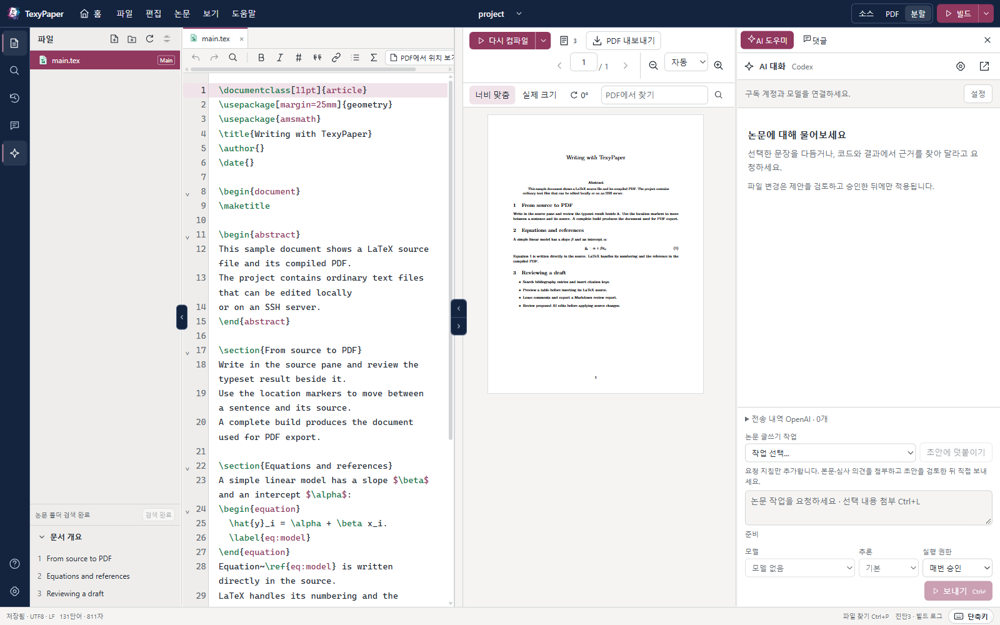

<div align="center">


# TexyPaper

**A Windows LaTeX editor for papers on this PC or an SSH server, with the compiled PDF beside the source.**

<p>
  <a href="https://github.com/HSoo-Kim/texypaper/releases/latest"></a>
  <a href="https://github.com/HSoo-Kim/texypaper/releases/latest"></a>
  <a href="LICENSE"></a>
</p>

<p>
  <b>English</b> ·
  <a href="README.ko.md">한국어</a> ·
  <a href="README.zh-CN.md">简体中文</a> ·
  <a href="README.ja.md">日本語</a>
</p>



</div>

TexyPaper opens a paper folder on this PC, or a real path on an SSH server, and edits the files where they are. There is no second working copy to keep in sync; the app reads the contents it needs into memory. Full builds run with latexmk on the machine that holds the paper. On compatible setups, a fast preview on this PC updates the PDF while you type. Codex and Claude can help with writing if you connect them, but editing and building work without AI.

## What TexyPaper does

| Area | What you get |
|---|---|
| Projects | Local folders and real paths on SSH servers, opened in place |
| Editing | LaTeX syntax highlighting, citation and label completion, a section outline, multiple cursors, folding, English spell check for prose and approximate word counts |
| Builds | latexmk on the project host, automatic main-document detection and a fast preview typeset on this PC |
| Source and PDF | Side-by-side panes, SyncTeX navigation in both directions and small prose fixes made from the PDF |
| Paper tools | BibTeX search with citation insertion, tables from CSV or TSV data, a pre-submission check, figure import and four templates |
| Review | Comments on the source or the PDF, with replies, resolution and a Markdown review report |
| Safety | Diff review, undo, checkpoints, conflict detection and recovery of unsaved edits |
| AI (optional) | Codex or Claude through their official CLIs; you apply source edits from a diff, and project commands need separate approval |

The app interface is available in Korean and English only.

## Install

1. Download `TexyPaper_<version>_x64-setup.exe` or the portable ZIP from the [latest release](https://github.com/HSoo-Kim/texypaper/releases/latest).
2. Run the installer. It installs for the current user and needs no administrator rights. If you use the ZIP, extract the whole archive before you run `texypaper.exe`.
3. Install a TeX distribution if you do not have one. The requirements are listed below.

TexyPaper runs on Windows x64 and was developed and tested on Windows 11. It needs the Microsoft Edge WebView2 runtime. The installer and the executable are not code-signed, so Windows SmartScreen may warn that it cannot verify the publisher.

To update, save your work and exit completely with **File → Exit TexyPaper**, `Ctrl+Shift+Q` or **Exit TexyPaper** in the tray menu, then run the new installer. Closing the window with X can leave TexyPaper running in the tray. The app shows a notice when a newer release exists, but it never downloads or installs an update by itself.

### Requirements

| For | You need |
|---|---|
| Builds | `latexmk`, your engine (`pdflatex`, `xelatex` or `lualatex`), and the packages, fonts and BibTeX or Biber your paper uses. For an SSH project, install these on the server. |
| Source and PDF navigation | SyncTeX output from the build and `synctex` on the build host |
| Fast preview | A compatible TeX Live 2026 on this PC with `kpsewhich` on `PATH`, even when the project is on an SSH server |
| SSH projects | Windows OpenSSH (`ssh.exe`), a Linux or macOS server with Python 3.9 or later, and write access to the project and a user cache folder |
| AI (optional) | The official Codex or Claude Code CLI on Windows, a subscription the provider supports for it, and an internet connection |

The app bundles WebAssembly TeX engines for the fast preview. They do not replace a full TeX distribution. TexyPaper does not bundle or install host TeX, Python, SSH or the AI CLIs. On a server without TeX you can still edit files, but builds fail.

## Open a project

Press `Ctrl+O` to open **Home** and choose **Open project**. Pick a folder on this computer or an SSH environment, open a `.tex` file and press `Ctrl+S` to save and run the first build.

TexyPaper finds the main document from a `% !TeX root` line, the document you selected, or the files with `\documentclass` near the one you opened. When several candidates tie, it asks you to choose instead of guessing. You can set the main document under **Build options** next to the **Build** button; the engine and build profile are in **Settings**. Your choices are stored in `.texypaper/project.json`.

### SSH projects

1. In **Add SSH environment**, enter an OpenSSH alias or host name. Add a user, port, private key or separate SSH config file if you need them. TexyPaper reads `Host` aliases and `Include` lines from your OpenSSH config and uses your existing keys, SSH agent and ProxyJump settings.
2. Enter the real POSIX path of the project on the server, such as `/home/user/paper`.
3. Accept the helper notice. TexyPaper starts a small Python helper that uses only the standard library, and it caches the verified copy in `~/.cache/texypaper/worker/<sha256>/`. The helper needs no root access, pip or npm install, open port, server-side AI CLI or always-on service.
4. On a first connection, check the full host-key fingerprint that OpenSSH shows. Passwords, key passphrases and other prompts appear in TexyPaper's own sign-in window.

TexyPaper treats a changed host key as an error and does not edit `known_hosts` to get past it. If the connection drops, your unsaved edits and the last PDF stay on screen. Choose **Reconnect** before you save or build again. TexyPaper never automatically retries a write whose result is uncertain.

## Builds and fast preview

`Ctrl+S` saves and starts a build unless you turn off **Build automatically after save**. `Ctrl+Shift+B` or the **Build** button starts a build at any time. TexyPaper also autosaves shortly after you stop typing and waits while an IME composition is in progress.

Full builds run latexmk on the project host, which is this PC for a local project and the server for an SSH project. PDF export and PDF comment anchors need a complete full build.

| Build profile | Behavior |
|---|---|
| Basic (default) | Runs `latexmk -norc` with shell escape off, so latexmk rc files are ignored. This does not sandbox TeX at the operating-system level. |
| Project | Runs your own latexmk configuration, which can execute commands. TexyPaper asks you to trust the project first. |

If a build fails, the last successful PDF stays on screen and is marked as out of date. The log button shows the number of errors and warnings.

### Fast preview

With the Basic profile and automatic builds on, TexyPaper can update the PDF pane before the full build finishes. A WasmTex engine running on this PC typesets the inputs of the last verified build together with your current editor buffers and shows the resulting PDF. Your documents are not sent to a cloud compiler. Starting the engine and running the first full build take longer.

For compatible pdfLaTeX input, the preview can typeset the visible page and the next page first. The other pages keep the previous full result and are marked as such. A preamble change or an unsupported case makes the preview compile the whole document instead. Input files outside the main document's parent folder, and fonts or packages the preview cannot use, leave the update to the full host build.

After the first build, automatic full builds for Basic/pdfLaTeX wait for a pause in typing. Saving and explicit builds do not wait for that pause.

### Source and PDF

A click in one pane marks the matching place in the other, and keyboard focus stays where it was. `Ctrl+click` in the PDF jumps to the source line, and `Ctrl+Alt+J` jumps from the source to the PDF. Navigation uses the SyncTeX data of the PDF on screen. When that mapping is still pending or the source has changed since the build, TexyPaper says so instead of guessing a location.

You can select text in the PDF and choose **Edit text**. This works only when TexyPaper can prove that the selection is one unique span of literal prose in a single source paragraph. You review a before-and-after diff, and TexyPaper checks the source hash again before it saves and rebuilds. Macros, math, citations, tables and ambiguous selections are left for you to edit in the source.

## Paper tools and comments

The **Paper** menu works for local and SSH projects and does not send your source to an AI provider.

- **Find references** searches titles, authors, years and citation keys in the project's `.bib` files, then inserts `\cite{key}`. It searches the metadata you already have and does not look up or verify papers online.
- **Create table from data** turns CSV, TSV or semicolon-separated text into an escaped LaTeX table that needs no extra package. You check the preview before inserting it.
- **Pre-submission check** reports missing or duplicate citations and labels, missing static inputs and TODO markers. It also tells you when the PDF needs a rebuild and which files the scan could not cover. It reads the source statically, so it does not run TeX, check facts or certify that a paper meets a venue's rules.

To add a figure, drop an image or PDF into the source editor or paste a screenshot there. TexyPaper copies the file into the project and inserts a figure block; a file dropped on the explorer is only copied. **New paper from template** on Home starts an English article, a Korean article, a Beamer presentation or a chapter-based report in an existing folder.

Comments attach to a selection in the source or the PDF, and threads support replies and resolution. They are stored in `.texypaper/comments.json` on the project host and are never inserted into the TeX source. **Export review report** writes the threads to a new Markdown file and does not overwrite an existing one.

## AI assistance (optional)

TexyPaper connects to Codex or Claude through their official CLIs, installed on Windows and signed in with a subscription the provider supports. The provider decides which accounts and models you can use, and TexyPaper does not switch to a paid API when access fails.

- Codex keeps its sign-in in a separate `CODEX_HOME` inside TexyPaper's app data. You may need to sign in once even if Codex is already signed in elsewhere, because TexyPaper does not copy your existing login.
- Claude uses the official CLI's claude.ai subscription sign-in. If needed, run `claude auth login` in a terminal and then press **Refresh connection**.

Both CLIs run on the Windows client and reach the project only through TexyPaper's own tools; the providers' built-in shell and file-write tools are turned off. The read tools skip `.env*` files, credentials and TexyPaper's own sign-in and recovery stores.

The Claude subscription connection is intended for personal use. Before you distribute TexyPaper to others, read the [official subscription guidance](https://support.claude.com/en/articles/15036540-use-the-claude-agent-sdk-with-your-claude-plan) and the [Agent SDK policy](https://code.claude.com/docs/en/agent-sdk/overview).

### What is sent

Selecting text sends nothing. When you press **Send**, the prompt, the text you attached with `Ctrl+L` and any project context the AI reads go to the provider you chose, OpenAI or Anthropic, whose models run in the cloud. The **Sent to OpenAI** or **Sent to Anthropic** list in the chat records what was handed over. Normal PDF builds do not involve an AI provider.

Four presets add instructions to your draft: **Shorten without changing claims**, **Polish academic English**, **Critique argument and evidence** and **Draft reviewer responses**. You can edit the draft and then send it yourself. The presets ask the model to keep numbers, citations and TeX intact, but they cannot guarantee that its output is accurate. When a build fails, **Ask AI about this error** attaches the source around the first error to the chat without sending it.

### Edits and commands

Source edits from the AI arrive as a diff marked **Awaiting approval**. A proposal is written only when you press **Apply changes**. TexyPaper checks for conflicts at that point, and you can undo an applied change.

Running project commands is a separate permission. With the default, **Ask each time**, you see each command's host, working folder, exact arguments and time limit before you approve it. **Deny** blocks commands. **Allow session** runs later commands without asking until you switch project, reconnect or quit.

An approved command runs with the privileges of your local or SSH account. It can change files, the network or the system outside the project, and TexyPaper does not undo its side effects.

## Data and safety

Before each save, TexyPaper checks the file's SHA-256 to catch changes made by another program. If the file changed while you had unsaved edits, you can compare, reload or save a copy. Unsaved text goes to a recovery record that TexyPaper checks when you restart or reconnect. Keep your own backups, because recovery does not replace them.

Project-wide replace shows every changed line before anything is written, and one undo reverts the whole replace. **Checkpoints** store snapshots of the project's text files in app data. TexyPaper also tries to take one automatically before it applies an AI proposal, a project-wide replace or a PDF text edit. If that checkpoint fails, the AI change or the replace continues with a warning, and the PDF text edit stops.

App data lives in `%APPDATA%\dev.texypaper.desktop`. The portable ZIP uses the same folder, not one next to the executable. The folder holds settings, recovery data, checkpoints, AI conversations and provider sign-in state, so do not share it as a whole. Developers can pass `--data-dir` to keep a separate profile.

Each project keeps its main-document settings in `.texypaper/project.json` and its comments in `.texypaper/comments.json`. Other folders under `.texypaper` hold generated build and recovery data; check for unfinished work before you delete them. The app's own network requests only read the latest release information for the update notice. Other traffic comes from your SSH connections and the AI CLIs.

## Keyboard shortcuts

| Key | Action |
|---|---|
| `Ctrl+O` | Home: open, add or switch projects |
| `Ctrl+P` | Open a file by name; start with `>` to search project text |
| `Ctrl+S` | Save and build (save only when automatic build after save is off) |
| `Ctrl+Shift+B` | Build now |
| `Ctrl+click` in the PDF | Jump to the matching source line |
| `Ctrl+Alt+J` | Jump from the source to the PDF |
| `Ctrl+L` | Attach the selection or the current line to the AI chat |
| `Ctrl+Shift+C` | Comment on the selection |
| `Ctrl+J` | Show or hide the comments panel |
| `Alt+F8` | Spelling suggestions for the word at the cursor |
| `Ctrl+Shift+Q` | Exit TexyPaper completely |

The **Shortcuts** button in the status bar and the Help menu list every shortcut, with search.

## Development

You need Windows x64, Node.js 24, `pnpm@12.16.1`, a Rust MSVC toolchain that supports edition 2024, the Visual Studio C++ Build Tools with the Windows SDK, and WebView2.

```powershell
pnpm install --frozen-lockfile --ignore-scripts
pnpm dev -- -- --data-dir "$env:TEMP\texypaper-dev-isolated"
pnpm test
pnpm tauri build --ci --target x86_64-pc-windows-msvc --bundles nsis -- --locked
```

The dev command above opens the app window with an isolated profile, and `pnpm test` runs the front-end tests. The first dev run or build downloads and verifies the pinned preview engine and its corresponding source. At runtime the preview looks up packages only on this PC. `pnpm dev:web` starts the front-end server alone, which cannot use the native file, SSH or process features.

[docs/DEVELOPMENT.md](docs/DEVELOPMENT.md) covers the full build, CI, packaging and signing. [docs/ARCHITECTURE.md](docs/ARCHITECTURE.md) describes the internals and trust boundaries, and [docs/VERIFICATION.md](docs/VERIFICATION.md) records what has been exercised.

## License

TexyPaper's own code is under the [MIT License](LICENSE). Third-party components, including the bundled preview engine, keep their own licenses and copyright notices; see [`THIRD_PARTY_NOTICES.md`](THIRD_PARTY_NOTICES.md) and [`licenses/`](licenses/). **Settings → Open source** in the app shows the engine licenses and the exact corresponding source. The MIT License does not change those terms, and neither the code license nor the notices grant trademark rights to product names or logos. The official CLIs, TeX distributions, WebView2 and cloud services follow their providers' licenses, terms and account limits.
