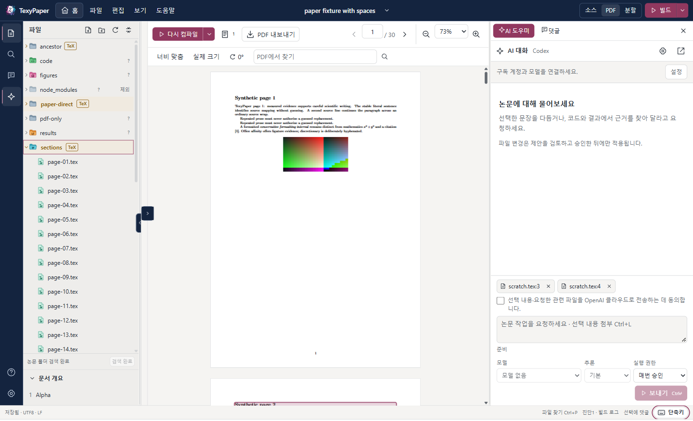

# TexyPaper

**The Sexy LaTeX Editor · v0.0.4**

**로컬과 SSH 서버의 논문을 원래 위치에서 편집하는 Windows용 개인 논문 IDE.** TeX 편집기, 호스트 측 LaTeX 빌드, PDF 미리 보기·원문 탐색, 댓글, 승인 기반 Codex/Claude 작업을 제공합니다. AI 대화는 오른쪽 패널이나 분리한 전용 창에서 사용할 수 있습니다.



<sub>낮 테마 작업 화면. 합성 테스트 논문으로 찍은 화면이며, 어두운 테마와 사용자 지정 색상도 지원합니다.</sub>

Tauri 2 + Rust + React 19 + CodeMirror 6 + PDF.js로 구성한 독립 애플리케이션입니다. Orca·OpenPaper·VS Code를 실행하거나 그 확장 호스트에 연결할 필요가 없습니다. 공동 편집 서비스나 임의의 PDF 레이아웃을 TeX로 복원하는 도구는 아닙니다.

**지원 플랫폼: Windows x64.** macOS 데스크톱 앱은 아직 빌드하거나 검증하지 않았습니다. 소스를 Mac으로 넘겨 작업할 수는 있지만 macOS 실행 파일·설치 파일·지원 기능을 제공한다고 주장하지 않습니다. SSH 서버로 사용하는 macOS/POSIX 호스트와 macOS 데스크톱 지원은 별개입니다. 자체 클라우드 로그인·문서 동기화·실시간 공동 편집은 제공하지 않습니다.

소스: [HSoo-Kim/texypaper](https://github.com/HSoo-Kim/texypaper) · Windows 다운로드: [v0.0.4 릴리스](https://github.com/HSoo-Kim/texypaper/releases/tag/v0.0.4). 실제 실행으로 확인한 범위와 미검증 항목은 [`docs/VERIFICATION.md`](docs/VERIFICATION.md)의 **현재 릴리스**에 구분해 기록했습니다.

이 문서는 구현된 동작과 사용 방법을 설명합니다. **빌드 성공만으로 데스크톱·SSH·실제 모델·설치·메모리 검증이 끝난 것은 아닙니다.** 실행별 증거와 미충족 조건은 별도 [`docs/VERIFICATION.md`](docs/VERIFICATION.md)에 기록하는 것을 기준으로 하며, 이 README는 해당 실행 결과를 대신하지 않습니다. 내부 경계와 저장 구조는 [`docs/ARCHITECTURE.md`](docs/ARCHITECTURE.md)를 참고하세요.

## 실행에 필요한 것

| 용도 | 전제 조건 |
| --- | --- |
| 데스크톱 실행 | Windows x64, Microsoft Edge WebView2 Runtime |
| 로컬 TeX 빌드 | PATH에서 찾을 수 있는 `latexmk`, 선택한 `pdflatex`·`xelatex`·`lualatex`, 필요한 TeX 패키지·글꼴·BibTeX/Biber |
| 소스 ↔ PDF 탐색 | 빌드에 대응하는 SyncTeX 데이터와 호스트의 `synctex`; 비ASCII 경로의 대체 파서는 별도 검증 게이트 적용 |
| SSH 편집 | Windows OpenSSH `ssh.exe`, Linux/macOS POSIX 서버, 서버의 `python3` 3.9 이상, 프로젝트와 사용자 캐시 디렉터리 쓰기 권한 |
| SSH 빌드 | 위 조건에 더해 **서버에** latexmk·선택 엔진·SyncTeX 및 논문 의존성 설치 |
| AI | Windows에 설치한 공식 Codex/Claude Code CLI, 해당 공급자의 지원되는 구독 로그인, 인터넷 연결 |

TeX·Python·SSH·AI CLI는 앱에 포함되지 않으며 TexyPaper가 전역 패키지나 서버 패키지를 자동 설치하지 않습니다. SSH 서버에는 Codex·Claude·Node나 상시 데몬이 필요하지 않습니다. TeX가 없는 서버에서도 파일 편집은 가능하지만 빌드는 `TEX_TOOL_MISSING`으로 실패합니다.

Windows 배포는 현재 사용자용 [NSIS 설치 파일](https://github.com/HSoo-Kim/texypaper/releases/download/v0.0.4/TexyPaper_0.0.4_x64-setup.exe)과 [portable ZIP](https://github.com/HSoo-Kim/texypaper/releases/download/v0.0.4/TexyPaper_0.0.4_windows_x64_portable.zip)입니다. ZIP에는 `texypaper.exe`, 루트 `LICENSE`, `THIRD_PARTY_NOTICES.md`와 전체 `licenses/` 트리가 함께 들어갑니다. [SHA-256 체크섬](https://github.com/HSoo-Kim/texypaper/releases/download/v0.0.4/SHA256SUMS.txt)도 제공합니다. **두 배포 파일 모두 코드 서명이 없어 Windows SmartScreen 경고가 나올 수 있습니다.** 설치·업데이트 검증 범위는 `docs/VERIFICATION.md`를 확인하세요. 새 PC의 WebView2 부트스트랩은 별도 전제입니다.

일상적으로 사용할 때는 **설치 파일(NSIS)을 권장**합니다. 현재 Windows 사용자에게 설치하고 시작 메뉴 바로가기와 제거 프로그램을 등록하며, 바탕 화면 바로가기는 설치 마지막 단계에서 선택할 수 있습니다. 설치 없이 쓰려면 portable ZIP 전체를 풀고 그 안의 `texypaper.exe`를 실행하세요. 라이선스·고지 파일도 같은 묶음으로 보관하세요. 앱 기능은 같고, 기본 실행에서는 두 형태 모두 `%APPDATA%\dev.texypaper.desktop`에 설정을 저장합니다. Portable은 profile까지 실행 파일 옆에 둔다는 뜻은 아닙니다. 실행 파일을 옮겨도 같은 Windows 계정의 설정은 유지되지만, 다른 PC와 자동으로 동기화되지는 않습니다. 업데이트 전에는 작업을 저장하고 **파일 → TexyPaper 완전 종료** 또는 트레이의 **종료**로 기존 앱을 완전히 닫으세요. v0.0.1에서는 트레이의 종료를 사용합니다. 자동 업데이트 설치는 지원하지 않습니다.

## 첫 프로젝트 열기

### 이 컴퓨터

1. **홈**(상단 홈 버튼, `Ctrl+O`)은 프로젝트를 고르고 추가하고 바꾸는 **전용 화면**입니다. 최근 프로젝트가 먼저 나오고 현재 열린 프로젝트에는 **프로젝트로 돌아가기**가 붙습니다. **프로젝트 열기**를 눌러 **이 컴퓨터 → 폴더 선택**을 고르거나 SSH 환경을 추가합니다. 폴더 입력과 SSH 환경 추가는 요청할 때 펼쳐집니다. 홈을 보는 동안에도 열린 프로젝트의 편집 내용·빌드·AI 작업은 그대로 유지되고, 같은 프로젝트로 돌아갈 때는 다시 열지 않습니다. 다른 프로젝트로 실제로 전환할 때만 미저장 변경과 실행 중인 작업을 확인합니다. 프로젝트는 선택한 디렉터리에서 직접 읽고 씁니다. SSH 최근 항목도 연결 전에 도움 프로그램 동의를 다시 받습니다.
2. 화면 구성은 Overleaf와 비슷합니다. 상단에는 **홈** 버튼과 파일·편집·보기·도움말 메뉴, 프로젝트 이름이 있고, 왼쪽 레일에서 **파일·프로젝트 검색·댓글·AI**를 고릅니다. 파일 탐색기는 왼쪽, 댓글과 AI는 오른쪽에 열립니다. 넓은 화면에서는 파일과 AI를 동시에 볼 수 있습니다. 파일 패널에서 `.tex` 파일을 엽니다. 아래쪽 **문서 개요**는 현재 파일의 `\section`·`\subsection`·`\subsubsection`을 `1`, `1.1`, `1.1.1` 번호와 단계별 들여쓰기로 보여 주고, 항목을 누르면 해당 줄로 이동합니다. 별표(`\section*`)는 번호가 없으며, 번호는 소스 순서 기준이라 문서 클래스·사용자 매크로·`\input` 파일을 반영한 컴파일 결과의 번호와 다를 수 있습니다. 주 문서를 수동 지정해야 할 때만 상단 **빌드 옆 화살표 → 주 문서**를 사용합니다.
3. `.tex` 파일을 열어 둔 상태면 바로 컴파일할 수 있습니다. **`Ctrl+S`는 저장 후 컴파일**하고(설정의 `저장 후 자동 빌드`를 끄면 저장만), 입력을 멈춰도 자동 저장 뒤 컴파일됩니다. PDF 쪽 **다시 컴파일**, 상단 **빌드**, `Ctrl+Shift+B`도 같습니다. 주 문서는 따로 지정하지 않아도 이 순서로 찾습니다: 열린 파일의 `% !TeX root = ...` → 직접 고른 주 문서 → `\documentclass`가 있는 열린 파일 → 열린 파일의 폴더와 그 상위 폴더 중 `\documentclass` 파일이 하나뿐인 가장 가까운 폴더. 같은 폴더에 후보가 여럿이면 추측하지 않고 **빌드 옵션 → 주 문서**나 **다시 컴파일** 옆 메뉴에서 고르게 합니다. 직접 고른 주 문서는 `.texypaper/project.json`에 저장됩니다. 로그 버튼의 숫자는 오류·경고 수이며, 누르면 PDF 자리에 **로그 및 출력**이 열립니다. 빌드가 실패하면 마지막으로 성공한 PDF를 '갱신 필요' 상태로 계속 보여 줍니다. 로그는 표시할 PDF가 없을 때만 자동으로 열립니다.
4. 소스·PDF·분할 보기로 전환합니다. 편집기 도구 막대에서 굵게·기울임·절·인용·참조·목록·수식을 선택 영역에 넣을 수 있습니다. 작은 창에서는 가운데 패널 하나와 오버레이 사이드 패널을 사용합니다. 소스와 PDF 사이 구분선을 끌거나 방향키로 움직여 두 창의 폭을 따로 조절하고(더블클릭하면 반반), 가운데 화살표로 한쪽을 접으면 같은 가장자리의 화살표로 이전 비율대로 다시 펼칩니다. `Ctrl+휠`이나 `Ctrl`+`+`/`-`로 소스 글자 크기와 PDF 배율을 각각 조절합니다(앱 전체 확대는 설정의 UI 확대이며 PDF 자체는 편집하지 않습니다).

탐색기는 파일 종류별 컬러 아이콘(TeX·bib·PDF·이미지·코드 등)과, 이름에 따라 색과 기호가 달라지는 폴더 아이콘을 보여 줍니다. `docs`·`src`·`tests`·`results`·`figures`·`sections`·`paper`·`references` 같은 흔한 이름은 각자의 색과 기호를 갖고, 알 수 없는 이름은 회청색 기본 폴더, `node_modules`·`.git` 같은 도구 폴더는 흐리게 표시합니다. 폴더 아이콘은 이름만으로 정하는 꾸밈이며 논문 파일이 있다는 증거가 아닙니다. 아이콘은 이 프로젝트의 원본 SVG 작업물입니다. `.tex`, `.ltx`, `.bib`, `.cls`, `.sty`, `.bst`, `.bbx`, `.cbx`가 **직접** 있는 폴더는 굵은 이름, 황색 밴드와 **TeX** 배지로 표시하고, 하위 폴더에서만 증거를 찾으면 흐린 **TeX** 배지를 붙입니다. 폴더를 펼치기 전에도 보이며 폴더 이름만으로 추측하지 않습니다. 미검색 상태는 논문 파일이 없다는 뜻이 아닙니다. 선택 강조와 논문 표식은 별개이며, 주 TeX에는 `Main` 배지가 붙습니다. PDF 하나만 있다고 LaTeX 프로젝트로 분류하지 않습니다.

자동 검색은 `.git`, `.texypaper`, `node_modules`, `.venv`, `venv`, `__pycache__`를 제외합니다. 설정에서 제외 목록을 볼 수 있고 탐색기에서 명시적으로 열 수 있습니다. 한 번에 최대 20,000개 항목을 조사하고 남은 검색은 **계속 찾기**로 이어갑니다. 파일 생성·이름 변경·이동·삭제를 지원하며, 삭제는 확인 후 프로젝트의 `.texypaper/trash/`로 이동합니다. 프로젝트 휴지통에서 복원할 수 있습니다.

### SSH 서버

1. **SSH 환경 추가**에서 OpenSSH 별칭 또는 호스트 이름을 지정합니다. 필요하면 사용자·포트·개인 키·별도 SSH 설정 파일을 입력합니다. 기존 OpenSSH 설정의 구체적인 `Host` 별칭과 `Include`를 읽으며, wildcard를 서버 목록으로 확장하지 않습니다.
2. 프로젝트 경로는 서버의 `/home/user/paper` 같은 **실제 POSIX 경로**를 입력합니다. Windows에 로컬 미러를 만드는 방식이 아닙니다.
3. 도움 프로그램 안내에 동의합니다. 연결 동안 작은 표준 라이브러리 Python worker를 실행하고, SHA-256으로 검증한 버전을 `~/.cache/texypaper/worker/<sha256>/`에 저장합니다. pip·npm·root 설치나 공개 포트는 사용하지 않습니다.
4. 처음 보는 서버는 OpenSSH가 제시한 전체 지문을 확인한 뒤 승인하세요. 암호·키 암호·keyboard-interactive 응답은 앱의 인증 창에서 입력합니다. 취소하면 연결도 중단됩니다.

기존 키·SSH agent·ProxyJump 설정을 사용하지만 ssh-agent 서비스를 자동 시작하거나 권한을 올리지 않습니다. **변경된 호스트 키는 오류**이며, 앱이 known_hosts를 지워 우회하지 않습니다. SSH 설정은 신뢰할 수 있는 파일만 사용하세요. 선택한 연결에 대한 OpenSSH 설정 해석에는 `Match exec` 같은 사용자 설정 동작이 포함될 수 있습니다.

연결이 끊기면 저장·빌드를 완료로 보고하지 않고 마지막 PDF와 편집 복구 내용을 유지합니다. **다시 연결** 후 원본 revision과 불확실한 트랜잭션 상태를 확인해야 합니다. 실패한 쓰기를 자동 재전송하지 않습니다. 원격 **외부에서 열기**는 다운로드한 복사본이며 서버 원본을 직접 편집하는 경로가 아닙니다.

## 편집, 충돌과 복구

- TeX 구문 강조, 괄호 짝, 들여쓰기, 줄 번호, 찾기/바꾸기와 로드한 TeX/Bib 의존성의 citation·label 완성을 제공합니다. LaTeX 명령(`\section`, `\centering` 등)은 팔레트와 무관하게 초록색으로 표시합니다. 단축키는 Overleaf 기본값을 따릅니다: 줄 삭제 `Ctrl+D`, 주석 전환 `Ctrl+/`, 굵게·기울임 `Ctrl+B`/`Ctrl+I`, 대소문자 변환, 줄 이동·복사, 접기, `Ctrl+클릭` 다중 커서, `Alt`+드래그 직사각형 선택. 코드 파일은 필요한 언어 모드를 지연 로드하고 알 수 없는 텍스트는 일반 텍스트로 엽니다. 언어 서버는 자동 기동하지 않습니다.
- 입력이 700ms 쉬면 자동 저장합니다. IME 조합 중에는 저장을 미룹니다. `Ctrl+S`는 대기 중인 소스를 즉시 저장하고 바로 컴파일합니다. 자동 저장 뒤의 자동 빌드는 별도로 800ms debounce됩니다.
- 저장 직전에 SHA-256을 비교하고 같은 파일시스템의 임시 파일을 flush한 뒤 교체합니다. UTF-8 BOM과 기존 줄바꿈을 보존합니다. 파일 크기·수정 시각만으로 충돌 여부를 결정하지 않습니다.
- 외부에서 수정한 파일이 깨끗한 버퍼면 다시 읽고, 미저장 편집이 있으면 `FILE_CONFLICT`를 표시합니다. **비교 / 다시 불러오기 / 복사본 저장** 중에서 선택하세요. 다시 불러오기는 내 변경을 버리는 동작이므로 확인이 필요합니다.
- 미저장 내용은 앱 전용 복구 기록에 남깁니다. 재시작·재연결 시 원본 hash와 트랜잭션 상태를 함께 확인합니다. `TRANSACTION_PARTIAL`이면 영향 경로와 보존된 journal을 확인하고, 무작정 같은 작업을 재실행하지 마세요.
- 프로젝트 전환·종료 시 미저장 내용에는 저장/버리기/취소, 실행 작업에는 중지 여부를 묻습니다. 저장 실패를 무시하고 다른 프로젝트로 넘어가지 않습니다.
- 프로젝트별로 열린 탭, 활성 파일, 소스 커서·선택·스크롤, 소스/PDF 분할 비율과 패널 폭, PDF 페이지·확대·회전, 대화 기록 페이지와 읽던 메시지를 복원합니다. PDF는 **같은 빌드와 파일 hash**에만 위치를 재사용하며 새 PDF는 처음부터 엽니다. 이 기록은 로컬·SSH 프로젝트 모두 현재 컴퓨터의 앱 데이터에 저장되며 다른 PC로 동기화되지 않습니다. 실행 권한이나 클라우드 전송 동의를 복구 기록에서 되살리지 않습니다.
- 편집기의 `Ctrl+Z`와 저장된 트랜잭션 되돌리기는 다릅니다. 앱의 **마지막 소스 변경 되돌리기**는 journal 기반이며, 결과 파일이 이후 바뀌었다면 덮어쓰지 않고 거부합니다. AI 제안에도 적용 후 되돌리기가 있습니다.
- 4MiB보다 큰 파일은 우선 읽기 전용입니다. 메모리 경고를 확인한 뒤 **이 파일 편집 허용**을 명시적으로 선택할 수 있습니다. UTF-8이 아닌 파일은 묵시적으로 변환하지 않습니다. **변환한 복사본 저장**은 읽을 수 없는 바이트를 대체 문자로 바꿀 수 있으며 원본은 유지합니다.

이 보호는 **낙관적 충돌 검출**입니다. 외부 편집기는 TexyPaper의 잠금을 따르지 않으므로 최종 hash 검사와 교체 사이까지 포함하는 파일시스템 차원의 compare-and-swap을 보장하지는 않습니다. 다중 파일 변경도 복구 가능한 앱 트랜잭션이지 파일시스템 전체 원자성이 아닙니다.

## 빌드와 PDF

빌드는 언제나 프로젝트가 있는 호스트에서 실행합니다. SSH 논문을 Windows로 통째로 복사해 빌드하지 않습니다. 설정을 변경하면 `.texypaper/project.json`에 주 문서·엔진·프로필·자동 빌드 여부를 저장합니다.

- **기본(Basic)**: `latexmk -norc`, 선택 엔진의 `-no-shell-escape`, SyncTeX와 recorder를 사용합니다. latexmk rc 파일을 무시한다는 것이며, TeX 자체를 OS 샌드박스로 만드는 것은 아닙니다. 신뢰할 수 없는 논문을 안전한 코드라고 간주하지 마세요.
- **프로젝트(Project)**: 기존 latexmk 설정을 사용합니다. 설정에 있는 명령이 실행될 수 있으므로 명시적 신뢰 확인을 받아야 합니다. 신뢰는 프로젝트 JSON이 아닌 클라이언트 앱 데이터에 별도로 저장합니다.

한 번에 하나의 빌드만 돌리고 저장이 겹치면 최신 재빌드 요청으로 합칩니다. 기본 제한 시간은 120초입니다. 중지는 앱이 시작한 프로세스 트리에 적용합니다. 실패·취소·시간 초과 시 마지막 성공 PDF를 남기되 오래된 상태로 표시합니다. 진단과 제한된 원시 로그에서 누락된 패키지·글꼴·Biber 등 실제 오류를 확인하세요.

PDF에는 페이지 이동, 너비 맞춤·실제 크기·확대/축소, 90도 회전, 페이지별 텍스트 검색과 PDF 내보내기가 있습니다. 별도로 연 참고 PDF는 무관한 주 문서 재빌드로 교체하지 않습니다. **빌드 PDF로 돌아가기**로 복귀합니다. PNG/JPEG/WebP와 비실행 SVG 미리 보기, 기타 바이너리의 메타데이터·외부 열기도 제공합니다.

### PDF의 글을 고칠 때

1. 렌더된 PDF 텍스트를 선택하고 **원문 보기 / 텍스트 수정 / AI로 수정 / 댓글** 중 하나를 선택합니다.
2. 텍스트 수정은 현재 PDF·SyncTeX·컴파일 당시 소스 snapshot·현재 소스 hash를 함께 확인합니다. SyncTeX 위치만 보고 문자 오프셋을 추측하지 않습니다.
3. 하나의 소스 문단 안에서 유일하게 증명된 리터럴 산문 구간만 전후 차이 검토로 보냅니다. 기본 입력은 일반 텍스트이며 TeX 특수 문자를 escape합니다. raw TeX는 소스 편집기에서 고칩니다.
4. 적용 시 hash를 다시 확인하고 하나의 되돌릴 수 있는 트랜잭션으로 저장한 뒤 재빌드합니다. 소스가 바뀌었거나 선택이 만료되면 `PDF_STALE`로 거부하므로 다시 빌드하고 선택하세요.

반복 문장, 복잡한 매크로·수식·인용·표, 파일/문단 경계를 넘는 선택, 비연속 다단 선택, 모호한 ligature·하이픈, 검증할 수 없는 좌표는 자동 대체하지 않습니다. 후보 원문으로 이동해 명시적으로 범위를 고치거나 검토 가능한 AI 제안을 사용하세요. 단독 참고 PDF는 볼 수 있고 댓글을 달 수 있지만 대응 빌드가 없으면 TeX 편집 권한을 얻지 않습니다. Unicode 경로의 대체 SyncTeX 파서도 동등성 검증을 생략한 채 편집을 허용하지 않습니다.

## 댓글

소스 또는 PDF 선택에서 댓글을 만들고 답글·수정·삭제·해결·다시 열기를 사용할 수 있습니다. 댓글은 프로젝트의 실제 호스트에 `.texypaper/comments.json`으로 저장됩니다. TeX `%` 주석으로 삽입하지 않으며 HTML/Markdown을 실행하지 않습니다.

앱 소스 변경에는 byte anchor를 이동하고, 외부 변경에는 같은 파일에서 인용문과 앞뒤 문맥이 유일하게 일치할 때만 다시 연결합니다. 찾을 수 없거나 모호하면 **연결 끊긴 댓글(Orphaned)**로 표시하므로 선택 후 재연결하세요. 소스 기반 댓글은 재빌드 후 SyncTeX 위치를 갱신합니다. PDF 전용 댓글은 해당 PDF hash에만 붙으며 새 PDF의 같은 페이지 번호로 임의 이동하지 않습니다. 외부 sidecar 수정은 충돌로 처리하고, 소스 저장 후 댓글 갱신만 실패한 경우도 별도 경고를 표시합니다.

## Codex와 Claude

AI 채팅 상단의 **설정**에서 공급자를 고르고 **연결 새로 고침**으로 공식 CLI와 계정을 확인합니다. 공급자·로그인·실행 파일 경로는 별도 설정에 두고, 자주 바꾸는 **모델·추론 수준·실행 권한**은 입력창 아래 보내기 버튼 왼쪽에서 고릅니다. 지원 프로토콜 기준은 **Codex 0.153.2 / Claude Code 2.1.300**입니다. 버전 불일치·사용 불가 모델·한도·인증·네트워크 실패는 명시적으로 표시하며 다른 유료 API로 전환하지 않습니다.

- **Codex**: **공식 로그인 → 인증 페이지 열기**에서 ChatGPT 로그인을 마칩니다. `CODEX_HOME=<app-data>/providers/codex`라는 TexyPaper 전용 공식 저장소를 쓰므로 기존 Codex에서 로그인했어도 한 번 더 필요할 수 있습니다. 기존 토큰이나 전역 설정을 복사하지 않습니다. 공식 app-server의 전체 모델 메타데이터와 아래 공식 모델 목록을 함께 사용합니다.
- **Claude**: 기존 공식 CLI의 `claude.ai` 구독 계정을 사용합니다. 필요하면 터미널에서 `claude auth login`을 실행한 뒤 앱에서 새로 고칩니다. Console/API 키/타사 로그인은 구독으로 간주하지 않습니다. 공식 초기화 메타데이터와 공식 모델 목록의 정확한 ID를 사용하며, 실패 시 다른 모델을 대신 고르지 않습니다.

모델 선택은 **GPT-6 이상에서 계열별 최신 버전**, **Claude는 Opus·Sonnet·Haiku 5.5만** 표시합니다. Sol 6.1이 있으면 Sol 6은 제외하지만, 6.1이 없는 Astra·Luna는 6을 유지합니다. 현재 기본 목록은 **GPT-6 Astra·Luna, GPT-6.1 Sol·Terra**, **Claude Opus 5.5, Sonnet 5.5, Haiku 5.5**입니다. GPT-5.6, Claude의 이전 버전과 Fable은 제외합니다. CLI가 반환한 추가 GPT 계열도 각각 최신 버전을 선택하며, 서로 다른 계열이나 변형을 대신 숨기지 않습니다. Claude는 지원하는 세 계열의 5.5 별칭·날짜 snapshot만 합치고, 직접 입력으로 제외 모델을 다시 선택하는 경로도 제공하지 않습니다. 출처: [OpenAI 모델 목록](https://developers.openai.com/api/docs/guides/latest-model), [Claude 모델 목록](https://platform.claude.com/docs/en/models/overview).

CLI의 축약 목록에서 빠진 공식 모델도 선택할 수 있습니다. 이 경우 **CLI 목록에 없는 공식 모델**이라는 안내를 표시하며, 선택한 ID를 그대로 전송합니다. 공식 API 모델이라고 해서 Codex/Claude의 구독 연결에서도 사용할 수 있다는 뜻은 아닙니다. 구독에서 지원하지 않거나 접근이 거부되면 공급자 오류를 표시하고, 다른 모델이나 API 결제로 전환하지 않습니다.

추론 수준은 선택한 모델의 CLI 메타데이터에 있는 단계만 제공합니다. 해당 메타데이터가 없는 공식 모델은 **공급자 기본값**으로 요청하며 추론 단계를 추측하지 않습니다. 공급자나 모델을 바꿔 지원되지 않게 된 추론 설정은 초기화합니다.

두 공급자 CLI는 **Windows 클라이언트에서만** 실행합니다. SSH URI를 CLI cwd로 넘기지 않습니다. 개인 제어 디렉터리와 TexyPaper의 일곱 MCP 도구(`list_files`, `read_text`, `search_text`, `get_build_status`, `propose_changes`, `propose_command`, `get_command_status`)를 통해 선택한 로컬/SSH 프로젝트에 접근합니다. 공급자 자체의 shell·직접 파일 쓰기 도구는 비활성화하며, 명령 실행은 아래의 앱 권한 절차를 거칩니다.

프롬프트를 보내기 전 첨부와 전송 경로를 확인하세요. **소스·PDF에서 드래그한 글(또는 현재 줄)은 `Ctrl+L`이나 우클릭 → AI에 첨부로 명시적으로 첨부한 것만** 입력창의 칩으로 쌓이고(칩에서 제거하거나 해당 위치로 이동), 선택만 해서는 공유되지 않습니다. 클라우드 전송 동의는 **공급자(OpenAI·Anthropic)별로 처음 한 번** 체크하면 기억되며, 입력창에 작은 안내와 **동의 철회**가 남습니다. 관련 소스·코드·결과 일부가 선택한 클라우드 공급자에게 전송됩니다. 기본 읽기 도구는 비밀 키·`.env*`·credential·앱 인증/복구 저장소를 제외합니다. `propose_changes`의 쓰기 대상은 TeX/Bib/style 계열로 제한합니다. 별도로 승인한 명령은 이 파일 읽기·쓰기 제한과 동일한 샌드박스 안에서 실행되는 것이 아닙니다. AI 대화 글자 크기는 대화 창 위에서 `Ctrl+휠`·`Ctrl`+`+`/`-`로 조절하며 도킹·분리 창 모두 저장됩니다.

**모델 응답 또는 제안 생성은 저장 완료가 아닙니다.** `propose_changes`는 변경 제안만 만들고 **승인 대기**로 남깁니다. diff와 근거 파일/줄을 확인한 뒤 사람이 **적용(Apply)**해야 저장됩니다. 거절·취소는 소스를 바꾸지 않습니다. 적용 직전에 모든 base hash를 재검사하며 충돌이면 제안을 보존하고 새 원본으로 다시 작성해야 합니다. 한 번에 AI 작업 하나만 실행하고, 프로세스는 필요할 때만 시작합니다. 세션 ID를 보존해 대화를 재개하며 항상 켜 둔 모델 서버는 없습니다.

### 프로젝트 코드 실행

AI는 실제 프로젝트 호스트에서 실행할 명령을 `propose_command`로 제안합니다. 로컬 프로젝트는 이 컴퓨터, SSH 프로젝트는 서버에서 실행합니다. 모델은 권한을 바꾸거나 자신이 제안한 명령을 승인할 수 없습니다.

| 실행 권한 | 동작 |
| --- | --- |
| 실행 안 함 | 새 명령 제안을 차단하고, 대기 제안을 거절하며 실행 중인 명령을 중지 |
| 매번 승인 — 기본값 | 명령마다 환경·작업 폴더·정확한 argv·제한 시간을 확인하고 승인 또는 거절 |
| 세션 허용 | 위험 안내와 체크박스를 확인한 뒤, 현재 프로젝트 연결의 이후 명령을 개별 승인 없이 실행 |

세션 권한은 프로젝트 전환·재연결·앱의 실제 종료 때 초기화됩니다. 트레이로 숨기는 것은 종료가 아니므로 작업과 권한이 유지됩니다. 언제든 **매번 승인**이나 **실행 안 함**으로 되돌릴 수 있습니다. 실행 카드에서 stdout/stderr, 종료 코드, 잘린 출력 여부를 확인하고 개별 명령을 중지할 수 있습니다. 한 번에 명령 하나만 실행하며, 기본 제한 시간은 120초입니다.

**작업 폴더 제한은 OS 샌드박스가 아닙니다.** 승인한 명령과 스크립트는 해당 로컬/SSH 계정 권한으로 실행되어 프로젝트 밖의 파일·네트워크·시스템에도 영향을 줄 수 있습니다. 명령의 부작용은 자동 되돌리기 대상이 아닙니다. 암묵적으로 shell 문자열을 실행하지 않으며, 인터프리터를 포함해 승인된 argv 그대로 실행합니다.

### 채팅 창과 트레이

- 채팅 상단의 **별도 창으로 열기**로 분리하고 **메인 창에 붙이기**로 복귀합니다. 대화·입력 초안·읽던 위치·진행 중인 작업·승인 대기는 메인 컨트롤러가 계속 보관합니다. 분리 창의 X도 채팅을 메인 창으로 돌려보냅니다. 이전 메시지를 읽거나 선택하는 동안 새 응답이 화면을 끝으로 끌어내리지 않습니다.
- 메인 창의 **첫 X**에서는 **트레이에서 계속 실행 / 완전 종료 / 취소**를 고릅니다. 트레이 동의를 저장한 뒤에는 X로 메인 창과 분리 채팅을 함께 숨기며 AI·명령·빌드는 계속 진행합니다.
- **파일 → TexyPaper 완전 종료**, `Ctrl+Shift+Q`, 트레이의 **종료**는 작업 중지와 미저장 내용 처리를 확인한 뒤 앱을 끝냅니다. 트레이의 **창 열기**, 아이콘 더블클릭 또는 같은 Windows 사용자·profile로 TexyPaper를 다시 실행하면 기존 창을 복원합니다. 다른 `--data-dir`은 별도 인스턴스입니다. Windows 자동 시작은 설정하지 않습니다.


Claude 구독 연동은 개인 사용 전제입니다. 다른 사용자에게 배포하기 전에는 [공식 구독 지원 안내](https://support.claude.com/en/articles/15036540-use-the-claude-agent-sdk-with-your-claude-plan)와 [Agent SDK 정책](https://code.claude.com/docs/en/agent-sdk/overview)을 다시 확인해야 합니다.

## 언어와 화면 설정

설정에서 **한국어 / English**, **시스템 / 밝게 / 어둡게**와 100–200% UI 확대를 선택합니다. UI 언어만 바뀌며 논문 원문이나 AI 출력 언어를 강제로 번역하지 않습니다. 선택은 앱 데이터에 저장합니다.

기본 화면은 네이비 chrome(낮 `#14243f`, 밤 `#0c1629`)과 절제한 버건디·로즈 강조(낮 `#91385f`, 밤 `#d78fb5`)를 사용합니다. 낮에는 따뜻한 회백색 배경과 흰 편집 영역, 밤에는 저채도 남색 면색을 사용합니다. 앱 아이콘은 원본 로고의 바깥 남색 배경을 투명하게 처리했습니다. 낮(light)과 밤(dark)의 **강조색·배경·편집 영역·사이드바** 색상을 각각 저장할 수 있습니다. 기존 사용자 팔레트는 그대로 두며, LaTeX 명령의 초록색은 팔레트와 별개의 고정색이고 초록색은 의미상 성공 표시나 선택형 프리셋에서도 사용할 수 있습니다. HEX 또는 색상 선택기를 사용하고, 배경색을 바꾸면 관련 면색을 함께 제안합니다. 프리셋, 최근 사용한 최대 8개 팔레트, 기본값 초기화가 있습니다. 글자 대비와 오류/경고색 구분 조건을 충족하지 못하는 팔레트는 적용하지 않습니다.

사용자 팔레트에서도 **PDF 용지는 흰색**이고, 오류·경고·논문 폴더 표식은 의미를 유지합니다. OS의 reduced motion/high contrast와 저전력·투명 효과 끄기 설정을 고려합니다. 화면색 변경은 PDF 자체를 반전하거나 편집하지 않습니다.

상태 표시줄 오른쪽 아래(홈에서는 오른쪽 위)의 **단축키** 버튼과 도움말 메뉴에서 분류별 전체 목록을 검색해 볼 수 있습니다. 아래는 자주 쓰는 앱 단축키입니다. 소스 편집 단축키는 위 편집 설명과 앱 안 도움말을 참고하세요.

| 단축키 | 동작 |
| --- | --- |
| `Ctrl+O` | 홈: 프로젝트 선택·추가·전환 |
| `Ctrl+P` | 빠른 파일 열기; `>`로 시작하면 프로젝트 본문 검색 |
| `Ctrl+S` / `Ctrl+Enter` / `Ctrl+.` | 저장 후 컴파일 (자동 빌드를 끄면 저장만). AI 입력창의 `Ctrl+Enter`는 전송 |
| `Ctrl+Shift+B` | 즉시 빌드 |
| `Ctrl+Alt+J` | 현재 소스 위치에서 PDF 탐색(소스 도구 막대 버튼도 있음). PDF에 위치를 강조 표시 |
| PDF에서 `Ctrl+클릭` | 클릭한 위치의 소스로 이동. 소스의 `Ctrl+클릭`은 Overleaf처럼 다중 커서 |
| `Ctrl+L` | 선택한 글(없으면 현재 줄)을 AI 대화에 첨부 |
| `Ctrl+J` | 댓글 패널 열기·닫기 |
| `Ctrl+Shift+C` | 선택에 댓글 (이전 버전의 `Ctrl+Shift+A`는 Overleaf의 변경 추적 단축키와 겹쳐 제거) |
| `Ctrl+휠` / `Ctrl`+`+` / `Ctrl`+`-` | 포인터 아래 또는 선택한 소스·PDF·AI 대화의 글자·배율 조절 |
| `Ctrl+Shift+Q` | 작업·미저장 변경을 확인한 뒤 앱 완전 종료 |
| `Escape` | 팝업·선택 닫기, 열린 SSH 인증 요청 취소 |

## 업데이트 알림

설정의 **업데이트 알림**은 새 버전을 알려 주는 기능뿐입니다. 설치 파일을 자동 다운로드·실행하거나 앱을 자동 교체하지 않습니다. 새 버전 알림의 **릴리스 확인**은 사용자가 눌렀을 때 HTTPS 페이지를 엽니다.

- 운영 피드 대상은 [HSoo-Kim/texypaper](https://github.com/HSoo-Kim/texypaper)입니다. 배포 빌드에 기본 피드를 주입하며, 아직 게시되지 않은 릴리스를 성공한 업데이트로 표시하지 않습니다.
- GitHub 저장소 주소 `https://github.com/HSoo-Kim/texypaper`를 지정하면 GitHub의 `/releases/latest` 메타데이터를 읽습니다. 해당 API의 HTTPS latest URL도 사용할 수 있습니다.
- 자체 HTTPS JSON 피드는 `{ "version": "0.0.3", "url": "https://example.org/releases/0.0.3", "notes": "변경 설명" }` 형식입니다. 이는 **형식 예시이며 실제 TexyPaper 배포 주소가 아닙니다**. `notes`는 선택 사항입니다.
- 버전은 SemVer로 비교하며 stable 새 버전만 알립니다. URL은 인증 정보·query·fragment 없는 HTTPS여야 합니다. 리다이렉트를 자동 추적하지 않습니다.
- 자동 확인은 마지막 확인 후 **24시간** 간격으로 제한합니다. **지금 확인**은 간격 제한을 우회하지만 알림을 꺼 놓은 상태를 우회하지는 않습니다. 실패도 상태로 남기고 기존에 확인한 새 버전 알림을 지우지 않습니다.
- 배포 빌드 시 `TEXYPAPER_UPDATE_FEED_URL` 환경 변수로 기본 피드를 넣을 수 있습니다. 이는 **컴파일 시점** 설정이며, 저장된 `updates.feedUrl`이 있으면 그 값이 우선합니다. 저장된 빈 문자열도 자동으로 운영 주소가 되지 않습니다.

## 개발과 패키징

Windows PowerShell에서 저장소 루트를 작업 디렉터리로 사용합니다. Node.js(이 구현 환경의 기준은 24.x), `pnpm@12.16.1`, Rust edition 2024를 지원하는 MSVC 도구체인, Visual Studio C++ Build Tools/Windows SDK와 WebView2가 필요합니다. 정확한 JS/Rust 의존성은 두 lockfile이 기준입니다. 아래 명령은 도구가 이미 준비되었다는 전제이며 전역 설치 명령을 포함하지 않습니다.

```powershell
pnpm install --frozen-lockfile
pnpm dev -- -- --data-dir "$env:TEMP\texypaper-dev-isolated"
```

위 개발 실행은 보이는 앱 창을 엽니다. 사용자의 허가 없이 백그라운드 작업에서 실행하지 마세요. Debug 실행은 기본 사용자 profile을 열지 못하며 명시적 `--data-dir`이 필요합니다. 개발용 경로에는 실제 사용자 설정·계정 저장소를 지정하지 마세요. `pnpm dev:web`은 프런트엔드 개발 서버만 실행합니다. 브라우저 탭만 열어서는 native 파일/SSH/프로세스 명령을 사용할 수 없습니다.

개별 검사와 Windows x64 NSIS 빌드:

```powershell
pnpm build
pnpm test
cargo fmt --manifest-path src-tauri/Cargo.toml --check
cargo test --manifest-path src-tauri/Cargo.toml --locked
cargo clippy --manifest-path src-tauri/Cargo.toml --locked --all-targets -- -D warnings
pnpm tauri build --ci --target x86_64-pc-windows-msvc --bundles nsis -- --locked
```

`pnpm typecheck`는 타입 검사만 합니다. 전체 빌드 스크립트는 외부 명령마다 종료 코드를 확인하며 실패 시 중단합니다.

```powershell
powershell.exe -NoProfile -ExecutionPolicy Bypass -File scripts/windows-build.ps1
```

실행 파일은 `src-tauri/target/x86_64-pc-windows-msvc/release/texypaper.exe`, NSIS 패키지는 같은 release 아래 `bundle/nsis/TexyPaper_0.0.4_x64-setup.exe`에 생성하도록 구성되어 있습니다. `CARGO_TARGET_DIR`을 지정하면 그 경로를 사용합니다. 실제 생성 여부와 설치 결과는 별도로 확인해야 합니다.

```powershell
$app = (Resolve-Path 'src-tauri/target/x86_64-pc-windows-msvc/release/texypaper.exe').Path
& $app --data-dir 'C:\TexyPaperData\isolated-session' --open 'C:\Papers\my-paper'
```

`--data-dir`은 설정·복구·WebView2·Codex 로그인까지 분리합니다. 다른 data-dir에서 로그인했다고 현재 저장소가 인증된 것은 아닙니다. `--open`은 로컬 프로젝트를 실제 production 경로 검증을 거쳐 엽니다.

### 실제 앱 smoke와 메모리 측정

**사용자 논문을 테스트 입력으로 쓰지 마세요. 아래 smoke·메모리 명령은 실제로 보이는 앱 창을 실행하며, 실행 전에 사용자의 명시적 허가가 필요합니다. 백그라운드 전용 작업에서는 실행하지 마세요.** 트레이·마우스 자동화는 기존 `--headed`/`-Headed` 안전 게이트도 통과해야 합니다. 일반 suite는 headless 도구가 아닙니다. 스크립트는 합성 fixture를 만들며 실제 release exe와 WebView2 CDP에 연결합니다. 매 실행마다 기존 결과가 없는 새로운 **ASCII 경로**를 `--output`에 지정하세요. fixture 생성기를 smoke 출력 폴더에 미리 실행하지 마세요. smoke가 자체 fixture 하위 폴더를 생성합니다.

```powershell
$app = (Resolve-Path 'src-tauri/target/x86_64-pc-windows-msvc/release/texypaper.exe').Path
$run = Join-Path $env:TEMP ('texypaper-evidence-' + [guid]::NewGuid().ToString('N'))

pnpm smoke:preferences --binary $app --output (Join-Path $run 'preferences')
pnpm smoke:usability --binary $app --output (Join-Path $run 'usability')
pnpm smoke:desktop --binary $app --output (Join-Path $run 'desktop')
pnpm smoke:ssh --binary $app --output (Join-Path $run 'ssh')
pnpm smoke:agents --binary $app --live --auth-timeout-seconds 600 --output (Join-Path $run 'agents')
pnpm measure:memory -AppPath $app -DurationSeconds 120 -Provider codex -AuthenticationTimeoutSeconds 600 -OutputDirectory (Join-Path $run 'memory')
```

메모리의 `-OutputDirectory`는 **존재하지 않는 디렉터리**여야 합니다. `--live` 없이 에이전트 성공으로 처리하지 않으며 로그인 대기 시간은 로그인을 대신하지 않습니다. 필요한 공식 인증 창을 직접 완료하세요. 재사용할 인증 데이터가 필요하면 정상 사용자 app-data가 아닌 smoke 전용 저장소를 쓰세요. 에이전트 smoke는 `--data-dir`, 메모리 측정은 `-AuthenticationDataDirectory`를 받습니다.

표준 메모리 판정은 실제 Windows 디스플레이 배율 100%에서 수행합니다. 현재 배율을 바꾸지 않고 진단 수치만 수집하려면 `-AllowNonstandardDisplayScale`을 명시하세요. 이 옵션은 OS 설정을 변경하지 않으며, 실제 배율이 100%가 아니면 나머지 측정이 끝나도 표준 판정과 전체 결과는 실패로 남습니다. CDP의 2× 렌더러 에뮬레이션은 실제 Windows 배율 측정으로 표시하지 않습니다.

설치까지 검사하려면 생성한 NSIS 실행 파일을 정확히 지정합니다. 기존 TexyPaper 설치가 있으면 격리 설치 검사는 덮어쓰지 않고 거부합니다.

```powershell
pnpm smoke:desktop --binary $app --installer 'C:\Builds\TexyPaper_0.0.4_x64-setup.exe' --output (Join-Path $run 'installer-desktop')
```

위 설치 파일 경로는 사용자가 실제 생성한 파일로 바꾸어야 하는 입력 예시입니다. 다음 통합 실행도 보이는 앱 창을 실행하므로 사용자 허가가 필요하며, 설치된 도구와 이름이 정확히 `TexyPaper_0.0.4_x64-setup.exe`인 NSIS 산출물을 요구합니다.

```powershell
powershell.exe -NoProfile -ExecutionPolicy Bypass -File scripts/windows-build.ps1 -RunSmoke -LiveAgents -MeasureMemory -OutputDirectory (Join-Path $env:TEMP ('texypaper-full-' + [guid]::NewGuid().ToString('N')))
```

SSH smoke는 개발 전용 `ssh2`로 loopback SSH와 ProxyJump 호스트를 만들고 **WSL `Ubuntu-24.04`의 실제 Python/TeX worker**를 실행합니다. Windows `ssh.exe`·`ssh-keygen.exe`, WSL 배포판, Linux의 Python ≥3.9·latexmk·pdfLaTeX·SyncTeX가 필요합니다. 다른 등록 배포판은 `--distribution`으로 지정할 수 있습니다. 누락된 도구를 자동 설치하거나 로컬 빌드를 원격 빌드로 치환하지 않습니다. CDP가 보안 정책에 막히면 그 차단을 해결해야 하며 컴포넌트 테스트를 실제 UI 증거로 대체하지 않습니다.

fixture만 만들려면 별도의 새 디렉터리를 사용합니다.

```powershell
node scripts/create-smoke-fixtures.mjs --output (Join-Path $env:TEMP ('texypaper-fixtures-' + [guid]::NewGuid().ToString('N')))
```

저메모리 설계는 단일 editor·PDF document/worker, 최대 3개 canvas, 깨끗한 비활성 editor state 최대 8개/소스 cache 8MiB 등을 사용합니다. **앱+전용 WebView2의 private working set 최대 300MiB는 측정 목표이지 하드 한도가 아닙니다.** 리브랜딩 이전 개발 빌드의 Windows 배율 125% 측정에서는 표준 작업 최대 282.7MiB, 20회 전환 후 같은 상태 증가 12.0MiB였습니다. 이는 현재 TexyPaper v0.0.4나 분리 채팅 창을 포함한 최신 빌드의 측정값이 아니며, 100% 배율 표준 판정도 아닙니다([`docs/VERIFICATION.md`](docs/VERIFICATION.md)의 이전 기준선). 메모리 스크립트는 워밍업 후 120초 동안 1초 간격 표본, 반복 전환과 별도 high-DPI/실제 AI 단계를 수행하며 TeX·SSH·AI 프로세스를 별도 항목과 전체 합계로 보고합니다. commit을 private working set으로 바꾸어 보고하지 않으며 원격 호스트 비용을 0으로 간주하지 않습니다.

### Mac 개발자에게 소스 넘기기

같은 [저장소](https://github.com/HSoo-Kim/texypaper)의 소스와 두 lockfile, `THIRD_PARTY_NOTICES.md` 및 `licenses/`를 함께 전달하세요. 사용자 profile, 인증 정보, 논문·복구 내용이나 기존 smoke 산출물을 소스에 섞지 마세요. 소스의 Node/pnpm/Rust 버전을 맞춘 뒤 Windows 전용 프로세스·OpenSSH·WebView·트레이 경계부터 별도로 검토해야 합니다. `scripts/windows-build.ps1`과 Windows NSIS/exe는 Mac용 빌드 경로가 아닙니다. 현재 macOS 빌드 명령·성공 결과·DMG는 제공하지 않습니다.


## 데이터와 라이선스

앱의 per-user 데이터 디렉터리는 Tauri 식별자 `dev.texypaper.desktop` 기준이며 `--data-dir`로 재지정할 수 있습니다. 설정·최근 프로젝트·복구 내용·AI의 보이는 대화 기록·CLI가 소유한 Codex 계정 정보가 포함될 수 있으므로 통째로 공개하지 마세요. 프로젝트의 `.texypaper/comments.json`과 `project.json`은 이동 가능한 데이터입니다. build/transactions/trash는 생성물·복구 기록이므로 임의 삭제 전에 미완료 작업을 확인하세요.

### 이전 Paperdock 데이터의 일회성 이전

- 먼저 이전 앱을 **트레이의 종료**로 완전히 닫으세요. 이전 소프트웨어는 새 잠금 규약을 따르지 않으므로 두 앱이 같은 프로젝트를 동시에 쓰는 상황의 원자성을 보장하지 않습니다.
- 기본 사용자 profile은 `%APPDATA%\dev.paperdock.desktop`만 있고 새 `%APPDATA%\dev.texypaper.desktop`이 없을 때 디렉터리 자체를 이동합니다. 설정·최근 프로젝트·복구·대화·공급자 저장소를 개별 복사하지 않으며, 인증 파일이나 토큰 내용을 읽거나 복사하지 않습니다. 실행 중인 이전 profile 잠금, 양쪽 디렉터리의 동시 존재, symlink/reparse 경로는 명시적 오류로 중단합니다. 사용자가 `--data-dir`을 지정하면 이 기본 profile 이전을 수행하지 않습니다.
- 로컬 및 SSH 프로젝트는 새 `.texypaper`가 없을 때만 이전 `.paperdock` 디렉터리를 이름 변경합니다. 두 디렉터리가 함께 있으면 충돌로 중단하며 자동 병합·삭제하지 않습니다. symlink나 프로젝트 밖으로 이어지는 경로, 잘못된 복구/빌드 레코드도 무시하지 않고 오류로 남깁니다.
- 프로젝트 설정·댓글·journal·휴지통과 원본 파일을 보존하고 workspace identity를 바꾸지 않습니다. 인식한 복구/빌드 레코드의 내부 경로만 새 metadata 위치에 맞춥니다. 사용자 논문·댓글·메시지 본문의 이름은 일괄 치환하지 않습니다. 이전 PDF는 보존하지만 기존 SyncTeX의 비공개 경로가 남아 있으므로 새로 빌드하기 전에는 그 PDF로 소스 수정 권한을 얻지 못합니다.
- 충돌·경로 오류가 있으면 두 디렉터리를 그대로 보존하고 백업 후 원인을 해결하세요. 임의로 한쪽을 삭제하거나 복구 journal을 지우지 마세요. 이전 앱의 metadata 이름은 이후에도 자동 검색과 AI 파일 접근에서 보호 대상으로 남습니다.


직접 작성한 코드는 [MIT License](LICENSE)로 제공합니다. 제3자 구성 요소에는 각자의 라이선스와 저작권 고지가 적용됩니다([`THIRD_PARTY_NOTICES.md`](THIRD_PARTY_NOTICES.md), [`licenses/`](licenses/)). 코드 라이선스와 제3자 고지는 제품 이름·로고의 상표 사용 허가를 뜻하지 않습니다. 공식 CLI, TeX 배포판, WebView2 및 클라우드 서비스는 각 공급자의 라이선스·약관·계정 제한을 따릅니다.
