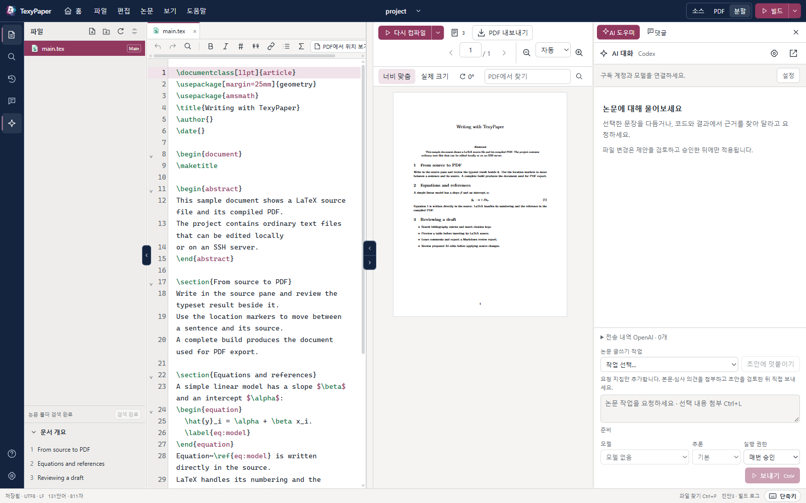

<div align="center">


# TexyPaper

**Windows 桌面 LaTeX 编辑器：在原位置编辑本机或 SSH 服务器上的论文，并在源文件旁显示 PDF**

<p>
  <a href="https://github.com/HSoo-Kim/texypaper/releases/latest"></a>
  <a href="https://github.com/HSoo-Kim/texypaper/releases/latest"></a>
  <a href="LICENSE"></a>
</p>

<p>
  <a href="README.md">English</a> ·
  <a href="README.ko.md">한국어</a> ·
  <b>简体中文</b> ·
  <a href="README.ja.md">日本語</a>
</p>



</div>

TexyPaper 直接打开本地文件夹或 SSH 服务器上的真实路径，不会另建一个同步用的工作文件夹。编辑和预览所需的内容只读入客户端内存，编译在论文所在的主机上进行。

应用界面支持韩语和英语。README 提供四种语言，但界面不支持中文。文中的菜单和按钮名称均采用英文界面的写法。

## 主要功能

| 功能 | 说明 |
|---|---|
| 本地与 SSH | 在原位置读写本机文件夹，或通过 OpenSSH 连接的服务器上的文件夹。 |
| 源文件编辑 | 语法高亮、引用和标签补全、章节大纲、多光标和代码折叠。另有英文正文拼写检查和大致字数统计。 |
| 快速预览 | 输入时由本机 TeX 引擎先更新真实的 PDF。最终 PDF 由主机上的完整编译生成。 |
| 源文件与 PDF 对应 | 点击一侧窗格，另一侧会标出对应位置。也可以用 SyncTeX 跳转。 |
| 论文工具 | 在 **Paper** 菜单中搜索 BibTeX 并插入引用、用数据生成表格、做投稿前检查。 |
| 评论与审阅 | 在源文件或 PDF 上添加评论，并把评论串导出为 Markdown 审阅报告。 |
| AI（可选） | 通过官方 CLI 使用 Codex 和 Claude。源文件修改建议需要先查看差异再应用。 |
| 保护与恢复 | 检查点、撤销、基于哈希的冲突检测，以及未保存编辑的恢复。 |

## 安装

1. 从[最新版本](https://github.com/HSoo-Kim/texypaper/releases/latest)下载安装程序 `TexyPaper_<version>_x64-setup.exe` 或便携 ZIP 包。
2. 安装程序只为当前用户安装，不需要管理员权限。ZIP 包需要完整解压后再运行 `texypaper.exe`。
3. 两者都没有代码签名，Windows 可能提示无法验证发布者，或显示 SmartScreen 警告。

更新前请保存工作，通过 **File → Exit TexyPaper**、`Ctrl+Shift+Q` 或托盘中的 **Exit TexyPaper** 完全退出应用，再运行新版安装程序。只点击窗口的 X 时，应用可能仍留在托盘中。

### 系统要求

| 用途 | 所需条件 |
|---|---|
| 应用本身 | Windows x64（在 Windows 11 上开发和测试）和 Microsoft Edge WebView2 运行时 |
| 编译 | `latexmk`、所选引擎（`pdflatex`、`xelatex` 或 `lualatex`），以及论文所需的宏包、字体和 BibTeX/Biber |
| 源文件与 PDF 跳转 | 生成 SyncTeX 数据的编译，以及主机上的 `synctex` |
| 快速预览 | 本机上兼容的 TeX Live 2026，且 `kpsewhich` 位于 `PATH` 中。SSH 项目同样需要本机安装 |
| SSH | Windows OpenSSH 的 `ssh.exe`、装有 Python 3.9 或更高版本的 Linux 或 macOS POSIX 主机，以及项目和缓存目录的写入权限 |
| AI（可选） | 安装在 Windows 上的官方 Codex CLI 或 Claude Code CLI，并已登录对应提供商支持的订阅账户 |

SSH 项目编译和 SyncTeX 所需的工具要装在服务器上。应用不捆绑主机用的 TeX、Python、SSH 或 AI CLI，也不会自动安装它们。内置的 WasmTex 引擎只用于快速预览，不能代替完整的 TeX 发行版。

## 打开第一个项目

1. 按 `Ctrl+O` 打开 **Home**，选择 **Open project**。
2. 本地项目在 **This computer** 中选择文件夹。SSH 项目在 **Add SSH environment** 中填写 OpenSSH 别名或主机名，再输入服务器上的真实路径，例如 `/home/user/paper`。
3. 打开一个 `.tex` 文件并按 `Ctrl+S`，即可保存并开始首次编译。

主文档根据 `% !TeX root` 指令、你的选择和对含 `\documentclass` 文件的查找来确定。如果有多个同等的候选项，应用不会自行猜测，会请你选择主文档和引擎。

SSH 连接直接使用现有的密钥、SSH agent、SSH 配置中的别名和 ProxyJump。连接时，应用会把一个经过校验、只依赖 Python 标准库的辅助程序缓存在 `~/.cache/texypaper/worker/<sha256>/`。不需要 root 权限、pip 或 npm、开放端口、服务器上的 AI CLI 或常驻服务。首次连接服务器时，请核对 OpenSSH 显示的完整指纹。主机密钥发生变化时，连接会报错停止，不会跳过验证。

## 快速预览与完整编译

`Ctrl+S` 保存并编译（关闭 **Build automatically after save** 后只保存）。`Ctrl+Shift+B` 可随时编译。正式的完整编译由 `latexmk` 在项目所在主机上运行：本地项目在本机编译，SSH 项目在服务器上编译。

| 配置 | 行为 |
|---|---|
| **Basic** | 以禁用 shell escape 的方式运行 `latexmk -norc`。它不读取 latexmk 配置文件，但不是操作系统沙箱。 |
| **Project** | 使用你自己的 latexmk 配置。该配置可以执行命令，因此使用前需要确认信任该项目。 |

启用 Basic 配置和自动编译后，本机常驻的 TeX 引擎可以根据上次验证通过的编译输入和当前编辑内容生成真实的 PDF，先更新 PDF 窗格。界面上显示为 **Live preview**。编译在本机完成，不发送到云端。首次初始化和首次完整编译需要更长时间。

对于兼容的 Basic/pdfLaTeX 文档，应用会优先更新当前可见页和下一页。其他页面保留上一次完整编译的结果，并在界面上标明。修改导言区或无法局部编译时，预览会编译整篇文档。不兼容的字体或宏包、Project 配置，以及主文档所在文件夹之外的文件，则交给主机上的完整编译处理。并非所有引擎都支持局部编译。

Basic/pdfLaTeX 的自动完整编译会等输入停下后再开始，保存和手动编译则不等待。编译失败时，上一次成功的 PDF 会继续显示，并标记为已过期。导出 PDF 和 PDF 评论锚点都需要一次经过验证的完整编译。

### 源文件与 PDF 位置

点击源文件或 PDF，另一侧窗格会标出对应位置，键盘焦点不会移动。需要明确跳转时，在 PDF 中按 `Ctrl+click`，在源文件中按 `Ctrl+Alt+J`。对应位置来自当前显示的 PDF，以及与之匹配的源文件和 SyncTeX 数据。映射尚未就绪或已过期时，应用会显示提示，不会猜测位置。

### 在 PDF 中修改文字

在 PDF 中选中文字并选择 **Edit text** 后，只有与源文件逐字一致、且能唯一定位的正文片段才能编辑。应用修改前会显示差异，并核对源文件哈希。这项功能不能任意修改 PDF 中的公式、表格或其他内容。无法定位的选区请直接在源文件中修改。导出的 PDF 始终是完整编译后的最终文档。

## 论文工具、审阅与 AI

### 论文工具

**Paper** 菜单中的工具适用于本地和 SSH 项目，不会把源文件发送给 AI。

- **Find references** 按标题、作者、年份和引用键搜索项目中的 `.bib` 文件，并插入引用。它只搜索已有的元数据，不会在线查找或核实文献。
- **Create table from data** 把 CSV、TSV 或分号分隔的数据转换为已转义的 LaTeX 表格。插入前可以预览，不需要额外宏包。上限为 200 行、30 列。
- **Pre-submission check** 列出缺失或重复的引用和标签、找不到的静态输入文件以及 TODO，并显示未能覆盖的范围和 PDF 是否已过期。它不会运行 TeX，不做事实核查，也不能证明论文符合投稿要求。

图片可以通过拖放或粘贴添加。放入源文件编辑器时，文件会复制到项目中，并插入 figure 代码块；拖放到文件浏览器则只复制文件。**Home** 中的 **New paper from template** 提供四种模板：英文论文、韩文论文、Beamer 幻灯片和分章报告。

### 评论与审阅报告

可以为源文件或 PDF 的选区添加评论，也可以回复或标记为已解决。评论保存在项目所在主机的 `.texypaper/comments.json` 中。**Export review report** 把评论串导出为 Markdown 报告。报告只能写到新路径，不会覆盖已有文件。

### AI（可选）

不使用 AI 也能完成全部编辑和编译。需要 AI 时，可以通过 Windows 上的官方 CLI，用你自己的订阅使用 Codex 或 Claude。可用的账户和模型由提供商决定。

- Codex 使用应用专用的 `CODEX_HOME`。应用不会悄悄复制你在别处的登录状态，因此可能需要在应用中再次登录。
- Claude 通过官方 CLI 登录 claude.ai 订阅账户后使用。

发送请求时，提示词、你明确附加的内容以及 AI 读取的相关上下文，会发送到你所选提供商（OpenAI 或 Anthropic）的云端。只选中文字不会发送任何内容。普通的 PDF 编译不调用云端 AI。聊天中的 **Sent to OpenAI** / **Sent to Anthropic** 列出了从本机发出的内容。

写作预设共有四个：在不改变论点的前提下精简（**Shorten without changing claims**）、润色学术英语（**Polish academic English**）、评析论证与证据（**Critique argument and evidence**）、起草审稿意见回复（**Draft reviewer responses**）。预设只会把指令加入可编辑的草稿，发送需要你自己点击 **Send**。预设不保证结果的事实准确性。

AI 提出源文件修改时会显示差异，点击 **Apply changes** 后才写入。应用时会检查冲突，已应用的修改可以撤销。在项目中运行命令是另一项单独的权限，默认为 **Ask each time**。经批准的命令以本地或 SSH 用户的权限运行，可能影响项目之外的文件和网络。

Claude 订阅连接面向个人使用。分发给他人之前，请查阅[官方订阅指南](https://support.claude.com/en/articles/15036540-use-the-claude-agent-sdk-with-your-claude-plan)和 [Agent SDK 政策](https://code.claude.com/docs/en/agent-sdk/overview)。

## 数据与安全

- 输入稍有停顿就会自动保存，输入法组字期间会推迟保存。
- 修改可以通过检查点和撤销恢复。项目范围的替换会先显示差异再应用。保存前会用哈希检测外部修改，未保存的编辑会记录下来以便恢复。
- 如果无法创建检查点，AI 修改和替换会在显示警告后继续，PDF 文字编辑则会中止。恢复数据不能代替备份。
- SSH 断开后，编辑内容和上一次的 PDF 仍会保留。写入和编译需要重新连接。结果不确定的写入不会自动重试。
- 应用数据位于 `%APPDATA%\dev.texypaper.desktop`。便携版也使用这个位置，不会保存在 EXE 旁边。其中包含恢复数据、检查点、AI 对话和提供商状态，请不要整体分享该文件夹。开发时可以用 `--data-dir` 隔离配置。
- `.texypaper/project.json`、`comments.json` 以及生成的恢复和编译元数据保存在项目中，与应用数据分开。
- 有新版本时只会提示，不会自动安装。

## 常用快捷键

| 按键 | 操作 |
|---|---|
| `Ctrl+O` | 在 **Home** 中选择、添加或切换项目 |
| `Ctrl+P` | 按名称打开文件；以 `>` 开头可搜索项目文本 |
| `Ctrl+S` | 保存并编译（关闭保存后自动编译时只保存） |
| `Ctrl+Shift+B` | 立即编译 |
| PDF 中的 `Ctrl+click` | 跳转到点击位置对应的源文件 |
| `Ctrl+Alt+J` | 从源文件位置跳转到 PDF |
| `Ctrl+L` | 将选区附加到 AI 聊天；没有选区时附加当前行 |
| `Ctrl+Shift+C` / `Ctrl+J` | 为选区添加评论 / 打开或关闭评论面板 |
| `Alt+F8` | 查看光标处单词的拼写建议 |
| `Ctrl+Shift+Q` | 确认运行中的任务和未保存修改后完全退出 |

应用内的 **Shortcuts** 按钮和 **Help** 菜单列出了全部快捷键。

## 开发与文档

开发需要 Windows x64、Node.js 24、pnpm 12.16.1、支持 Rust edition 2024 的 MSVC 工具链、Visual Studio C++ Build Tools / Windows SDK 和 WebView2。

```powershell
pnpm install --frozen-lockfile --ignore-scripts
pnpm dev -- -- --data-dir "$env:TEMP\texypaper-dev-isolated"
pnpm test
pnpm tauri build --ci --target x86_64-pc-windows-msvc --bundles nsis -- --locked
```

上面的开发命令会用隔离的配置打开应用窗口。首次编译和准备开发环境时，会下载并校验固定版本的引擎及其对应源码；运行时预览查找宏包只在本地进行。单独运行 `pnpm dev:web` 无法使用原生 API。CI 通过并不代表已在真实的桌面和 TeX 环境中验证。

- [docs/DEVELOPMENT.md](docs/DEVELOPMENT.md)：编译、CI、打包和真实应用测试步骤
- [docs/ARCHITECTURE.md](docs/ARCHITECTURE.md)：内部结构与存储方式
- [docs/VERIFICATION.md](docs/VERIFICATION.md)：实际验证过的内容及记录

## 许可证

应用程序采用 [MIT 许可证](LICENSE)。第三方组件保留各自的许可证和版权声明（[`THIRD_PARTY_NOTICES.md`](THIRD_PARTY_NOTICES.md)、[`licenses/`](licenses/)）。MIT 许可证不会覆盖内置 TeX 引擎的许可证。引擎许可证及其完全对应的源码可在 **Settings → Open source** 中查看。

代码许可证和第三方声明不授予产品名称或徽标的商标权。官方 CLI、TeX 发行版、WebView2 和云服务遵循各自提供商的许可证、条款和账户限制。
