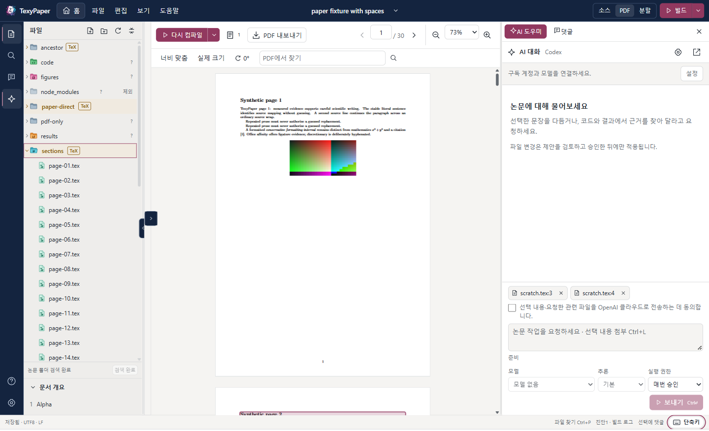

<div align="center">


# TexyPaper

**性感的 LaTeX 编辑器。直接编辑本地和 SSH 服务器上的论文，在文件所在的主机上编译，并在每一处 AI 修改写入源文件前亲自审核。**

<p>
  <a href="https://github.com/HSoo-Kim/texypaper/releases/latest"></a>
  <a href="https://github.com/HSoo-Kim/texypaper/releases/latest"></a>
  <a href="https://github.com/HSoo-Kim/texypaper/releases"></a>
  <a href="https://github.com/HSoo-Kim/texypaper/stargazers"></a>
  <a href="LICENSE"></a>
</p>

<p>
  <a href="README.md">English</a> ·
  <a href="README.ko.md">한국어</a> ·
  <b>简体中文</b> ·
  <a href="README.ja.md">日本語</a>
</p>



</div>

一款基于 Tauri 2、Rust、React 和 CodeMirror 构建的 Windows 桌面 LaTeX 编辑器。打开本机或 SSH 服务器上的论文文件夹，直接在文件所在的主机上编辑和编译，并在源文件旁显示 PDF。

应用界面提供韩语和英语，本文中的界面名称均使用英文标签。

## 核心功能 (Key Capabilities)

| 功能 | 说明 |
|---|---|
| **本地和 SSH 项目** | 打开本机文件夹，或通过你自己的 OpenSSH 配置打开服务器上的真实 POSIX 路径。文件直接原地读写，不会镜像到 Windows。[详情](#打开项目) |
| **`Ctrl+S`，然后查看 PDF** | 保存时，在论文所在的机器上通过 latexmk 编译。主文档根据 `% !TeX root`、你的选择或 `\documentclass` 确定，通常无需配置。[详情](#编译与-pdf) |
| **源文件与 PDF 并排显示** | 在 PDF 中 `Ctrl+click` 可跳转到源文件对应行；`Ctrl+Alt+J` 可高亮 PDF 中的对应位置（SyncTeX）。可拖动分隔线，并分别缩放源文件、PDF 和聊天内容。 |
| **Overleaf 风格的编辑体验** | Overleaf 默认快捷键（`Ctrl+D` 删除行、`Ctrl+/` 注释、多光标、折叠）、带编号的章节大纲，以及文献引用和标签补全。 |
| **拼写检查与字数统计** | 仅检查正文的英语拼写，不会标记 TeX 命令、数学公式、注释或文献引用键；点击或按 `Alt+F8` 可查看建议。状态栏显示全文字数或选区字数。[详情](#拼写检查与字数统计) |
| **项目内批量替换** | 按文件预览每一行修改，然后对最多 16 个文件执行一次可撤销的批量保存。[详情](#项目内批量替换) |
| **拖放或粘贴插图** | 将图片或 PDF 拖放到文件浏览器，或将截图粘贴到源文件中：文件会复制到项目内，并插入待填写的插图代码块。[详情](#拖放或粘贴插图) |
| **检查点** | 为项目文本文件创建命名快照，在 AI 修改、项目内批量替换和 PDF 文字编辑前自动创建快照，逐文件查看与当前状态的差异，并执行可撤销的恢复。[详情](#检查点) |
| **从模板新建论文** | 在本地或 SSH 服务器上的现有文件夹中，以英语文章、韩语文章、幻灯片或分章报告为起点创建项目。[详情](#从模板开始) |
| **从 PDF 修改文字** | 选择渲染后的文字，将经过验证的字面正文片段送入修改前后的差异视图。应用修改时，会执行一次可撤销的保存，然后重新编译。[详情](#在-pdf-中修改文字) |
| **评论** | 为源文件或 PDF 中的选区添加评论。评论串保存在 `.texypaper/comments.json`，编辑后会根据引用文字及其上下文重新定位。 |
| **AI 提议，由你应用** | Codex 和 Claude 通过官方 CLI 使用你自己的订阅运行。它们可以读取项目并提出修改；在你点击 **Apply changes** 前，不会写入任何内容。[详情](#aicodex-与-claude) |
| **安全保存与恢复** | 每次写入前检查 SHA-256；外部修改触发冲突对话框；恢复日志保留未保存文字；上一次保存可撤销。 |
| **识别论文的文件浏览器** | 包含 TeX 文件的文件夹在展开前就会显示 **TeX** 标记，并配有文件类型图标和按用途着色的文件夹图标。 |
| **主题与语言** | 提供韩语和英语界面、浅色、深色或跟随系统的主题，并可自定义强调色、背景色、编辑器和侧栏颜色。 |
| **更新提示** | 有新版本时，底部会持续显示提示。应用绝不会自行安装任何内容。 |

[完整功能列表](#功能)

## 快速开始

1. 从[最新版本](https://github.com/HSoo-Kim/texypaper/releases/latest)下载 `TexyPaper_<version>_x64-setup.exe`（Windows x64，在 Windows 11 上开发和测试；需要 Microsoft Edge WebView2 运行时）。也提供便携 ZIP 包。
2. 运行安装程序。仅为当前用户安装，不需要管理员权限。若使用 ZIP 包，请完整解压后运行 `texypaper.exe`。
3. 按 `Ctrl+O` 打开 **Home**，选择 **Open project**，选中论文文件夹，打开一个 `.tex` 文件，然后按 `Ctrl+S`。

还需要安装 TeX 发行版，并确保 `latexmk` 位于 `PATH` 中（SSH 项目需在服务器上配置）。安装程序和可执行文件均未进行代码签名，因此 Windows 可能提示无法验证发布者。更新时，请先保存工作，完全退出 TexyPaper（**File → Exit TexyPaper**、`Ctrl+Shift+Q` 或托盘中的 **Exit TexyPaper**），再运行新版安装程序。

### 系统要求

| 用途 | 所需条件 |
|---|---|
| 桌面应用 | Windows x64 和 Microsoft Edge WebView2 运行时 |
| 本地 TeX 编译 | `PATH` 中的 `latexmk`、所选引擎（`pdflatex`、`xelatex` 或 `lualatex`），以及论文所需的 TeX 宏包、字体和 BibTeX/Biber |
| 源文件 ⇄ PDF 跳转 | 编译产生的 SyncTeX 数据，以及主机上的 `synctex` |
| SSH 编辑 | Windows OpenSSH `ssh.exe`、安装了 `python3` 3.9 或更高版本的 Linux 或 macOS POSIX 服务器，以及项目和用户缓存文件夹的写入权限 |
| SSH 编译 | 上述条件，以及**安装在服务器上**的 latexmk、所选引擎、SyncTeX 和论文依赖项 |
| AI | Windows 上安装的官方 Codex 或 Claude Code CLI、对应提供商支持的订阅账户登录，以及互联网连接 |

应用不捆绑 TeX、Python、SSH 或 AI CLI，也绝不会替你安装全局或服务器软件包。SSH 服务器不需要 Codex、Claude、Node 或常驻守护进程。未安装 TeX 的服务器仍可编辑文件，但编译会报错 `TEX_TOOL_MISSING`。

## 打开项目

**Home**（**Home** 按钮、`Ctrl+O`）是用于选择、添加和切换项目的全屏页面。最近项目优先显示，当前打开的项目提供 **Return to project**。停留在 **Home** 时，当前项目的编辑、编译和 AI 任务仍会继续；只有切换到其他项目时，才会询问如何处理未保存文件和运行中的任务。

**This computer：**选择 **Open project → This computer → Browse folder**。项目直接在该目录中读写。从文件面板打开 `.tex` 文件；下方的 **File outline** 会将 `\section`、`\subsection` 和 `\subsubsection` 显示为 `1`、`1.1`、`1.1.1`，并逐级缩进。点击条目可跳转到对应行（编号按源文件顺序排列，可能与编译后的编号不同）。

**SSH server：**

1. 在 **Add SSH environment** 中填写 OpenSSH 别名或主机名，并按需填写用户名、端口、私钥或独立的 SSH 配置文件。应用会读取 OpenSSH 配置中具体的 `Host` 别名和 `Include` 行，但不会将通配符展开为服务器列表。
2. 输入**服务器上的真实 POSIX 路径**，例如 `/home/user/paper`。
3. 接受辅助程序提示。连接时会启动一个仅使用 Python 标准库的小型工作进程；通过 SHA-256 验证的版本缓存在 `~/.cache/texypaper/worker/<sha256>/`。不使用 pip、npm、root 安装，也不开放端口。
4. 首次连接服务器时，确认 OpenSSH 显示的完整指纹。密码、私钥口令和键盘交互式认证的应答均在应用自己的认证窗口中输入；取消即停止连接。

应用会使用你现有的密钥、SSH agent 和 ProxyJump 设置，但绝不会启动 ssh-agent 服务或提升权限。**主机密钥变更会被视为错误**；应用不会通过清空 `known_hosts` 来绕过检查。连接中断时，保存和编译绝不会被报告为已完成：应用会保留上一次的 PDF 和未保存的修改，点击 **Reconnect** 后，你需要检查原始版本及状态不确定的事务。失败的写入不会自动重试。

## 编译与 PDF

编译始终在项目所在的主机上执行；SSH 论文绝不会复制到 Windows 后再编译。**`Ctrl+S` 保存并编译**（在设置中关闭 **Build automatically after save** 后仅保存），停止输入片刻后也会自动保存并编译。PDF 面板中的 **Recompile**、顶部的 **Build** 按钮和 `Ctrl+Shift+B` 执行相同操作。

无需配置即可按以下顺序确定主文档：当前文件中的 `% !TeX root = ...` → 你选定的主文档 → 当前文件（如果包含 `\documentclass`）→ 从当前文件所在文件夹向上查找，最近的、恰好包含一个带 `\documentclass` 文件的文件夹。如果多个候选项并列，TexyPaper 会询问而不是猜测：请使用 **Build options → Main document** 或 **Recompile** 旁的菜单。选定的主文档保存在 `.texypaper/project.json` 中。

| 配置 | 行为 |
|---|---|
| **Basic** | 使用带 `-no-shell-escape`、SyncTeX 和 recorder 的 `latexmk -norc`。这会忽略 latexmk rc 文件，但并不为 TeX 本身提供沙箱。 |
| **Project** | 使用项目现有的 latexmk 配置。该配置可以执行命令，因此需要明确确认信任。信任记录保存在客户端应用数据中，而不是项目 JSON 中。 |

同一时间只运行一次编译，重叠的保存会合并为最新的重新编译请求。默认时限为 120 秒；取消时会终止应用启动的进程树。编译失败、取消或超时时，上一次成功生成的 PDF 会继续显示，并标记为已过期。日志按钮上的数字表示错误和警告总数；只有没有 PDF 可显示时，日志才会自动打开。

编译失败且日志中出现带源文件位置的错误时，**Ask AI about this error** 会将第一个错误周围的源文件内容（前后各 20 行）附加到 AI 聊天；如果输入框为空，还会填入一个问题。点击发送之前，不会发送任何内容。日志只列出文档错误：存在实际错误时，会去掉 TeX Live 包装程序的“command failed with exit code”行和 latexmk 的汇总行，因此一处错误只计一次。

PDF 面板提供页面导航、适合宽度、实际大小、缩放、90° 旋转、逐页文字搜索和 PDF 导出。单独打开的参考 PDF 不会被主文档重新编译的结果替换；点击 **Return to built PDF** 可返回编译生成的 PDF。PNG、JPEG、WebP 和不执行代码的 SVG 文件可直接预览。

### 在 PDF 中修改文字

1. 选择 PDF 中渲染后的文字，然后选择 **View source / Edit text / Edit with AI / Comment**。
2. **Edit text** 会同时检查当前 PDF、其 SyncTeX 数据、编译时的源文件快照和当前源文件哈希。它绝不会仅凭 SyncTeX 位置猜测字符偏移量。
3. 只有经过验证、在同一源文件段落内唯一出现的字面正文片段，才会进入修改前后的审核视图。输入按纯文本处理，TeX 特殊字符会被转义；原始 TeX 请在源文件编辑器中修改。
4. 应用修改时会重新检查哈希，将修改保存为一次可撤销事务，然后重新编译。如果源文件已变更或选区已失效，会以 `PDF_STALE` 拒绝修改；请重新编译后再次选择。

重复句子、宏、数学公式、文献引用、表格、跨文件或跨段落边界的选区、不连续的多栏选区、有歧义的连字或连字符，以及无法验证的坐标，都绝不会被自动替换。请跳转到候选源文件位置明确修改，或使用可供审核的 AI 提案。

### 评论

可从源文件或 PDF 选区创建评论，然后回复、编辑、删除、解决或重新打开。评论存储在项目实际所在主机的 `.texypaper/comments.json` 中，绝不会作为 TeX `%` 注释插入。应用内的编辑会调整字节锚点；外部编辑后，只有引用文字及其周围上下文在同一文件中唯一匹配时，评论才会重新定位，否则显示为 **Orphaned**，以便你重新选择关联位置。仅针对 PDF 的评论绑定于该 PDF 的哈希，不会迁移到新 PDF 的相同页码。

## 写作与修订

### 拼写检查与字数统计

在 **Settings → Source editing** 中开启或关闭 **Spell check (English)**（默认开启）。源文件可见区域中的拼写错误会以波浪下划线标记；悬停或点击单词，或将光标放在单词上并按 `Alt+F8`，即可查看最多五条建议和 **Ignore word**。

- **检查范围：**仅检查渲染后的正文。跳过 TeX 命令及其可选参数、数学公式、注释、原样文本、标签和文献引用键，也跳过含数字的单词、全大写缩略词、camelCase 和包含连字符或下划线的标识符。不检查韩文等其他文字系统的文本。只有停止输入片刻后，才会标记匹配项。
- **词典：**电脑上有 Windows 英语（美国或英国）词典时，优先使用该词典。仅安装其他语言的 Windows 电脑（例如常见的纯韩语配置）没有英语词典，此时 TexyPaper 会使用内置英语词典（SCOWL，约 0.5 MB，仅在首次检查时加载；实测加载后工作集额外增加约 3 MB）。**Settings** 会显示当前使用的词典。
- **忽略的单词：** **Ignore word** 将单词保存到 TexyPaper 自己的设置中（最多 500 个；**Clear ignored words** 清空列表）。绝不会修改 Windows 自定义词典。
- **字数统计：**状态栏显示正文的单词数和字符数，不计 TeX 命令、数学公式或注释；选中文字时显示选区的统计结果。由于不进行分词，连续的韩文或其他 CJK 字符计为一个单词，缩约词或带连字符的单词也计为一个单词，独立数字不计入单词数。字符数包含正文中的空格和标点。这是对源文件的估算，不会展开宏。

### 项目内批量替换

打开左侧栏的 **Project search** 面板，输入要查找的文字，再打开 **Replace**。**Preview** 按文件列出修改前后的每一行，**Replace all** 应用这些修改。

- **范围：**仅限 UTF-8 文本文件。超过 4 MiB 的文件、二进制文件、非 UTF-8 文件和应用私有元数据会列为已跳过，保持不变。支持 **Match case** 和 **Whole word**。
- **限制：**每次最多 16 个文件、2,000 处匹配。超出限制会提示并拒绝操作，不写入任何内容，因此请先缩小搜索范围。
- **一次可撤销的保存：**应用会重新读取每个文件，将其 SHA-256 与预览时的值比较，先保存已打开的编辑器，再以一次事务写入所有文件，保留原有 BOM 和换行符。如果任何文件在预览后发生变更，就不会写入任何内容。结果旁的 **Undo** 可恢复每个文件之前的内容。
- 本地和 SSH 项目均支持。

### 拖放或粘贴插图

将 PNG、JPEG、GIF、WebP、SVG、PDF 或 EPS 文件拖放到文件树上（放到文件夹行时使用该文件夹；放到其他位置时，若存在 `figures` 文件夹则使用它，否则使用项目根目录），也可将文件拖放到源文件编辑器，或将剪贴板图片粘贴到编辑器中。拖放到文件浏览器只会复制文件；在编辑器中拖放或粘贴，还会在光标处插入包含 `\includegraphics`、空图题和标签的 `\begin{figure}` 代码块，路径相对于当前打开的文件。

- **安全复制：**每个文件最多 20 MiB，且仅支持上述扩展名。文件名会处理为文件系统安全的名称，绝不覆盖现有文件（改为添加数字）；传输后会验证内容哈希，文件以原子方式出现。因此，目标文件夹所在的文件系统若不支持硬链接，操作会报错失败，而不是留下写到一半的文件。
- 粘贴的图片保存为 `pasted-image-<date>-<time>.png`（非 PNG 剪贴板图片会先转换为 PNG）。LaTeX 能否插入某种格式取决于所用引擎；pdfLaTeX 支持 PNG、JPEG 和 PDF。本地和 SSH 项目均支持；SSH 项目的字节数据通过现有连接传输。

### 检查点

左侧栏的 **Checkpoints** 为项目文本文件保留快照，提供比版本控制仓库更轻量、且独立于仓库的保护。历史记录筛选器可显示全部、手动或自动记录。

- **Create checkpoint** 先保存打开的文件，再将项目中属于源文件类型的文本文件存储到 TexyPaper 应用数据中，而不是项目内：支持可写的 UTF-8 `.tex`、`.ltx`、`.bib`、`.bst`、`.cls`、`.sty`、`.bbx`、`.cbx`、`.dtx`、`.ins`、`.md`、`.txt`、`.csv`、`.tsv`、`.json`、`.yaml`、`.yml`、`.toml`、`.py`、`.r`、`.m`、`.jl` 和 `.sh` 文件。隐藏文件和文件夹（例如 `.git` 和 `.texypaper`）、`node_modules`、`venv`、`__pycache__`、`build`、`dist` 和 `target`，以及无法作为 UTF-8 文本读取的文件均被排除。
- **自动检查点**在对 AI 提案执行 **Apply changes**、执行 **Replace all** 或编辑 PDF 文字之前创建。它们只包含该操作要修改的文件（最多 16 个），并标明原因，例如 *Automatic · before replace*。如果无法保存检查点，AI 修改和 **Replace all** 仍会继续，同时显示警告（两者均可撤销）；PDF 文字编辑则会停止。
- **限制：**超过 1 MiB、只读或非 UTF-8 的文件会被跳过并列出；每个手动检查点最多包含 400 个文件、总计 8 MiB，项目超出限制时会说明原因并拒绝创建，而不是仅保存部分内容。手动和自动检查点分别保留 50 个和 20 个，各自清理最旧的记录，自动检查点绝不会挤掉手动检查点。
- **Compare** 列出与当前项目相比已修改、新增和删除的文件，并逐文件显示行级差异。自动检查点只比较和恢复自身包含的文件。
- **Restore** 可恢复所有已修改文件、所选文件或单个文件，每次最多 16 个。操作前会询问，创建一个 **Before restore** 检查点，再以一次事务写入文件，并提供 **Undo**。检查点创建后新增的文件绝不会被删除。

### 从模板开始

在 **Home** 上，**New paper from template** 可在已存在、最好为空的文件夹中创建论文起始项目。选择本机或 SSH 环境、文件夹，以及 **English article**、**Korean article**（使用 ko.TeX 的 XeLaTeX）、**Presentation slides**（Beamer）或 **Chapter-based report**，再点击 **Create and open**。

TexyPaper 只创建新文件；模板中的任一文件或文件夹若已存在，就不会创建任何内容，并会列出这些路径。主文档和引擎保存在 `.texypaper/project.json` 中，论文打开后即可编译。

## AI：Codex 与 Claude

打开 AI 聊天顶部的 **Settings**，选择提供商，然后点击 **Refresh connection** 检查官方 CLI 和账户。支持的协议基准版本为 **Codex 0.153.2 / Claude Code 2.1.300**。模型、推理级别和执行权限位于发送按钮旁。版本不匹配、模型不可用、用量限制、认证和网络故障都会如实显示；TexyPaper 绝不会切换到其他付费 API。

- **Codex：**通过 **Official sign-in → Open authorization page** 完成 ChatGPT 登录。TexyPaper 使用独立的官方存储目录（`CODEX_HOME=<app-data>/providers/codex`），因此即使已在其他地方登录 Codex，也可能需要再次登录。应用绝不会复制现有令牌和全局设置。
- **Claude：**使用官方 CLI 的 `claude.ai` 订阅账户；如有需要，在终端运行 `claude auth login` 后刷新。Console/API 密钥和第三方登录不被视为订阅。

模型选择器显示 GPT-6 及以上各系列的最新版本，Claude 则仅显示 Opus、Sonnet 和 Haiku 5.5。当前默认模型为 **GPT-6 Astra 和 Luna、GPT-6.1 Sol 和 Terra**，以及 **Claude Opus 5.5、Sonnet 5.5 和 Haiku 5.5**（[OpenAI 模型](https://developers.openai.com/api/docs/guides/latest-model)、[Claude 模型](https://platform.claude.com/docs/en/models/overview)）。未出现在 CLI 简短列表中的官方模型仍可选择；模型访问说明会把它描述为当前 CLI 未报告的官方目录选项，模型 ID 将按输入原样发送。如果订阅不允许使用该模型，会显示提供商的错误，而不会改用其他模型。推理级别仅取自所选模型的 CLI 元数据；缺少元数据时使用提供商默认值。

两个 CLI 都**仅在 Windows 客户端运行**，绝不会以 SSH URI 作为工作目录。它们通过私有控制目录和七个 MCP 工具访问选定的本地或 SSH 项目：`list_files`、`read_text`、`search_text`、`get_build_status`、`propose_changes`、`propose_command` 和 `get_command_status`。提供商自带的 shell 和直接文件写入工具均已禁用。

**附加内容。**只有你通过 `Ctrl+L` 或右键 → **Attach to AI chat** 明确附加的文字（来自源文件或 PDF），才会成为输入框中的附加内容标签；仅选中文字不会共享任何内容。发送时，请求、附加内容以及 AI 读取的相关源文件、代码和结果片段会发送给你所选的提供商（OpenAI 或 Anthropic）。官方 CLI 使用提供商云端的模型运行，因此没有单独的授权步骤。默认读取工具会排除机密信息、`.env*`、凭据，以及应用自己的认证和恢复存储；`propose_changes` 只能写入 TeX、Bib 和样式文件。

**已发送的内容。**聊天中的 **Sent to OpenAI** / **Sent to Anthropic** 列出该项目对话向提供商交付的内容：附件、提示词大小，以及 AI 通过工具获得的每次文件读取、搜索、编译状态和命令结果，并记录路径、行范围、大小和时间。记录在数据交给提供商 CLI 时写入，而不是在准备数据时写入，因此它记录的是离开本机的数据，并非云端收据。仍在输入框中的附件显示为 **Not sent yet**。记录不存储内容，仅保留最近 500 条；聊天设置中的 **Clear conversation history** 会将这些记录与本地对话一并删除。

**模型回复或提案不等于保存。**`propose_changes` 只会创建提案，并将其保留在 **Awaiting approval** 状态。请审核差异及其依据文件和行号，再点击 **Apply changes** 写入。拒绝或取消不会改变源文件；应用时会重新检查每个基准哈希；发生冲突时会保留提案，以便基于新的源文件重新编写。已应用的提案可以撤销。同一时间只运行一个 AI 任务；进程按需启动，并保留会话 ID 以继续对话；不会有常驻模型服务器。

### 运行项目代码

AI 通过 `propose_command` 提出命令；命令在项目实际所在的主机上执行（本地项目在本机，SSH 项目在服务器）。模型不能更改权限，也不能批准自己的命令。

| 执行权限 | 行为 |
|---|---|
| **Deny** | 阻止新提案，拒绝待批准提案，并停止正在运行的命令 |
| **Ask each time**（默认） | 对每条命令显示环境、工作文件夹、完整 argv 和时限，供你批准或拒绝 |
| **Allow session** | 确认风险提示并勾选复选框后，当前项目连接中的后续命令无需逐条批准即可运行 |

切换项目、重新连接或真正退出时，会重置会话权限（隐藏到托盘不算退出）。你可以随时改回 **Ask each time** 或 **Deny**。命令卡片显示 stdout/stderr、退出码及输出是否被截断，每条命令都可以停止。同一时间只运行一条命令，默认时限为 120 秒；不会隐式执行 shell 字符串：经批准的 argv（包括解释器）会被原样执行。

**工作文件夹限制不是操作系统沙箱。**经批准的命令以该本地或 SSH 账户的权限运行，可以影响项目之外的文件、网络和系统。副作用不会自动撤销，经批准的命令也不受上述文件读写限制约束。

### 聊天窗口与托盘

- **Detach chat window** 将聊天分离为独立窗口，**Dock in main window** 将其移回。对话、草稿、阅读位置、运行中的任务和待批准操作仍由主控制器管理；关闭独立窗口会将聊天移回主窗口。当你阅读或选择较早的消息时，新回复不会将视图拉到末尾。
- 主窗口**第一次点击 X** 时会询问 **Keep running in tray / Exit completely / Cancel**。同意驻留托盘后，点击 X 会同时隐藏主窗口和独立聊天窗口，AI、命令和编译仍会继续运行。
- **File → Exit TexyPaper**、`Ctrl+Shift+Q` 和托盘中的 **Exit TexyPaper** 会在确认停止任务和处理未保存内容后退出。托盘中的 **Open TexyPaper**、双击图标，或以相同 Windows 用户和配置再次启动 TexyPaper，均会恢复现有窗口；不同的 `--data-dir` 会启动独立实例。应用不会配置 Windows 开机自启。

Claude 订阅连接旨在供个人使用。向他人分发前，请重新阅读[官方订阅指南](https://support.claude.com/en/articles/15036540-use-the-claude-agent-sdk-with-your-claude-plan)和 [Agent SDK 政策](https://code.claude.com/docs/en/agent-sdk/overview)。

## 功能

### 编辑器与保存
- **编辑：**TeX 语法高亮、括号匹配、缩进、行号、查找替换，以及基于已加载 TeX/Bib 文件的文献引用和标签补全。无论配色如何，`\section` 和 `\centering` 等 LaTeX 命令始终为绿色。代码文件按需加载对应语言模式，未知文本按纯文本打开，不会启动语言服务器。
- **Overleaf 默认操作：**`Ctrl+D` 删除行、`Ctrl+/` 切换注释、`Ctrl+B` / `Ctrl+I`、大小写转换、移动和复制行、折叠、`Ctrl+click` 添加多个光标，以及 `Alt`+拖动进行矩形选择。`Ctrl+Enter` 和 `Ctrl+.` 编译，`Ctrl+J` 切换评论面板，`Ctrl+Shift+C` 为选区添加评论。
- **行号：**与 Overleaf 一样，每个源文件行只在其第一行显示一个行号，自动换行产生的后续行没有行号。点击行号可选中整行（包括换行符），在行号上拖动可选择多个完整行。行号列使用与正文不同的背景色和细分隔线，当前行的行号会高亮。编译错误和 SyncTeX 给出的就是这些行号。
- **自动保存：**停止输入 700 ms 后保存，输入法组字期间延后执行。`Ctrl+S` 立即保存待保存的源文件并编译；自动保存后的自动编译有独立的 800 ms 防抖间隔。
- **安全写入：**写入前立即比较 SHA-256，在同一文件系统中将临时文件刷入存储后替换原文件，并保留 UTF-8 BOM 和现有换行符。绝不会仅凭文件大小或修改时间判断冲突。
- **冲突：**文件被外部修改时，若缓冲区无未保存修改则重新加载；若有未保存修改则显示 `FILE_CONFLICT`，由你选择 **Compare / Reload / Save copy**（重新加载会丢弃你的修改，因此会先询问）。这是乐观冲突检测；外部编辑器不会遵循 TexyPaper 的锁定机制。SSH 项目在你操作时每 2 秒检查一次打开的文件，空闲时每 10 秒检查一次（窗口隐藏时每 15 秒）；窗口获得焦点和每次保存时都会立即检查。
- **恢复：**未保存文字写入应用管理的恢复记录；重启或重连时会同时检查原始哈希和事务状态。遇到 `TRANSACTION_PARTIAL` 时，请查看受影响的路径和保留的日志，而不是重复执行相同操作。**Undo last save** 基于日志执行；如果结果文件此后又发生变更，则拒绝覆盖。
- **保护措施：**切换项目或退出时，会询问未保存内容是保存、丢弃还是取消，以及是否停止运行中的任务；保存失败时绝不会继续切换或退出。超过 4 MiB 的文件以只读方式打开，只有在显示内存警告并由你明确允许后才可编辑；非 UTF-8 文件绝不会被静默转换（**Save converted copy** 可能替换无法读取的字节，但会保留原文件）。
- **会话恢复：**按项目恢复打开的标签页、活动文件、源文件光标、选区和滚动位置、源文件/PDF 分栏比例和面板宽度、PDF 页码、缩放和旋转，以及聊天记录中的阅读位置。仅当**编译结果和文件哈希均相同**时才复用 PDF 位置。本地和 SSH 项目均保存在本机的应用数据中，不会同步到其他电脑。运行权限绝不会从会话数据中恢复。

### 文件浏览器
- **文件类型与文件夹：**提供彩色文件类型图标（TeX、bib、PDF、图片、代码等），文件夹图标的颜色和图形随名称变化。`docs`、`src`、`tests`、`results`、`figures`、`sections`、`paper` 和 `references` 等常见名称有各自的颜色和图形，未知名称使用默认蓝灰色，`node_modules` 和 `.git` 等工具文件夹则淡化显示。文件夹颜色仅作装饰，不代表其中一定有论文。图标为原创 SVG 图形。
- **TeX 标记：**直接包含 `.tex`、`.ltx`、`.bib`、`.cls`、`.sty`、`.bst`、`.bbx` 或 `.cbx` 文件的文件夹会以粗体名称、琥珀色条带和 **TeX** 标记显示；仅在更深层级包含这些文件的文件夹会显示淡化的 **TeX** 标记。这些标记在展开文件夹前就会显示，绝不依据文件夹名称判断。主 TeX 文件带有 **Main** 标记，单独一个 PDF 不会被认作 LaTeX 项目。
- **搜索范围：**自动发现会跳过 `.git`、`.texypaper`、`node_modules`、`.venv`、`venv` 和 `__pycache__`；该列表在设置中可见，你也可以明确打开这些文件夹。每次最多扫描 20,000 项，点击 **Continue discovery** 可继续。
- **文件操作：**创建、重命名、移动和删除。删除前会询问，并将文件移入项目的 `.texypaper/trash/`，可从项目回收站恢复。

### 面板、缩放与导航
- **Home：**按 `Ctrl+O` 打开；当前项目仍在后台保持运行。
- **面板：**源文件与 PDF 之间的分隔线可用指针拖动或方向键移动（双击设为 50/50 分栏），中间的箭头可收起一侧。随后点击同一侧边缘的箭头可恢复原比例。小窗口使用一个中央面板和覆盖式侧面板。
- **缩放：**`Ctrl+wheel` 或 `Ctrl`+`+`/`-` 可调整指针下方或当前所选面板中的源文件字号、PDF 比例或 AI 聊天字号，各自独立保存。整个应用的缩放由界面缩放设置控制（100–200%）；PDF 本身绝不会被修改。
- **源文件 ⇄ PDF：**在 PDF 中 `Ctrl+click` 可打开源文件对应行（PDF 早于源文件时会标记为近似位置）；`Ctrl+Alt+J` 或编辑器工具栏按钮会滚动到 PDF 对应位置，并高亮约三秒。源文件中的 `Ctrl+click` 仍用于 Overleaf 风格的多光标操作。
- **快速打开与搜索：**`Ctrl+P` 按名称打开文件；以 `>` 开头可搜索项目文本。
- **快捷键帮助：**状态栏右下角（**Home** 页面右上角）的 **Shortcuts** 按钮和 **Help** 菜单按类别列出所有快捷键，并支持搜索。

### 外观
- **语言与主题：**韩语或英语界面，以及跟随系统、浅色或深色主题。只改变界面语言，不会翻译你的论文或 AI 的输出语言。
- **配色：**应用框架采用海军蓝，搭配克制的酒红与玫瑰色点缀；日间主题为暖米白色，夜间主题为低饱和度海军蓝。可分别为浅色和深色主题通过 HEX 或颜色选择器设置 **accent, background, editor and sidebar** 颜色，并提供预设、最近八套配色和重置功能。未通过文字对比度或错误/警告区分检查的配色不会应用。PDF 纸张保持白色，错误、警告和论文文件夹标记保留原有含义。
- **无障碍：**遵循减少动态效果、高对比度、低功耗或关闭透明效果的设置。

### 更新
- **仅提示：**设置中的 **Update notifications** 只告知有新版本。TexyPaper 绝不会自行下载或运行安装程序，也不会替换自身；点击 **View release** 才会打开 HTTPS 页面。
- **更新源：**发行构建内置 [HSoo-Kim/texypaper](https://github.com/HSoo-Kim/texypaper) 更新源。提供 GitHub 仓库 URL 时会读取其 `/releases/latest` 元数据；也支持形如 `{ "version": "1.2.3", "url": "https://example.org/releases/1.2.3", "notes": "optional" }` 的普通 HTTPS JSON 更新源（这只是格式示例，不是真实地址）。版本按 SemVer 比较，仅提示更新的稳定版本；URL 必须使用 HTTPS，且不含凭据、查询参数或片段，也不会跟随重定向。
- **检查间隔：**自动检查至少间隔 **24 小时**。**Check now** 可跳过该间隔，但不会绕过已关闭的更新提示设置；检查失败会保留为一种状态，不会清除已有的新版本提示。

## 使用方法

1. 按 `Ctrl+O`，打开项目，再打开一个 `.tex` 文件。
2. 按 `Ctrl+S` 保存并编译；PDF 会显示在源文件旁。
3. 在 PDF 中 `Ctrl+click` 跳转到源文件，或选择 PDF 文字进行编辑、评论或向 AI 提问。
4. 从左侧栏打开 AI 面板，使用 `Ctrl+L` 附加选区，并在点击 **Apply changes** 前审核每一项提案。

### 键盘快捷键

| 按键 | 操作 |
|---|---|
| `Ctrl+O` | **Home**：选择、添加或切换项目 |
| `Ctrl+P` | 快速打开文件；以 `>` 开头可搜索项目文本 |
| `Ctrl+S` / `Ctrl+Enter` / `Ctrl+.` | 保存并编译（关闭 **Build automatically after save** 后仅保存）。在 AI 输入框中，`Ctrl+Enter` 用于发送 |
| `Ctrl+Shift+B` | 立即编译 |
| `Ctrl+Alt+J` | 从源文件位置跳转到 PDF 并高亮（也可使用源文件工具栏按钮） |
| PDF 中的 `Ctrl+click` | 跳转到点击位置的源文件。在源文件中 `Ctrl+click` 则像 Overleaf 一样添加光标 |
| `Ctrl+L` | 将选区（或当前行）附加到 AI 聊天 |
| `Ctrl+J` | 打开或关闭评论面板 |
| `Ctrl+Shift+C` | 为选区添加评论（此前的 `Ctrl+Shift+A` 因与 Overleaf 的修订跟踪快捷键冲突而移除） |
| `Ctrl+wheel` / `Ctrl`+`+` / `Ctrl`+`-` | 缩放指针下方或当前所选面板中的源文件、PDF 或 AI 聊天 |
| `Ctrl+Shift+Q` | 确认运行中的任务和未保存修改后，完全退出 |
| `Alt+F8` | 打开光标所在的带下划线单词的拼写建议 |
| `Escape` | 关闭弹出窗口或取消选区；取消已打开的 SSH 提示 |

源文件编辑快捷键遵循 Overleaf 默认设置；应用内帮助列出了全部快捷键。

## 数据与兼容性

- **应用数据：**每用户目录为 `%APPDATA%\dev.texypaper.desktop`（可通过 `--data-dir` 覆盖）。其中可能包含设置、最近项目、恢复内容、检查点、可见的 AI 对话及其已发送内容记录，以及 CLI 管理的 Codex 账户，因此请勿整体分享。不会同步到其他电脑。
- **项目数据：**`.texypaper/comments.json` 和 `project.json` 随项目一起移动。`build`、`transactions` 和 `trash` 是生成文件或恢复记录；删除前请检查是否有未完成的操作。
- **便携版：**便携 ZIP 版保存到相同的 `%APPDATA%` 位置；移动可执行文件后，同一 Windows 账户的设置仍会保留。
- **从 Paperdock 迁移：**首次启动会将旧的 `%APPDATA%\dev.paperdock.desktop` 配置和项目的 `.paperdock` 文件夹重命名为新名称，不会读取或复制凭据。发生冲突时会明确报错并停止，不会合并或删除任何内容。参见[迁移说明](docs/DEVELOPMENT.md#one-time-migration-from-paperdock-data)。
- **网络：**应用自己的 HTTP 客户端仅用于更新提示，在你主动检查或到达计划时间时读取最新版本信息。其他流量来自你的 SSH 连接和运行的 AI CLI。
- **验证：**已实际执行的验证及证据记录在 [docs/VERIFICATION.md](docs/VERIFICATION.md) 中，内部边界和存储布局记录在 [docs/ARCHITECTURE.md](docs/ARCHITECTURE.md) 中。

## 从源码构建

要求：Windows x64、带 `pnpm` 的 Node.js、MSVC Rust 工具链（edition 2024）、Visual Studio C++ Build Tools / Windows SDK 和 WebView2。

```powershell
pnpm install --frozen-lockfile
pnpm dev -- -- --data-dir "$env:TEMP\texypaper-dev-isolated"   # 可见的应用窗口，独立配置
pnpm test                                                      # 前端测试
pnpm tauri build --ci --target x86_64-pc-windows-msvc --bundles nsis -- --locked
```

输出：`src-tauri/target/x86_64-pc-windows-msvc/release/texypaper.exe` 和 `bundle/nsis/TexyPaper_<version>_x64-setup.exe`。GitHub Actions 在每次推送时运行类型检查、前端测试、Rust fmt/clippy/tests 和 SSH 工作进程测试。`pnpm package:release` 负责打包并验证发行版；提供证书后，可选的签名覆盖配置可为构建产物签名（当前发行版未签名）。完整构建脚本、CI、打包、代码签名、真实应用冒烟测试套件、内存测量和迁移说明见 [docs/DEVELOPMENT.md](docs/DEVELOPMENT.md)。

## 项目结构

```text
src/                         React front end
  ui/                        App shell, toolbar, Home, themes, shortcut help
  editor/                    CodeMirror editor, TeX shortcuts, folding, buffers, spelling, word count, image paste
  pdf/                       PDF.js viewer, text layer, range transport
  features/
    explorer/                File tree, paper index, outline, file icons
    ai/                      Chat, proposals, command review, chat history
    comments/                Comment threads and anchors
    search/                  Project-wide replace plan and review
    templates/               Paper templates and create-only project start
    assets/                  Figure import (drop and paste)
    history/                 Checkpoints, diff and restore
    pdf-edit/                Selection actions and the source-edit review
  state/                     Workspace and reading-position state
src-tauri/
  src/
    workspace/               Local and SSH workspaces, transactions, SSH config
    spell.rs                 English spell check (Windows dictionary, built-in fallback)
    checkpoints.rs           Checkpoint storage in app data
    latex/                   latexmk scheduler, diagnostics, SyncTeX, prose mapping
    ai/                      Codex/Claude adapters, MCP broker, proposals, model catalog
    execution.rs             Approved command execution
    comments.rs              Comment storage and anchors
    migration.rs             One-time Paperdock data migration
    updates.rs  tray.rs  chat_window.rs  process.rs  state.rs
  resources/remote_worker.py SSH worker (Python standard library only)
  tests/                     Native integration tests
scripts/                     Windows build, smoke suites, memory measurement
docs/                        ARCHITECTURE, VERIFICATION, DEVELOPMENT
```

## 许可证

[MIT 许可证](LICENSE)。第三方组件保留各自的许可证和版权声明（[`THIRD_PARTY_NOTICES.md`](THIRD_PARTY_NOTICES.md)、[`licenses/`](licenses/)）。代码许可证和第三方声明不授予产品名称或徽标的商标权。官方 CLI、TeX 发行版、WebView2 和云服务遵循各自提供商的许可证、条款和账户限制。
